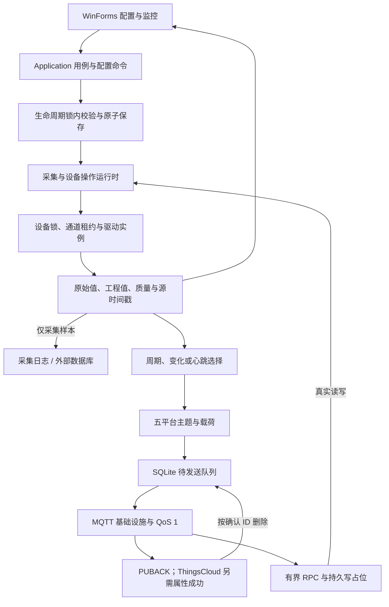

# 结构参考与工程约束

## 目录

- [参考基准](#参考基准)
- [当前分层与资源所有权](#当前分层与资源所有权)
- [架构门禁](#架构门禁)
- [运行流程](#运行流程)
- [配置事务与会话边界](#配置事务与会话边界)
- [采集、诊断与写入](#采集诊断与写入)
- [上报与平台 RPC](#上报与平台-rpc)
- [源码定位](#源码定位)
- [迁移边界](#迁移边界)

## 参考基准

上游：[iioter/iotgateway](https://github.com/iioter/iotgateway)。结构与源码迁移固定在提交 [`8de442a7dec52d2993d1e9667d799846936d681b`](https://github.com/iioter/iotgateway/commit/8de442a7dec52d2993d1e9667d799846936d681b)，该版本已升级到 .NET 10，采用 ASP.NET / WTM 的 B/S 界面。本项目主体按其模块职责独立实现，同时将全部 12 个原驱动工程与 PluginInterface 重新编译为 .NET 8，以适配层接入 WinForms；不提供与上游数据库或 .NET 10 驱动 DLL 的二进制兼容承诺。

| 上游结构 | 本项目对应 | 适配决策 |
|---|---|---|
| IoTGateway.Model | src/EdgeGateway.Model | 通道、设备、点位、上报配置和运行时样本分开 |
| IoTGateway.DataAccess | src/EdgeGateway.DataAccess | SQLite仅配置；JSON导入导出；文件outbox/RPC；外部数据库 |
| Plugins/PluginInterface | Plugins/PluginInterface + src/EdgeGateway.IotGateway | 保留源契约；适配至 Abstractions 异步工厂接口 |
| Plugins/Drivers | Plugins/Drivers 下相同的 12 个原目录 | 保留方法与参数，逐工程迁移 .NET 8，每设备独立实例 |
| DriverService | Service/DriverRegistry | 工厂注册、插件依赖解析与契约共享 |
| DeviceService / DeviceThread | Service/GatewayRuntime、DeviceScanPlanner | 生命周期锁内局部重启；设备/通道互斥、点位扫描、降速、质量、真实诊断与写后读回 |
| MessageService / PlatformHandler | Service/PlatformMqttAdapter、GatewayRuntime.Rpc 与 Infrastructure.Mqtt/MqttTelemetryPublisher | 核心保留五平台主题/载荷/响应规则与 RPC；具体 MQTTnet 传输独立，持久补传语义不变 |
| IoTGateway / ViewModel / WalkingTec.Mvvm | WinForms + Application + Hosting | WinForms 交互、Application 用例、Hosting 资源组装；替换 Web/WTM，保留七页和平台独立草稿 |

## 当前分层与资源所有权

按 [项目架构](../../../../docs/architecture.md) 的依赖方向安排代码。WinForms 直接引用 Application/Hosting；页面和弹窗调用 `IGatewayApplication`，启动入口通过 `GatewayHost` 取得应用对象。应用层依赖 Service，负责最新配置上的命令、预览确认和查询，不持有控件。`IDriverCatalog` 只暴露驱动元数据和校验，不向编辑器提供工厂或协议连接。

Hosting 创建数据目录占用、配置存储、SQLite、日志、原生与迁移驱动注册、MQTT 发布器、运行时及应用入口；创建本身不自动采集，窗口显示后的 AutoStart 继续决定是否启动。运行时持有并释放设备会话和驱动实例；宿主依次释放应用/运行时、发布器、存储与目录占用，初始化失败时清理已创建资源。首次默认配置开始采集前，由应用层先保存身份。

Infrastructure.Mqtt 承担 MQTTnet/TLS/订阅/QoS 1 传输，复用 Service 的纯 `PlatformMqttAdapter`。Service 不反向引用基础设施或 MQTTnet，DataAccess 通过存储契约接入。不要仅移动文件却保留窗体自行创建存储、直接落盘、读取驱动工厂或调用具体 MQTT 实现的旧路径。应用层命令串行入口不替代运行时生命周期锁或设备/通道锁。

## 架构门禁

修改项目引用、应用契约或组合根后，在仓库根目录执行 `python scripts/verify-architecture.py`。脚本检查八个主层的精确直接引用、`src`/`Plugins` 下当前 24 个工程无环及引用有效、WinForms 和应用接口的具体实现隔离、Model/Service 包边界与 MQTTnet 唯一归属。详细检查范围与局限见 [架构边界自动门禁](../../../../docs/architecture.md#架构边界自动门禁)。

Windows CI 的两个系统作业在 Restore/Build/Test 之前执行同一脚本。新增工程或获授权的依赖调整须同步检查规则和文档；不得只为通过检查而放宽边界。门禁成功仅说明所检查的静态规则满足，配置事务、并发、取消、资源清理和实际界面仍按 [验收规范](acceptance.md) 验证。

## 运行流程

配置编辑对象不得直接交给运行中的采集任务。驱动实例由运行时持有；存储和发布器由 Hosting 组合根持有和释放。普通采集与真实写入读回发布共享最新样本，历史仍由采集扫描链路保存。原生 UI 限 Windows；OPC DA 和 FOCAS 的实际调用还有 Windows、COM 或厂商原生库要求，不能将核心跨平台编译能力等同于这些驱动可在任意系统运行。

## 配置事务与会话边界

桌面通过 `IGatewayApplication` 提交，应用层基于最新配置构建完整候选，再调用 `GatewayRuntime.ApplyConfigurationAsync`。运行时接收候选及 `IConfigurationStore`，与设备启停共用生命周期锁。先深拷贝并校验所有设备和点位，再原子保存；提交前失败或取消不动现有会话。保存提交后完成同步，不再因调用方取消留下磁盘和运行时不同步的状态。

按稳定 ID 计算新增、变更和删除：新建与原本停止的设备保持停止；配置发生实质变化且原本运行的设备取消并等待旧会话与写入，再用新配置建立会话；禁用或删除只停止对应目标。其他设备的连接、状态、最新样本和共享采集输出/MQTT 工作任务保持不变。仅重启唯一运行设备时仍复用共享任务；禁用或删除最后一个运行目标时才处理采集输出并关闭共享 MQTT/RPC。旧 `Configure` 保留给全停初始化，不用于 UI 先保存后配置的流程。

每设备变更包含其点位集合，因此运行设备增删点位、切换上传或换算参数会重启该设备；旧显示样本被清除，等待新会话产生新数据，已写入的外部数据库数据不因编辑或删除被清空。字典键顺序不触发无意义的重启，点位数组顺序继续有意义。配置应用完成表示新会话已调度，实际连接结果通过设备状态、错误与重连机制报告。

平台使用独立草稿，未应用时设备启动使用已保存设置，普通设备提交保留平台输入。修改通道定义、网关/数据库/上报、MQTT 全局设置，以及整份配置替换，均要求全部设备停止。应用平台设置时从最新配置克隆，只覆盖平台负责字段，保留后来设备变更；完整导入经确认后刷新平台草稿。

设备、点位及 CSV 弹窗通过可等待回调，校验、保存及运行时应用全部成功才关闭，失败保留输入。流程和结果集合见 [运行中配置与数据闭环](../../../../docs/live-configuration.md)。

设备复制保留完整点表与参数，重新生成设备和所有点位 Guid，默认禁用且不启动。点位 CSV 当前导出 20 列，保留原 17 个必需表头并兼容旧文件；`Expression`、`ScanIntervalMs`、`Deadband` 是可选扩展，按名称更新时缺列保留，显式空表达式清除，数值扩展不可留空。CSV 不接受 Id，整批经同一配置事务保存。

## 采集、诊断与写入

通道是通信调度域，每设备仍持有独立驱动连接。采集、诊断和写入按设备锁再通道租约串行进入，同通道互斥、跨通道并行；请求间隔从上批完成起计算。通道不是共享串口实现，同一物理串口仍只允许一个启用设备。`DeviceScanPlanner` 按单调时间选择到期点，周期 0 继承设备，不追赶慢通信期间积压的轮次。故障降速等待释放通道，真实读取恢复后回到正常周期，状态与批次统计供界面诊断。

`ProbeDeviceAsync` 对停止设备建立短生命周期真实驱动，连接/读取后释放；对运行设备复用当前会话及相同锁。仅连接成功而没有可读点位时返回 Uncertain，普通诊断不写最新值或历史。`WriteVerifiedAsync` 取得锁后再次核对会话与权限，只下发一次写入，随后在同一设备/通道租约内有界主动读回；保留实际尝试、提交状态和 Submitted/Matched/Mismatched/TimedOut/Failed/Cancelled，不能把取消或超时解释为设备未执行。

正常实际读回在设备锁内更新共享最新值，匹配和不匹配均按真实值、质量与时间发布；取消或过期后的迟到结果不得变成 Good。未核对提交先将旧值标为 Uncertain，后续真实采样恢复质量。倍率/偏移后可执行 `NumericExpression` 受限单点数值表达式，预览和运行使用同一解析器，限制语法、长度、深度与计算范围；计算失败标 Bad，表达式点只读，不执行任意脚本、跨点依赖或自动反解。实现边界见 [核心采集能力](../../../../docs/kepware-core-capabilities.md)。

## 上报与平台 RPC

`TelemetryReportPlanner` 对启用设备、启用点位与 `UploadEnabled` 合格的最新样本执行周期全量、仅变化或变化加心跳选择。死区相对最后成功入队值累计，质量/错误变化独立触发，心跳保留原采样时间；只有完整快照的全部平台消息落盘后才推进基线。进程、配置或设备会话重启重新发初值。上传关闭不改变本地采集和历史，已经持久化的 outbox 保留原主题、原消息 ID 与原载荷；队列回压和检查间隔内未生成的中间变化不会逐条还原。

`PlatformMqttAdapter` 生成 Generic、ThingsBoard、ThingsCloud、ThingsPanel、IoTSharp 的真实主题与 JSON，`MqttTelemetryPublisher` 负责 QoS 1、订阅确认、子设备通知与相应平台响应。四种非 ThingsCloud 模式收到 PUBACK 后才能删除 outbox；ThingsCloud 当前运行目标还须先完成匹配地址的注册应用确认，属性发送须同时取得 PUBACK 和 `gateway/attributes/response result=1`。拒绝、超时或响应丢失保留消息。停止或已删除目标的旧载荷仍补传，必要的临时历史路由不改变本地运行状态、质量或时间。上述确认不证明所有下游规则或业务入库，传输仍为至少一次；分设备消息按设备标识与消息 ID 联合去重。

平台类型改变时，outbox 非空则在保存前拒绝；同平台连接目标变化也不会改写积压主题或载荷。应用层预览返回确认凭据、原目标、新目标及积压数量，UI 展示并确认，提交时再次核对当前配置、候选和队列；过期确认不能继续应用。平台详细字段、主题、应用响应及历史投递边界统一见 [平台接入与 RPC](../../../../docs/platform-protocols.md) 和 [遥测语义](../../../../docs/telemetry.md)。

RPC 默认关闭，远程写许可另行关闭；仅开放 `read`/`write`，不暴露任意驱动方法、脚本、配置或启停命令。MQTT 回调进入有界队列，独立任务执行真实单点读取或统一写后读回，拒绝 retained、超限与过期请求，写入在设备锁内再核权限。`messaging/rpc` 命令文件在写前持久占位、完成后保存回复；相同去重域内重复同 ID 重放，内容或方法冲突拒绝，未完成占位返回 Indeterminate 而不重写。去重域含平台/连接/网关/配置账号身份及设备，令牌账号使用稳定网关/客户端/账号标识而非可轮换的 Token 值；读响应只用有界进程缓存。写审计满时保留证据并拒绝新远程写，不宣称端到端恰好一次或无限期无容量限制。

## 源码定位

- [上游设备模型](https://github.com/iioter/iotgateway/blob/8de442a7dec52d2993d1e9667d799846936d681b/IoTGateway.Model/Device.cs)
- [上游点位模型](https://github.com/iioter/iotgateway/blob/8de442a7dec52d2993d1e9667d799846936d681b/IoTGateway.Model/DeviceVariable.cs)
- [上游驱动接口](https://github.com/iioter/iotgateway/blob/8de442a7dec52d2993d1e9667d799846936d681b/Plugins/PluginInterface/IDriver.cs)
- [上游采集线程](https://github.com/iioter/iotgateway/blob/8de442a7dec52d2993d1e9667d799846936d681b/Plugins/Plugin/DeviceThread.cs)
- [上游 MIT 许可](https://github.com/iioter/iotgateway/blob/8de442a7dec52d2993d1e9667d799846936d681b/LICENSE)
- [Windows Forms .NET 8](https://learn.microsoft.com/dotnet/desktop/winforms/whats-new/net80)

## 迁移边界

全部 12 个驱动的目录、文件、原方法和参数有显式迁移清单与自动检查。完整信息见 [驱动迁移说明](../../../../docs/driver-migration.md)。保留 3 个本项目原生驱动入口，共 15 个工厂。驱动迁入和程序集加载不等于每个型号都经过现场验证；新增依赖核对许可证、目标框架和包版本，不直接复制上游 .NET 10 的包清单。

上述结构不扩大为 Kepware 全部功能对等声明。OPC UA 对外服务端已彻底移除，南向 `OPC.UaClient` 继续保留。Windows Service、共享串口多从站、跨点计算、多用户 RBAC 及现场逐型号认证不在当前完成范围。本轮分层与界面验证见 [界面操作与验收](../../../../docs/ui-usability.md)，删除服务端的上一版证据保留在 [移除记录](../../../../docs/opc-ua-service-removal.md)。构建、协议回环、Windows 等效工作区、真实系统 DPI/跨屏和现场联调分别记录，不将未通过或未执行的 CI 写成已完成。

## 当前开发存储规则

仅支持schema3，不迁移或归档旧SQLite历史/旧JSON。SQLite只配置，采集默认可配置滚动日志；外部MySQL/PostgreSQL/Oracle支持点行和已有字段映射，独立有界队列及有限重试。MQTT/RPC使用文件协议状态。日志热应用，数据库全停保存。以[当前数据记录规则](../../../../docs/data-recording.md)为准。
