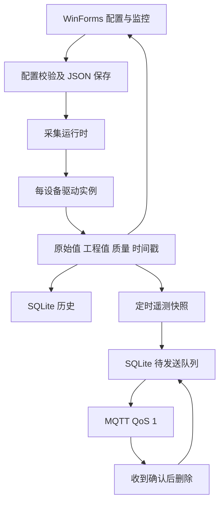

# 结构参考与工程约束

## 参考基准

上游：[iioter/iotgateway](https://github.com/iioter/iotgateway)。结构与源码迁移固定在提交 [`8de442a7dec52d2993d1e9667d799846936d681b`](https://github.com/iioter/iotgateway/commit/8de442a7dec52d2993d1e9667d799846936d681b)，该版本已升级到 .NET 10，采用 ASP.NET / WTM 的 B/S 界面。本项目主体按其模块职责独立实现，同时将全部 12 个原驱动工程与 PluginInterface 重新编译为 .NET 8，以适配层接入 WinForms；不提供与上游数据库或 .NET 10 驱动 DLL 的二进制兼容承诺。

| 上游结构 | 本项目对应 | 适配决策 |
|---|---|---|
| IoTGateway.Model | src/EdgeGateway.Model | 设备、点位配置与运行时样本分开 |
| IoTGateway.DataAccess | src/EdgeGateway.DataAccess | 本地 JSON 配置；SQLite 历史与 outbox |
| Plugins/PluginInterface | Plugins/PluginInterface + src/EdgeGateway.IotGateway | 保留源契约；适配至 Abstractions 异步工厂接口 |
| Plugins/Drivers | Plugins/Drivers 下相同的 12 个原目录 | 保留方法与参数，逐工程迁移 .NET 8，每设备独立实例 |
| DriverService | Service/DriverRegistry | 工厂注册、插件依赖解析与契约共享 |
| DeviceService / DeviceThread | Service/GatewayRuntime | 生命周期、互斥、质量、退避与独立发布 |
| MessageService / PlatformHandler | Service/MqttTelemetryPublisher | 通用 JSON 遥测；厂商格式另行适配 |
| IoTGateway / ViewModel / WalkingTec.Mvvm | EdgeGateway.WinForms | 替换控制器、Web 视图和 WTM 依赖 |

## 运行流程

配置编辑对象不得直接交给运行中的采集任务。驱动实例由运行时持有；存储与发布器由程序组合根持有和释放。原生 UI 限 Windows；OPC DA 和 FOCAS 的实际调用还有 Windows、COM 或厂商原生库要求，不能将核心跨平台编译能力等同于这些驱动可在任意系统运行。

## 源码定位

- [上游设备模型](https://github.com/iioter/iotgateway/blob/8de442a7dec52d2993d1e9667d799846936d681b/IoTGateway.Model/Device.cs)
- [上游点位模型](https://github.com/iioter/iotgateway/blob/8de442a7dec52d2993d1e9667d799846936d681b/IoTGateway.Model/DeviceVariable.cs)
- [上游驱动接口](https://github.com/iioter/iotgateway/blob/8de442a7dec52d2993d1e9667d799846936d681b/Plugins/PluginInterface/IDriver.cs)
- [上游采集线程](https://github.com/iioter/iotgateway/blob/8de442a7dec52d2993d1e9667d799846936d681b/Plugins/Plugin/DeviceThread.cs)
- [上游 MIT 许可](https://github.com/iioter/iotgateway/blob/8de442a7dec52d2993d1e9667d799846936d681b/LICENSE)
- [Windows Forms .NET 8](https://learn.microsoft.com/dotnet/desktop/winforms/whats-new/net80)

## 迁移边界

全部 12 个驱动的目录、文件、原方法和参数有显式迁移清单与自动检查。完整信息见 [驱动迁移说明](../../../../docs/driver-migration.md)。保留 3 个本项目原生驱动入口，共 15 个工厂。驱动迁入和程序集加载不等于每个型号都经过现场验证；新增依赖核对许可证、目标框架和包版本，不直接复制上游 .NET 10 的包清单。
