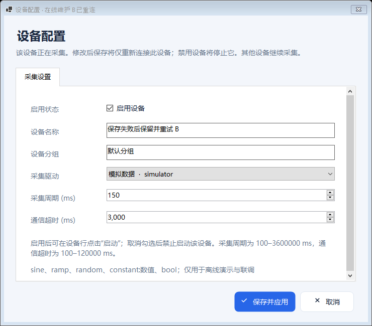

# Edge Gateway · .NET 8 WinForms 采集网关

参考 [iioter/iotgateway](https://github.com/iioter/iotgateway) 的分层与驱动扩展思路，使用 **.NET 8 + 原生 Windows Forms** 实现的桌面工业数据采集网关。网关主体独立实现，并将源项目 **`Plugins/Drivers` 下全部 12 个驱动工程**及其驱动接口迁入本仓库，接入统一采集、配置与监控界面。包含设备与点位管理、实时监控、历史趋势、MQTT 上报与持久化补传。

开发规范入口：[开发 SKILL](.agents/skills/develop-edge-gateway/SKILL.md) · [全部驱动迁移清单](docs/driver-migration.md) · [结构参考](.agents/skills/develop-edge-gateway/references/architecture.md) · [驱动扩展](.agents/skills/develop-edge-gateway/references/driver-development.md) · [验证记录](docs/verification.md)

功能闭环说明：[运行中配置、点表交换与通信诊断](docs/live-configuration.md) · [源项目与主流网关能力对照](docs/gateway-capability-review.md)

界面与显示适配：[DPI 与界面升级说明](docs/ui-dpi.md) · [Windows 构建与运行包](https://github.com/kingtentx/edge-gateway/actions/workflows/build.yml) · [源码 ZIP](https://github.com/kingtentx/edge-gateway/archive/refs/heads/main.zip)。采用统一现代工业界面、FontAwesome 图标和 PerMonitorV2；区分真实 Windows DPI 运行检查与 20 种等效工作区布局验证。

**2026-10-23 当前交付：** [下载 Windows x64 自包含运行包](https://github.com/kingtentx/edge-gateway/actions/runs/39923092261/artifacts/12487349660) · [本轮双系统 CI](https://github.com/kingtentx/edge-gateway/actions/runs/39923092261) · [完整验证记录](docs/live-configuration-verification.md) · [机器可读证据](docs/live-configuration-verification.json)。程序源码 [`f1d398b`](https://github.com/kingtentx/edge-gateway/commit/f1d398ba27728e919c3fd56f60cbf510312267d8) 支持其他设备运行时新增、编辑、删除设备与点位；保存运行目标的变更只重启该目标。点位上传开关、CSV 点表交换和“通信诊断”已接入；设备与点位弹窗完整提交成功后关闭，失败保留输入。操作见 [运行中配置与数据闭环](docs/live-configuration.md)。

Windows Server 2022 / 2025 各通过 **163 / 163 项测试、20 / 20 个等效工作区布局**，覆盖七个主页面及四类矩阵编辑器，各保存 102 张实际 PNG，成功作业 stderr 为空、失败截图为 0。Server 2025 在 attempt 1 通过；Server 2022 首次出现焦点异常，在同一提交、未改代码或断言的情况下，仅重跑失败作业后于 attempt 2 通过。完整 CI 最终成功，不表述为首次全部通过；失败与重跑过程见验证记录。



上图来自本轮实际 WinForms 检查，展示运行设备编辑失败后保留草稿。两套成功环境均为 .NET 8.0.32、实际/原生窗口 DPI 96、屏幕 1024×768；20 种矩阵为等效工作区模拟，不替代真实多 DPI 切换、跨显示器或现场设备通信验收。

## 当前功能

| 模块 | 已实现内容 |
|---|---|
| 桌面管理 | 深色导航、FontAwesome 图标、圆角按钮与卡片、统一表格；运行总览、设备与点位、实时监控、历史与趋势、平台与系统、运行日志、通信诊断七页 |
| DPI 与分辨率 | PerMonitorV2、统一 96 DPI 基准、当前屏幕工作区约束、跨 DPI 后重排；小屏卡片换列、滚动表单与固定操作栏 |
| 设备配置 | 添加、编辑、行内配置及双击共用一个窗体；运行中可维护设备与点位，保存后仅重启发生变更的运行设备，其他会话保持；失败保留配置及弹窗输入 |
| 点位模型 | 数据类型、寄存区、字节序、倍率/偏移、单位、上下限、只读/可写、采集启用及上传开关；上传关闭仍保留本地采集和历史 |
| 点表交换 | UTF-8 BOM 点位 CSV 模板与导出；追加或按名称更新，完整候选预览校验，8 MiB / 2000 点限制 |
| 上游驱动迁移 | 全部 12 个原驱动工程；保留 65 个原读取方法、74 个原配置参数及协议辅助源码 |
| 驱动专用配置 | 根据驱动元数据生成参数编辑器；点位可选择原读取方法、原数据类型及字节序 |
| 内置模拟 | sine、ramp、random、constant:数值、bool；开箱可演示；明确标记为模拟设备 |
| Modbus TCP | FC1/2/3/4 读取；FC5/6/16 写入；完整 MBAP、字节数、功能码和写入回显验证 |
| Modbus RTU | 真实 SerialPort 通信、CRC16、帧间隔、超时与取消；当前每个串口一个启用设备 |
| 采集引擎 | 每台设备独立启动/停止与取消任务，停止一台不影响其余设备；同设备读写互斥、退避重连、原始值与工程值、数据质量；最后一台停止后关闭共享历史/MQTT任务 |
| 告警与审计 | 点位高低阈值状态变化日志、通信故障、手动写入确认与结果日志 |
| 本地数据 | JSON 原子配置与上一版备份；SQLite WAL 历史，按天数/行数清理 |
| 云端通信 | MQTT 3.1.1、QoS1、用户名/环境变量密码、TLS 系统证书验证、通用 JSON 遥测 |
| 离线补传 | 遥测持久化 outbox、收到 Broker QoS 1 确认后删除、重启重发、消息 ID 去重依据、队列满告警 |
| 通信诊断 | 设备最近成功采集、连续失败次数和错误；MQTT 入队、连接、发送、Broker 确认、积压时间和重试状态 |
| 查询与导出 | 按设备/点位/时间查询历史、数值曲线、CSV 导出、配置 JSON 导入导出、日志导出 |
| 扩展机制 | 独立驱动工厂与契约，扫描 `plugins` 下可信驱动程序集，重启加载 |
| 工程交付 | 标准 `.sln`、自动测试、Windows Server 2022 / 2025 CI、窗体启动及工作区矩阵烟测、Windows x64 自包含发布脚本 |

上游结构与迁移基准固定在 [`8de442a7dec52d2993d1e9667d799846936d681b`](https://github.com/iioter/iotgateway/commit/8de442a7dec52d2993d1e9667d799846936d681b)。上游该版本目标为 .NET 10；本项目将驱动重新编译为 .NET 8，保留原目录名与方法，通过适配层接入桌面程序。迁移范围包含所有源驱动，不包含上游 Web/WTM 界面与数据库；不承诺直接加载上游 .NET 10 生成的 DLL。

## 全部迁移驱动

| 原目录 / 稳定驱动标识 | 协议或设备 |
|---|---|
| `PLC.SiemensS7` | Siemens S7，含源驱动标准地址及字节字符串方法 |
| `PLC.MelsecMc` | Mitsubishi MC，含源驱动单点、批量与缓存读取 |
| `PLC.OmronFins` | Omron FINS |
| `PLC.AllenBradley` | Allen-Bradley EtherNet/IP |
| `PLC.ModBusMaster` | 源 Modbus 主站，TCP/UDP、RTU/ASCII 及网络封装模式 |
| `OPC.UaClient` | OPC UA 节点读取 |
| `OPC.DaClient` | OPC DA，依赖本机 COM/DCOM 环境 |
| `CNC.Fanuc` | Fanuc FOCAS，依赖厂商 x64 原生运行库 |
| `CNC.Fanuc.H` | HslCommunication Fanuc，按库要求提供有效授权 |
| `CNC.MTConnect` | MTConnect HTTP 数据项读取 |
| `Other.Toledo` | 源 Toledo 称重设备驱动 |
| `Mock.TcpClient` | 源 TCP 示例驱动，连接实际 TCP 测试端 |

原有 `simulator`、`modbus-tcp`、`modbus-rtu` 同时保留，共 15 个驱动入口。迁移驱动的参数、读取方法和外部依赖详见 [迁移说明](docs/driver-migration.md)。源码迁移与编译通过不代表已对每种现场设备完成联调。

## 快速启动

### 从源码运行

在 Windows 10/11 或具备桌面环境的 Windows Server 上安装 [.NET 8 SDK](https://dotnet.microsoft.com/download/dotnet/8.0)。Visual Studio 用户可使用支持 .NET 8 的 VS 2022，并安装“.NET 桌面开发”工作负载。

```powershell
git clone https://github.com/kingtentx/edge-gateway.git
cd edge-gateway
dotnet restore EdgeGateway.sln
dotnet build EdgeGateway.sln -c Release
dotnet run --project src/EdgeGateway.WinForms -c Release --no-build
```

也可以直接打开 `EdgeGateway.sln`，把 `EdgeGateway.WinForms` 设为启动项目。

首次启动且尚无已保存配置时，包含一台启用的“演示机组”、一台**未启用**的 Modbus TCP 示例，以及一台**未启用**的“Modbus RTU 从站 1（COM11）”，后者预置从站 1、9600 / 8N1、保持寄存器地址 0–9。进入“设备与点位”，点击“演示机组”所在行的“启动”，即可看到该设备的温度、频率、运行状态和目标温度；该行“停止”只停止演示机组。默认自动启动与 MQTT 均关闭。已有配置继续原样加载，可通过“导入设备”追加 [RTU 示例](docs/modbus-rtu-com11.md)。

### 发布可直接运行的 Windows 包

```powershell
powershell -ExecutionPolicy Bypass -File scripts/publish-win-x64.ps1
```

输出为 `artifacts/EdgeGateway-win-x64.zip`。完整解压后双击 `EdgeGateway.WinForms.exe`。自包含发布包自带 .NET 运行时；若自行选择依赖框架的发布方式，则需安装 [.NET 8 Desktop Runtime](https://dotnet.microsoft.com/download/dotnet/8.0)。

运行包中的 `build-info.json` 用于核对源码提交、CI run/attempt 与打包作业的实际测试、布局和 DPI 摘要；手工本地发布的 `verification` 为 null，不冒充 CI 验证结果。

GitHub Actions 工作流会在提交后构建、测试、启动窗体并生成同类运行包，见 [Actions](https://github.com/kingtentx/edge-gateway/actions)。工作流是否实际通过以该次执行结果为准。

## 连接现场设备

在“设备与点位”点击工具栏 **添加设备**、**编辑设备**，或点击设备行 **配置**、双击普通数据列，均使用同一个配置窗和相同的字段布局。弹框默认显示“采集设置”，首行 **启用设备** 复选框下依次提供设备名称、分组、驱动下拉框、采集周期和通信超时。切换到连接或驱动参数页后，内置 Modbus TCP 显示网络字段，RTU 显示串口字段；迁移驱动按源项目的参数、类型与枚举生成编辑器。在同一弹框中来回切换驱动会保留各驱动的参数草稿。

点击“确定”后，弹窗等待完整候选配置校验、原子保存和运行时应用全部成功才关闭；失败时显示原因并保留输入，原配置与运行会话不因校验或保存失败而变化。新建设备生成所选驱动的默认点位，保存后保持停止；编辑已有设备保留设备 ID 和已有点位，换驱动不会自动转换或清空点位，不兼容的点位会使完整校验失败。

设备 A 运行时，可以新增、编辑、删除或追加导入设备 B，也可以维护 B 的点位。若 B 原本停止，保存后仍停止；若 B 正在运行，保存变更后只重启 B，禁用或删除 B 则只停止 B。A 的连接、最新值与共享历史/MQTT 任务保持运行。连接失败会显示错误并进入原有重连流程，已经保存的参数不会自动回滚。完整流程见 [运行中配置与数据闭环](docs/live-configuration.md)、[参数说明](docs/device-configuration.md) 与 [单设备启停及自动保存](docs/device-control-autosave.md)。

按 Modbus Slave 截图连接 COM10 / COM11 虚拟串口对，参见 [Modbus RTU 从站 1（COM11）配置与导入步骤](docs/modbus-rtu-com11.md)；已有配置可用“导入设备”追加 [单设备示例 JSON](examples/modbus-rtu-com11.json)，保留当前网关、MQTT 和已有设备配置。

迁移驱动：在“设备与点位”选择上述原目录名对应驱动，填写驱动专用参数；添加点位时选择具体读取方法。OPC 默认选择 `ReadNode`，源 Modbus 默认选择 `HoldingRegisters` / `InputRegisters` / `Coil` / `Input` 等方法；原有演示 `Read` 入口已改为真实读取的兼容别名。Fanuc 依具体采集项选择相应方法。参数与方法说明见 [驱动清单](docs/driver-migration.md)，可导入 [12 个驱动的未启用示例](examples/migrated-drivers.json) 查看配置。

以下步骤适用于本项目原有的 `modbus-tcp` / `modbus-rtu`：

1. 在“设备与点位”点击“添加设备”，其他设备可以继续采集。在默认打开的“采集设置”页填写名称、分组，选择 `modbus-tcp` 或 `modbus-rtu`，勾选“启用设备”并配置周期、超时。
2. TCP 填写 IP/域名、端口、站号；RTU 填写 COM 端口、波特率、数据位、校验位、停止位与站号。
3. 点击“确定”，生成所选驱动的默认点位，经完整配置校验和自动保存后添加设备；新增设备保持停止。
4. 在下方点位表按实际点表修改默认点位或添加点位，填写**从 0 开始的地址**、寄存区、数据类型、字节序和工程量换算。每次确认后自动校验并保存。
5. 确认设备已启用，再点击该设备行的“启动”。在“实时监控”核对原始值、工程值、质量和时间，在“历史与趋势”查询采样。每行“停止”仅停止对应设备。

超时覆盖一次设备采集循环，驱动也对单次交换限时；点位多或串口低速时应按实际通信时间配置。

例如：厂家“40001”若确认为首个保持寄存器，对应本项目 `HoldingRegister` / 地址 `0`；厂家若已经给出 0 基偏移则直接使用。不要把参考地址 40001 直接当作偏移。

| 参数 | 支持范围 |
|---|---|
| 站号 | 1–247；不支持广播写入 |
| 位区 | Coil、DiscreteInput，仅 Boolean |
| 寄存器类型 | Boolean、Int16、UInt16、Int32、UInt32、Float32、Float64 |
| 32 位字节序 | ABCD、BADC、CDAB、DCBA |
| 64 位字节序 | ABCDEFGH、BADCFEHG、GHEFCDAB、HGFEDCBA，分别对应上述四种枚举 |
| 工程量 | `工程值 = 原始值 × Scale + Offset` |
| 写入 | 默认只读；允许写入后，通过实时页确认写入工程值，服务反算原始值并检查范围 |

写操作不会因超时自动重试。超时可能表示设备已执行但确认未到达，应先读回确认。输入寄存器与离散输入不允许写入。

### 批量维护点位

选中设备后使用“点位模板”“导出点位”和“导入点位”维护 CSV 点表；仓库提供 [空白模板](examples/tag-template.csv)。模板包含 17 个业务字段，不含 `Id`。导出为 UTF-8 BOM；导入可选“追加”或“按名称更新”，后者按不区分大小写的名称匹配并保留已有点位 ID，未出现在文件中的点位继续保留。文件最多 8 MiB，单次最多 2000 条数据，合并后每台设备最多 2000 点；预览优先显示新增与变化点位，最多 500 条，校验和保存覆盖完整点表。任意一行、驱动参数或整份配置校验失败时整批不保存。运行设备导入后仅重启该设备，详见 [CSV 字段与操作说明](docs/live-configuration.md#点位-csv-导入导出)。

## MQTT 上报

可以随时在“平台与系统”编辑 Broker、端口、ClientId、主题和上报周期，或点击“重置修改”恢复已保存值。平台输入先作为独立草稿，未应用时设备仍可按已保存的设置启动；普通设备保存不会覆盖这份草稿。**应用平台全局设置和“导入配置”整份替换仍要求所有设备停止**，避免切换共享服务的连接配置。默认主题：`edge/{gatewayId}/telemetry`。启用 TLS 时通常使用 Broker 配置的 TLS 端口（例如 8883），证书必须通过系统验证；程序不会跳过证书错误。

配置文件只存密码环境变量名称，默认 `EDGE_MQTT_PASSWORD`。使用用户名认证时，启动程序前在 Windows 用户环境变量中设置该变量，然后重新启动程序。不要把密码填到“密码环境变量名”输入框，也不要提交密码或真实现场配置到 Git。

遥测采用周期最新值快照，仅纳入当前配置中启用设备的启用且允许上传的点位。点位“上传”默认开启，关闭后本地采集、实时值与历史保持，已持久化的旧消息仍继续补传。格式及正在入队消息的边界见 [遥测与数据语义](docs/telemetry.md)。`messageId` 在补传中保持不变，接收端按此去重。只有收到 Broker 的 QoS 1 PUBACK 后才删除 outbox 记录；确认到达与删除之间崩溃可能重复投递，语义为至少一次。Broker 确认不代表业务平台已校验、处理或入库。

队列满时保留旧消息并暂停生成后续遥测快照，采集与历史继续。恢复后继续补传，再生成新的最新值快照；暂停期间未生成的中间快照不会逐条还原。改变 Broker 等连接目标前，应先完成旧队列补传，或明确确认将待发送消息迁移到新连接。

“通信诊断”页显示 MQTT 是否启用、任务和连接状态、最近入队/发送/Broker 确认、累计确认、待补传数量与最早时间、重试及错误。设备表同时显示最近成功采集、连续失败次数和最近错误，便于区分现场采集、持久化与平台连接问题。

## 本地数据与恢复

默认数据目录：`%LOCALAPPDATA%\EdgeGateway`，可在界面中打开。

| 文件 | 用途 |
|---|---|
| `gateway.json` | 已保存的设备、点位与系统配置 |
| `gateway.json.bak` | 上一份成功替换前的配置 |
| `gateway.db` | SQLite 历史数据和待发送消息 |
| `gateway.db-wal` / `gateway.db-shm` | SQLite 运行时文件，运行中不要单独删除或拷贝数据库 |
| `logs/` | 按 UTC 日期记录并轮转的运行日志 |

设备、点位与导入配置通过同一个运行时事务入口提交：在生命周期锁内校验完整候选、原子保存，再同步受影响设备；顶部不再提供“保存配置”。保存失败不停止原会话，弹窗保留输入。保存提交后完成运行时同步，调用方随后取消不撤回已保存配置；物理连接结果由设备状态和日志反映。平台输入通过“应用设置”单独提交。正常修改会保留上一版 `.bak`。配置损坏会报错并保留原文件，不会静默重置。恢复前停止程序并备份数据目录，再用确认无误的 `.bak` 恢复。备份数据库时先正常关闭程序后复制整个数据目录。

迁移版本使用配置格式 2；旧版本 1 配置在加载时内存升级，保存前不改写原文件，保存时保留 `.bak`。设备与点位 ID 保持不变；未知配置版本会被拒绝。新增可选字段 `TagConfiguration.UploadEnabled` 缺省为 `true`，旧配置保持原上传行为，因此本次不升级 schema。破坏兼容性的结构、类型或语义变更仍需显式升级并提供迁移，见 [配置兼容规则](docs/live-configuration.md#配置兼容规则)。

默认保留 30 天、最多 1,000,000 条历史，定期清理；数据库文件空间可复用，删除记录不会立即缩小物理文件。内存日志最多 2,000 条；文件日志保留最近 30 个 UTC 日期，每日最多当前文件及 2 个轮转文件，每个约 10 MiB。

历史采样先进入有界内存缓冲，再批量写入 SQLite；正常停止等待缓冲处理完。突然断电可能丢失尚未落盘的历史和尚未生成的快照。已成功持久化的 outbox 在重启后仍然可发送。

## 解决方案结构

| 路径 | 内容 |
|---|---|
| `src/EdgeGateway.Model` | 配置和运行数据模型 |
| `src/EdgeGateway.Abstractions` | 驱动、存储、日志、发布器接口 |
| `src/EdgeGateway.DataAccess` | JSON 配置与 SQLite |
| `src/EdgeGateway.Service` | 采集运行时、插件、校验、MQTT、日志 |
| `src/EdgeGateway.IotGateway` | 全部源驱动的工厂、参数/方法元数据、线程与接口适配 |
| `src/EdgeGateway.WinForms` | Windows 桌面界面与组合根 |
| `Plugins/PluginInterface` | 迁移后的原驱动接口、属性与数据契约 |
| `Plugins/Drivers` | 12 个原驱动工程及本项目模拟 / Modbus 工程 |
| `tests/EdgeGateway.Tests` | 驱动、存储、运行时与 MQTT 回环测试 |
| `.agents/skills/develop-edge-gateway` | 可复用开发 skill 及架构、驱动、验收参考 |
| `examples/` | 不含凭据的示例配置 |
| `scripts/` | Windows x64 构建和打包 |
| `.github/workflows/` | Windows 构建、测试、启动与发布 |

## 验证和边界

```powershell
dotnet test tests/EdgeGateway.Tests/EdgeGateway.Tests.csproj -c Release
# Windows 上执行；检查界面与隔离配置中的本地模拟采集，不连接现场设备
dotnet run --project src/EdgeGateway.WinForms -c Release -- --smoke-test --screenshot artifacts/ui-smoke.png
```

核心自动测试包含实际 TCP 回环与 TLS 握手。本轮源码 `f1d398b` 的两套 Windows 作业均通过 163 项测试、运行中配置烟测和 20 个等效工作区场景，完整环境、失败重跑记录、截图和运行包信息见 [本轮验证](docs/live-configuration-verification.md)；[功能验收范围](docs/live-configuration.md#验收用例与证据) 与实际执行结果分别记录。**尚未连接真实 PLC、串口设备或用户现场 Broker，不应将自动测试等同于现场验收。** 现场需核对点表、字节序、串口硬件、TLS 证书和 24–72 小时长稳运行。

历史交付另行保留：[驱动迁移基线](docs/verification.md)、[单设备启停](docs/device-control-autosave.md#此前版本验证与运行包)、[配置窗合并版本](docs/device-configuration-unification.md#实际执行结果)。这些文档中的运行包、截图和通过数量对应各自源码提交。

本项目原生 Modbus 驱动按点位请求；源 Modbus / MC 驱动保留原有批量和缓存方法，需按其方法说明配置。串口仍按设备独占，不提供多个设备共享一条串行总线的调度。当前是桌面程序，关闭后停止采集；未包含 Windows Service、远程 RPC、用户角色权限、OTA、VPN 或完整平台专用消息适配。配置数量限制是输入保护，不代表已完成相同规模性能验收。源驱动中未实现的写入方法仍明确拒绝，不因迁移而宣称获得写入能力。

## 许可与来源

本项目原创部分采用 [MIT License](LICENSE)。迁入源码保留上游与各第三方的原版权和许可证，详见 [第三方说明](THIRD-PARTY-NOTICES.md)；FANUC 绑定、厂商原生库和商业组件不因本仓库的 MIT 许可而改变其授权条件。实际 NuGet 依赖及其许可证见包元数据，发布包包含相应许可说明。
