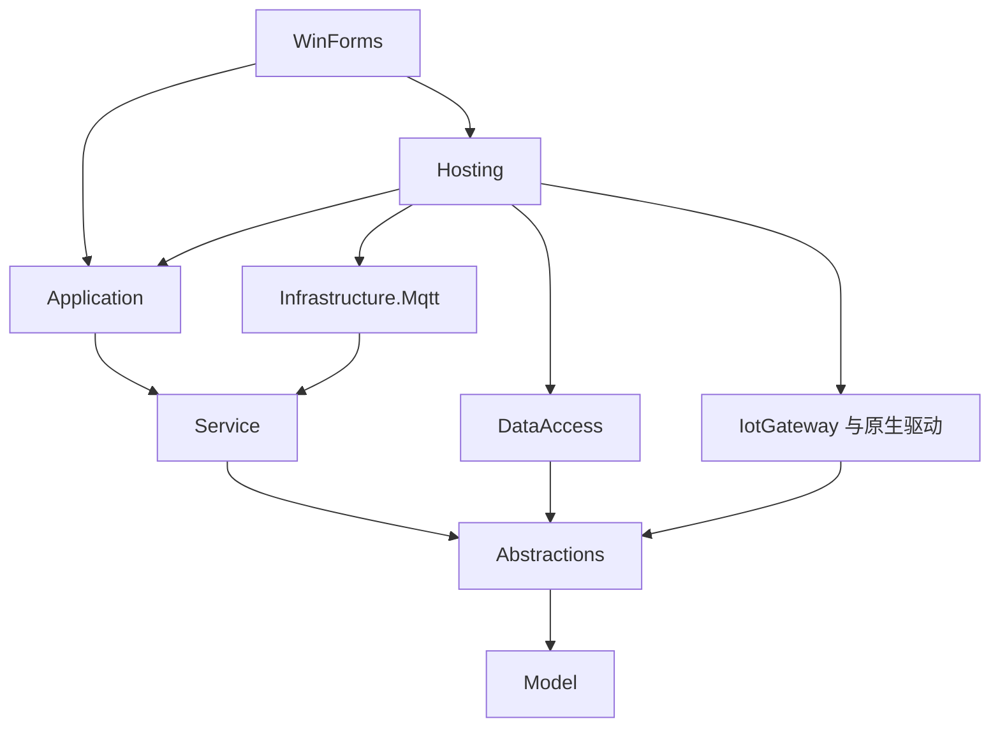

# 项目架构与依赖方向

更新日期：2026-10-24。目标为 .NET 8、原生 Windows Forms 桌面采集网关。

当前版本将 SQLite 限定为配置存储，采集默认输出可配置日志，外部数据库写入通过独立契约、映射与有界后台队列实现。详见 [数据记录](data-recording.md)。桌面用例、资源组装和 MQTT 传输分别位于独立层。窗体通过应用入口操作网关，采集运行时继续负责设备会话、调度和数据质量。**分层改造的构建、回归和 Windows 运行结果以 [本轮验收](ui-usability.md#执行证据) 为准；本文不将架构说明视为已执行验证。**

## 目录

- [工程职责](#工程职责)
- [依赖方向](#依赖方向)
- [架构边界自动门禁](#架构边界自动门禁)
- [应用层入口](#应用层入口)
- [资源组装与生命周期](#资源组装与生命周期)
- [配置事务](#配置事务)
- [采集、存储与平台链路](#采集存储与平台链路)
- [后续修改放在哪里](#后续修改放在哪里)
- [保持的边界](#保持的边界)

## 工程职责

| 工程 | 负责内容 | 不负责内容 |
|---|---|---|
| `EdgeGateway.Model` | 配置、设备与点位身份、样本、质量、查询和运行结果模型 | 控件、SQL、网络连接、资源组装 |
| `EdgeGateway.Abstractions` | 驱动、配置存储、外部数据库、采集输出、文件 outbox、遥测发布和日志契约 | 协议或存储具体实现 |
| `EdgeGateway.Service` | 采集运行时、会话与通道调度、扫描、校验、表达式、CSV、平台报文规则、RPC 执行、数据映射、有界队列和后台日志 | WinForms、MQTTnet 客户端和数据库 SQL |
| `EdgeGateway.Application` | `IGatewayApplication` 桌面用例入口、配置命令、预览与提交、查询和只读快照；`IDriverCatalog` 编辑器元数据 | 弹窗、MessageBox、厂商协议连接与资源组装 |
| `EdgeGateway.Hosting` | `GatewayHost` 创建目录与资源、注册驱动、装配应用和运行时、统一释放 | 页面状态、设备轮询实现、Windows Service 安装 |
| `EdgeGateway.Infrastructure.Mqtt` | MQTTnet 连接、TLS、QoS 1、订阅和平台传输确认 | 设备采集锁、配置持久化事务、WinForms |
| `EdgeGateway.DataAccess` | SQLite 配置事务，JSON 导入导出，文件 outbox / RPC，以及 MySQL、PostgreSQL、Oracle 参数化访问 | 设备连接和控件事件 |
| `EdgeGateway.IotGateway` | 全部 12 个源驱动的工厂、元数据、异步接口与工作线程适配 | 桌面页面、Web/WTM、平台直传 |
| `PluginInterface` | 保留迁移驱动原有接口、属性和数据契约 | 上游 Web 或数据库依赖 |
| `Plugins/Drivers/*` | 12 个源驱动以及原生模拟、Modbus TCP/RTU 的协议连接和读写 | 云端上传与桌面业务 |
| `EdgeGateway.WinForms` | 窗体、输入草稿、选择、导航、展示、确认和可等待的交互 | 构造驱动、SQL、MQTTnet、配置落盘或后台采集循环 |
| `EdgeGateway.Tests` | 协议、并发、存储、应用边界与生命周期的关键行为回归 | 以假通信代替现场验收 |

UI 使用 `net8.0-windows`，其余业务与契约工程保持 `net8.0`。南向 OPC DA、FOCAS 和真实串口仍有各自操作系统、组件及硬件要求；工程能够跨平台编译不等于这些现场调用能跨平台运行。

## 依赖方向

下图表示主要项目依赖，不表示每一次运行时调用：



当前 `Application` 与 `Infrastructure.Mqtt` 均直接引用 `Service`，后者引用 `Abstractions`，`Abstractions` 引用 `Model`。`DataAccess` 直接引用 `Abstractions`。`IotGateway` 另引用 `PluginInterface` 及全部 12 个迁移驱动；Hosting 直接引用 Application、DataAccess、Infrastructure.Mqtt、IotGateway 和两个原生驱动工程。实际项目引用见各目录的 `.csproj`。

`Service` 的 `PlatformMqttAdapter` 是平台主题、报文及响应规则，不持有 MQTTnet 连接。MQTT 基础设施复用这一纯规则组件，经 Service 传递使用基础契约；`Service` 不反向依赖 `Infrastructure.Mqtt`。因此传输实现可替换，采集运行时只使用发布器契约，避免循环引用。

WinForms 的直接工程引用收敛到 `Application` 和 `Hosting`：`Program` 使用宿主完成组装，页面和弹窗依赖应用契约及模型。通过传递引用能够访问某个类，不代表允许窗体继续直接构造运行时、存储或驱动。工程依赖与实际调用都需要检查。

## 架构边界自动门禁

在仓库根目录执行：

```bash
python scripts/verify-architecture.py
```

[`verify-architecture.py`](../scripts/verify-architecture.py) 不启动构建，直接检查项目文件与指定源码边界：

- 对 Model、Abstractions、Service、Application、DataAccess、Infrastructure.Mqtt、Hosting、WinForms 八个主层逐项比较精确的直接工程引用集合；同时确认新增三个工程已加入解决方案。
- 遍历 `src` 与 `Plugins` 下当前 24 个工程，拒绝循环依赖及指向未知工程的引用。该数量不包含测试工程，后续新增工程时以实际遍历结果记录。
- 检查 WinForms 顶层 C# 文件中禁止的具体运行时、存储、发布器、驱动工厂类型及基础设施命名空间引用；检查 `IGatewayApplication` 契约不暴露运行时、存储、工厂或发布器资源所有权。
- 要求 Model 与 Service 不直接引用第三方实现包，并限定 `MQTTnet` 包只由 Infrastructure.Mqtt 工程引用。

[`build.yml`](../.github/workflows/build.yml) 的 `windows-2022` 与 `windows-2025` 两个作业均在驱动清单检查之后、Restore/Build/Test 之前执行此门禁；检查失败即阻止后续构建与发布。项目引用变更需要同步核对架构说明和检查规则，不能为消除失败而移除隔离要求。

此门禁覆盖显式工程引用与上述源码文本规则，不是完整的 C# 语义分析，也不证明锁、事务、资源释放或真实 UI 行为正确；这些仍由代码审查、自动测试和 Windows 验收分别确认。截至本次本地检查，架构门禁及全部驱动迁移清单已通过，完整 Release 构建成功，TRX 记录 333/333 测试通过、0 失败、0 未执行。Windows CI、可用性烟测和发布包仍待本轮实际执行，完整提交及产物记录由 [本轮验收](ui-usability.md#执行证据) 汇总。

## 应用层入口

完整契约见 [`IGatewayApplication`](../src/EdgeGateway.Application/IGatewayApplication.cs)。入口分为以下几类：

| 用例 | 代表入口 | 调用约定 |
|---|---|---|
| 配置读取与校验 | `GetConfiguration`、`ValidateConfiguration`、`ReadConfigurationFileAsync` | 返回用于展示或构建草稿的数据，不向窗体暴露活动会话或厂商连接 |
| 完整候选提交 | `PreviewConfigurationAsync`、`ApplyConfigurationAsync`、`ReplaceConfigurationAsync` | 候选先预览，再等待完整事务；替换与全局设置保持全停约束 |
| 设备和点位维护 | `Add/Update/DeleteDeviceAsync`、`Add/Update/DeleteTagAsync` | 通过稳定 ID 对最新已保存配置构建修改，避免不同窗体草稿相互覆盖 |
| 追加和点表提交 | `AppendDevicesAsync`、`ReplaceDeviceTagsAsync` | 在当前配置中追加设备或替换目标点表，保持非目标设备与全局字段 |
| 通道和全局设置 | `UpsertChannelAsync`、`DeleteChannelAsync`、`ApplyGlobalSettingsAsync` | 命令内要求全停；被设备引用的通道不能删除，全局草稿只覆盖所属字段 |
| 启停与操作 | `StartDeviceAsync`、`StopDeviceAsync`、`ProbeDeviceAsync`、`WriteVerifiedAsync` | 复用同一运行时及设备/通道锁；界面不能复制一套连接执行操作 |
| 监控与查询 | `GetLatest`、`GetDeviceStatuses`、`GetTelemetryStatus`、`GetRpcStatus`、`QueryHistoryAsync` | 读取快照或异步查询，返回后在 UI 线程更新控件 |
| 导入导出与诊断支持 | 配置文件读取/导出、统计与通信快照 | 文件格式和事务检查留在应用/核心边界，页面处理文件选择与结果展示 |

`IDriverCatalog` 仅向编辑器提供驱动描述和配置校验能力，不能创建真实驱动实例。表达式预览、CSV 与复制筛选由 [`ConfigurationTools`](../src/EdgeGateway.Application/ConfigurationTools.cs) 复用核心实现，避免 UI 和采集链路出现不同规则。

界面仍负责用户确认、独立输入草稿及选择状态。应用层不引用 Windows Forms，也不通过事件请求显示 MessageBox。错误作为结果或异常返回，窗体决定在原编辑器或页面反馈区呈现；在确认保存成功前不能关闭编辑器。

## 资源组装与生命周期

`GatewayHost.CreateAsync(dataDirectory, pluginDirectory, cancellationToken)` 是启动组装入口。宿主依次建立数据目录及排他占用、加载配置、初始化存储、创建日志和注册驱动、完整校验配置，再构造运行时与应用入口。仅在配置文件不存在时创建演示配置；损坏或不支持的配置报错并保留文件。

宿主创建本身不自动开始采集。桌面显示完成后依据已保存的 `AutoStart` 决定是否启动；首次启动尚未保存的默认配置前，应用层先持久化生成的设备与点位身份。界面重新启动不能给同一演示配置不断生成新身份。

运行时持有采集会话和驱动实例；宿主持有应用/运行时、MQTT 发布器、存储及数据目录占用。正常退出先停止应用/运行时，等待工作任务和驱动释放，再释放发布器、SQLite 和目录锁。初始化中途失败也释放已创建资源；不在窗体 `Dispose` 中随意抢先释放仍被采集任务使用的对象。

“Hosting”在此表示本进程的资源组合与释放边界，不代表已经提供 Windows Service、后台守护或远程管理服务。关闭桌面程序仍停止采集。

## 配置事务

SQLite 由 DataAccess 按功能拆为 17 张关系表，模型/JSON 交换版本仍为 3，独立的数据库物理结构版本为 4。配置存储不再序列化整份 JSON；网关、上报、平台连接、RPC、日志、通道、设备与连接参数、点位、外库连接及映射都有明确类型的列。当前与上一份共享同组表，以 `slot` 和外键区分；驱动登记与可用清单共享 `driver_registry`。旧数据库拒绝且不迁移，完整结构与事务说明见 [SQLite 配置表](sqlite-configuration-schema.md)。

应用层命令在自己的串行入口中基于当前配置构建候选，再委托 `GatewayRuntime.ApplyConfigurationAsync`。运行时保留与启停共用的生命周期锁：完整校验，原子保存，再同步受影响设备。应用层不重复实现设备锁、通道锁或运行会话。

保存前校验失败、文件写入失败或取消不能更改活动会话与配置。原子提交完成后继续同步运行时，不因调用方随后取消而留下磁盘和内存不一致。新建和原本停止的设备仍保持停止；仅重建真正变更且原本运行的目标。其他设备、共享采集输出任务和 MQTT 链路按既有规则保持运行。

应用层为有积压的同平台 MQTT 目标变化提供预览确认凭据。界面展示原目标、新目标和待发送数量，由操作者确认；提交时重新核对凭据、当前配置、候选和队列条件。不能只因曾经显示过确认框就允许后来变化的目标继续提交。更换平台类型且积压未清空时仍拒绝保存。

`ApplyGlobalSettingsAsync` 在命令锁内从最新配置只覆盖网关标识/名称、AutoStart、上报和 MQTT 字段，保留最新的 Devices 与 Channels；通道命令同样要求全停，被设备引用的通道不能删除。整份替换使用独立的全停与确认流程。已有 outbox 消息保留原主题、载荷和稳定消息 ID。具体事务与数据语义见 [运行中配置](live-configuration.md) 和 [遥测说明](telemetry.md)。

## 采集、存储与平台链路

读写、诊断和主动读回保持“设备锁 → 通道租约”的顺序；同通道串行，不同通道并行。通道只调度请求，不共享厂商连接，也不解除物理串口的独占限制。配置应用、采集调度和错误质量仍由 `Service` 统一维护。

普通采集与写后真实读回使用共享最新样本；采集扫描链路默认写日志，按配置生成外部数据库记录。不会因为应用层或 UI 分离而另建一份“写入成功值”缓存。原始值、工程值、质量与源时间戳继续成组传递，读取失败不能借旧值生成新 Good。

上报先由核心规则选择样本、生成平台报文并持久化 outbox，再由 MQTT 基础设施发送。Generic、ThingsBoard、ThingsPanel 和 IoTSharp 等待 QoS 1 确认，ThingsCloud 还需相应应用响应；确认后才清理队列。平台 RPC 仍通过运行时真实读写、权限核对与持久去重，不把网络回调直接接到控件或驱动。

## 后续修改放在哪里

| 修改需求 | 首选位置 | 联动检查 |
|---|---|---|
| 新按钮、过滤、选择保持、布局 | WinForms | 调用应用入口；真实焦点、菜单/页签、可见边界和保存反馈 |
| 新桌面用例、配置命令 | Application | 稳定 ID、最新候选、确认凭据、异步错误与取消边界 |
| 启动资源或部署路径 | Hosting | 失败清理、重复启动、资源所有权、正常退出 |
| MQTTnet 连接、订阅或 TLS | Infrastructure.Mqtt | 真实通信回环、应用确认、超时和敏感信息保护 |
| 平台报文规则、采集策略 | Service | 运行时和 UI 预览共享规则；不引入具体传输或控件依赖 |
| 配置/协议状态可靠性 | DataAccess | SQLite 配置事务、文件原子提交、故障与正常重启恢复 |
| 外部采集记录 | Service + DataAccess | 映射与配额留在 Service；具体SQL、连接和事务留在DataAccess，UI只调用应用用例 |
| 新协议或迁移驱动维护 | 独立驱动或 IotGateway 适配层 | 来源清单、原方法/参数、线程、质量和真实协议验证 |

## 保持的边界

本轮不改变配置 schema、设备和点位 ID、上游驱动目录/方法/参数、读写权限、采集互斥及停止顺序。全部 12 个迁移工程、65 个源读取方法、74 个源参数和 176 个来源文件继续由 [迁移检查](driver-migration.md) 核对。

OPC UA 仅保留南向 `OPC.UaClient`；对外服务端工程、字段、依赖和兼容层不恢复。配置数量上限、工程分层或自动测试通过均不代表现场性能认证。真实 PLC/CNC、串口、COM/DCOM、FOCAS、南向服务器、平台租户与长稳仍需实际环境验证。

## 数据记录的资源所有权

首页设备健康汇总由 Application 调用 Service 的 `OverviewSummaryBuilder` 构建，过滤不再配置、未启用及已停止设备的旧采样。服务器资源契约 `IServerResourceMonitor` 位于 Abstractions，快照位于 Model；Hosting 的 `ServerResourceMonitor` 实现 Windows 整机 CPU、物理内存及固定磁盘容量读取，通过 Application 返回。宿主通过 ServerResourceSampler 每秒持续读取系统资源，任务独立于页面和 IPC 请求，持有最近 60 秒有界 CPU/内存历史。Application 返回最新缓存快照及 History；UI 定时获取并恢复真实曲线，切页或短暂刷新延迟不会丢失后台读数。单个客户端取消不停止采样，宿主统一取消并等待任务释放。首次 CPU 采样或读取失败显示采样中/不可用，不返回伪造零值。

`GatewayHost` 持有 SQLite 配置存储、文件协议状态存储、日志与 MQTT 发布器。`GatewayApplication` 创建运行时及 `AcquisitionDataService`，运行时负责采集输出器的启动、停止、设备活跃世代和释放；应用停止后宿主再关闭其他资源。数据库连接器按操作借用连接池连接并释放。

`IAcquisitionDataSink` 不暴露给页面。数据库连接/映射编辑、日志设置、连接测试、表字段读取、标准表创建与外部历史查询均通过 `IGatewayApplication`。配置只支持schema3；旧样本SQLite代码和本地历史接口已删除，不能以旧接口无操作实现保留兼容层。日志配置允许热应用，数据库配置要求全停。

标准点行按每条采样生成；自定义字段行要求关联点位齐全、活跃、新鲜且符合质量设置。数据库队列按连接共享行数和载荷预算，每组独立工作；某组成功不能清除同连接其他组的错误。停止后的迟到完成不能重置停止状态。SQLite不保存样本、外部数据库重试队列或协议消息。
