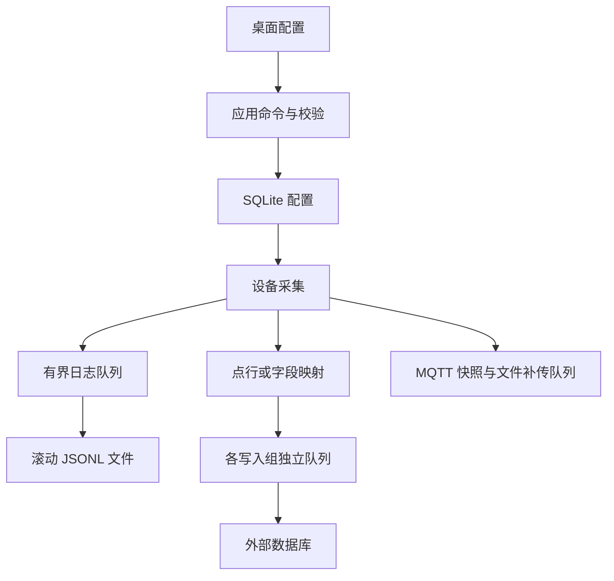

# 配置、采集日志与外部数据库

## 当前版本的存储边界

本版本按开发环境重新定义存储，不保留旧 SQLite 采集历史，不提供旧数据库、旧配置版本的迁移或兼容层。配置只接受 **schema 3**；导入 JSON 和 SQLite 中的配置内容都必须显式声明 `schemaVersion: 3`，缺少版本字段同样明确拒绝，不按模型默认值接纳。开发部署请使用新的空数据目录；旧 `gateway.db`、`gateway.json` 不再作为应用数据源读取。

| 内容 | 当前存放位置 | 说明 |
|---|---|---|
| 网关、通道、设备、点位、MQTT、日志、数据库及字段映射配置，以及驱动元数据 | `AppData/gateway.config.db` | `configuration_versions` 保存当前与上一份同版本配置，`driver_plugins` / `driver_catalog` 保存插件登记和可用驱动清单；配置版本在一个事务内更新 |
| 程序运行事件 | `logs/yyyyMMdd.log` | JSON Lines 滚动日志 |
| 采集数据的默认输出 | `logs/data/yyyyMMdd.log` | 精简 JSON Lines 滚动日志，默认开启；不创建 SQLite 采样表 |
| 启用后的业务采集记录 | 用户配置的 MySQL / PostgreSQL / Oracle | 支持标准点表与自定义字段映射；默认没有启用的外部连接或写入组 |
| 未确认 MQTT 消息 | `messaging/outbox/*.json` | 独立原子文件；正常重启后继续补传 |
| RPC 写入占位及结果 | `messaging/rpc/*.json` | 独立原子文件；在下发写指令前记录占位，避免重复执行 |
| 手工导入 / 导出配置 | 用户选择的 JSON 文件 | schema 3 交换文件，不是运行时的配置主存储 |

旧 `SqliteGatewayStore`、本地采集历史查询、历史天数/条数设置以及旧 JSON 配置存储类已移除。SQLite 不再保存 `samples`、`outbox` 或 `rpc_commands`。



## 日志配置

在“运行日志 → 日志设置”修改并保存。日志设置可以在采集运行中应用，不重启设备；保存失败保留原有设置和编辑输入。

| 设置 | 默认值 | 作用 |
|---|---|---|
| 最低等级 | Information | Debug / Information / Warning / Error；低于阈值的记录不输出 |
| 记录采集样本 | 开启 | 采集记录为 Information；选择 Warning / Error 时采样日志也会被过滤 |
| 单文件大小 | 10 MiB | 达到大小上限轮转；单条过大记录拒绝并增加丢弃计数 |
| 保留文件数 | 30 | 包括当前文件；超过数量时先删除较旧文件 |
| 保留天数 | 30 | 按文件时间清理；数量和天数同时生效，不能把它理解为保证保存 30 天 |

程序日志保存到程序根目录 `logs`，采样日志保存到 `logs/data`，两类文件独立轮转和保留。当天主文件名为 `yyyyMMdd.log`（沿用 UTC 写入日期），不再添加 `gateway-` 前缀；达到大小上限后归档为 `yyyyMMdd.001.log`、`yyyyMMdd.002.log` 等未占用的序号文件，继续写入当天主文件。已有 `gateway-*.log` 仍参与查询和保留策略，不重写历史内容。

采样日志为一条样本一行扁平 JSON，保留 `timestamp`（UTC 采样时间）、`deviceId`、`deviceName`、`tagId`、`tagName`、`address`、`rawValue`、`value`、`quality`。不再写入重复的外层时间、`sample` 包装、`level`、`kind` 和可计算的 `numericValue`；`unit`、`error` 仅在有内容时输出。失败采样保留实际质量、错误以及为 null 的原始值/工程值，不能省略故障语义。字符串/64 位整数/结构值按原类型序列化，日志不会把所有值强制转为 double。程序事件仍保留等级、类别和消息。

日志查询将精简采样视为 Information，按采样时间筛选；导出保留原始 JSON 行。示例（测试标识）：

```json
{"timestamp":"2026-10-26T00:00:00+00:00","deviceId":"00000000-0000-0000-0000-000000000001","deviceName":"测试设备","tagId":"00000000-0000-0000-0000-000000000002","tagName":"温度","address":"0","rawValue":250,"value":25,"quality":"Good","unit":"℃"}
```

2026-10-26 文件命名及采样格式调整：经用户确认，后台 WinForms Release 编译通过（0 错误、419 条现有迁移驱动警告），26 项日志定向测试全部通过（0 失败、0 跳过）。覆盖精简字段、64 位整数精度、失败采样与 UTC 时间、新文件命名和轮转保留、磁盘保护、新旧记录查询及原文导出。测试项目编译另有 1 条原有 xUnit2031 警告（ExternalDatabaseConnectorTests.cs:372）。证据：`artifacts/compact-logs-20261026/build.log`、`tests.log`、`compact-logs.trx`。未运行全量测试、界面或外部数据库验证。

内存查看区保留运行事件，避免采样量较大时刷掉通信和保存错误；采样记录在日志文件中，可通过“打开日志目录”查看。日志配置页显示待写、累计丢弃、累计失败及当前文件错误。

采集线程不执行日志磁盘 I/O。日志后台队列最多 8,192 条、估算有效载荷最多 64 MiB；单条采样预检上限 1 MiB、结构上限 4,096 个节点 / 16 层。容量不足拒绝新记录并保留可见计数。正常退出排空已接收的日志，突然终止可能丢失尚在内存的记录。滚动文件是诊断输出，不承诺完整历史归档。

## 新建外部数据库连接

1. 停止全部设备，进入“数据库”。
2. 新增连接，选择 MySQL、PostgreSQL 或 Oracle，填写名称、主机、端口、数据库/服务名、账号、密码与 TLS 设置。
3. 直接在“密码”输入框填写密码；可包含空格、引号与分号，程序保留原值，无密码时留空。
4. 点击“测试连接”。成功表示使用当前草稿参数完成数据库连接及测试查询，不会自动保存草稿或证明业务表有写入权限。
5. 保存连接，再新增写入组、选择目标表和存储方式，确认启用连接及写入组。
6. 启动设备，从数据库页观察写入、积压、失败、丢弃、跳过和最近成功时间。

Oracle 的“数据库”填写 **Service Name**，不是连接字符串或任意 TNS 描述符；使用托管 ODP.NET 驱动，不依赖另外安装的 Oracle 原生客户端。连接默认端口分别为 3306 / 5432 / 1521。

配置 SQLite 和导出 JSON 直接保存密码字符串；输入框使用掩码，日志与诊断不输出密码。MySQL / PostgreSQL 启用 TLS 时验证服务器证书及主机名；Oracle 使用 TCPS 和服务端身份匹配，证书信任由部署环境配置，不接受全部证书。

数据库连接和写入组属于全局设置，保存要求全部设备停止。连接测试、表结构读取和显式建表是用户单独触发的动作；关闭编辑器不会撤回已经执行的建表。设备/点位编辑仍按稳定 ID 进行，自定义映射引用的点位删除前须先解除映射。

## 写入组名称与保存失败（2026-10-26）

写入组名称在全部数据库连接中唯一，比较时忽略前后空格和大小写。新增写入组从最新配置生成未占用名称，如“采集数据”“采集数据（2）”；编辑原组保留 ID，名称比较排除自身。名称长度/控制字符与名称重复分别报告，重复时提示“名称已存在”，不会再混合显示为长度错误。保存时若重名，编辑器自动切换到“写入设置”并选中名称输入框，修改名称后可重试，字段映射草稿保留。

截图所示错误为名称校验失败，发生在提交配置阶段，尚未执行业务表写入。手动创建第二个写入组时，应改用不同名称；维护已有组的映射时，使用该组的“编辑写入组”入口。业务表 `_QUALITY` 为整数且采用固定业务状态时，选择“常量 / 整数”并填写状态值；“质量”来源仍表示实际采样质量文本，不自动生成厂商整数状态码。

本次已补充应用层重名拒绝、保存失败不改配置、改名保存及同 ID 编辑用例，并扩展单弹窗后台检查以覆盖自动命名、重名定位和映射保留。经用户确认，3 项核心定向测试通过（0 失败、0 跳过），包括写入组重名/编辑保存、全停限制及最新配置合并、自定义逐点配置校验。首轮 WinForms Release 编译失败：新增的弹窗检查代码中局部变量 `name` 与既有循环变量重名（CS0136，另有 419 条现有迁移驱动警告）；已更名为 `nameInput`，用户随后选择本次不再执行，因此未重新编译，也未执行隔离桌面弹窗检查。修正后的 WinForms 编译和界面行为仍待验证，不作为验收通过。证据：`artifacts/database-group-save-20261026/build.log`、`tests.log`、`database-group-save.trx`。未运行全量测试，未连接本机业务数据库。

## 方式一：每个点位一行

默认写入组使用标准点表 `gateway_point`。可选择一部分点位，点位选择为空表示所有启用设备的启用点位；是否向 MQTT 上传与数据库选择相互独立。

每点一行模式写入默认 `gateway_point` 表时，如果表不存在，程序会在首次写入事务前自动创建标准表和索引，重新读取并校验结构后写入。数据库账号需要具备目标 Schema 的建表和建索引权限；权限不足时保留脱敏错误码并报告失败。已有表只校验、不修改。其他名称的标准表仍可点击“创建标准点表”确认创建；自定义字段映射只使用已有业务表，即使表名为 `gateway_point` 也不会自动建表。

| 字段 | 类型 | 内容 |
|---|---|---|
| `event_id` | varchar(64)，主键 | 本次样本记录的稳定唯一键；同一批重试保持不变 |
| `device_id` | varchar(36)，非空 | 设备稳定 GUID |
| `device_name` | varchar(128) | 采样时的设备名称 |
| `tag_id` | varchar(36)，非空 | 点位稳定 GUID |
| `tag_name` | varchar(128) | 采样时的点位名称 |
| `address` | varchar(128) | 点位地址 |
| `raw_value` | varchar(128) | 原始值的 JSON 文本，保留类型和精度 |
| `value_text` | varchar(128) | 工程值的 JSON 文本，保留类型和精度 |
| `timestamp` | UTC 时间，非空 | 源采样时间 |
| `quality` | varchar(16)，非空 | Good / Uncertain / Bad |

标准表只保留上述 10 列，不保存 `numeric_value`、`unit`、`error`；错误详情仍记录在日志中，历史趋势从工程值计算数值。读取失败也形成记录，`quality=Bad`，值为空，不把上一次成功值补成新值。数据库 `timestamp` 使用 PostgreSQL timestamptz、MySQL datetime(6)、Oracle timestamp(6)，后两者按 UTC 约定保存。Oracle 字符列使用 VARCHAR2，128 字符列显式使用 `VARCHAR2(128 CHAR)`。

128 字符限制对序列化后实际写入的文本生效，JSON 引号与转义也占长度。超长名称、地址或值在连接数据库前拒绝整批写入并显示失败，不静默截断；较大的结构数据请使用自定义字段映射及足够长的业务字段。

本次开发调整不迁移旧标准表、不兼容旧连接配置；需重新配置连接与写入组；默认 `gateway_point` 缺失时在写入前自动创建，其他名称的标准表需显式创建。2026-10-25 已清除本机 Debug 运行目录配置库当前/上一版本中的外库连接与写入组，设备、点位和其他设置保持原内容；未删除外部数据库内的数据表。

标准表具有 `event_id` 主键以及采样时间、点位+采样时间索引。标准点表重试按 `event_id` 去重；这保证同一已接收记录的重试不会重复插入，不代表队列溢出或突然退出时所有采样都能保存。

Oracle 标准字段使用大写列名，例如 `EVENT_ID`；通过界面读取的表 / schema 名按真实大小写引用。不要在其他工具中擅自创建大小写不同的同名表。

## 方式二：已有业务表的字段映射

自定义模式分为“自定义逐点（每点一行）”和“自定义整行（固定点位组合）”。读取真实数据库的表及字段，再逐列选择采样来源或手动常量；固定点位组合还需为采样来源绑定具体点位。勾选“使用采样”表示使用所选来源，取消勾选表示写入手动常量；不写入某列须在值来源中明确选择“不写入 [默认值/NULL]”。界面显示数据库类型、是否允许 NULL、是否有默认值及是否自动生成；不能写入生成列，不能遗漏既不可空又无默认值的必需列。保存配置时进行离线校验，实际写入时再次核对数据库结构和权限。

### 手动常量与来源名称（2026-10-26）

- 对整数 `_QUALITY`：先“读取 / 刷新字段”，取消“使用采样”，在“手动常量”填写业务规定的数值，例如 `192`。该列仍参与写入；类型选择“自动”时按读到的整数列转换并保存为 `Int64`，也可显式选择“整数”。常量不是系统替用户生成的质量码，不改变实际采样质量。
- 常量与采样来源切换保留输入；刷新字段、保存后重新打开均保留手动常量。生成列始终跳过；尚未配置的可空/带默认值列保持“不写入”，不因刷新而意外写入空字符串；可直接在未勾选行输入常量，输入后自动纳入写入。弹窗默认宽度增加，小屏仍允许横向滚动。
- `quality [质量]` 的值为 `Good / Bad / Uncertain` 文本，不能配置为整数、浮点等类型；发现此类配置或无效整数常量，在保存前拒绝并保留草稿，不再等采集时重复报类型错误。
- 只修改“值来源”下拉框的显示名：`raw_value [原始值]`、`value_text [工程值]`、`timestamp [采样时间]`、`quality [质量]`、`tag_name [点位名称]` 等使用标准点表的真实字段名。标准表未包含的扩展来源使用属性/生成项标识，如 `NumericValue [数值·派生属性]`、`Unit [单位·采样属性]`、`RecordTime [记录时间·生成项]`、`Constant [手动常量]`；不宣称这些是标准表已有列。左侧目标表字段名及实际 SQL 标识符保持数据库原名。
- 元数据校验仍然有效：编辑器显示“尚未读取”时，必须读取当前表字段后才能保存；只改常量不代表表结构已核对。

本次按用户确认的最小范围及最多两轮修复重跑执行，证据保存在 `artifacts/mapping-constant-20261026/`：

- 首轮构建失败：来源枚举数组的 `Append` 调用匹配到返回 void 的扩展方法，产生 CS0023，日志 `build-1.log` 保留；显式使用 `Enumerable.Append` 后 `build-2.log` 构建通过。首轮另有 419 条既有迁移驱动警告。
- 17 项定向测试全部通过，无失败/跳过；覆盖三类数据库常见元数据类型、质量文本与整数配置冲突、整数常量格式/精度/溢出，以及实际采样行以 `Int64` 写入手动 `192`（使用测试连接器，不代表外库联调）。结果 `test-1/mapping-constant.trx`，执行日志 `tests-1.log`；另有一条既有 xUnit2031 分析警告。
- 架构检查通过，日志 `architecture.log`。UI 经 Application 调用纯规则，未新增工程依赖或数据库直连。
- 首轮弹窗检查通过；截图审查后加宽默认窗口，并允许未配置的未勾选行直接输入常量。最终 `build-3.log` 构建通过，0 警告、0 错误；`ui-2/` 弹窗重跑通过，实际 DPI 192，保留同名完成标记和截图。确认取消勾选、直接输入、切回采样、刷新/重开保留、自动 Int64、生成列/省略列、重名校验与目标改变失效；使用独立配置宿主及表结构样例，未连接业务数据库。人工查看最终截图，确认表字段、来源、常量在默认窗口可见。
- 未执行全量回归、完整 DPI 矩阵、真实外部数据库写入或现场验收。既往验证结果不作为本次修改的验证结果。

### 自定义逐点：多个点位共用一套映射

在“写入设置”选择连接及已有表，在“点位选择”页勾选要写入的点位（或全部启用点位），再在“字段映射”页点击“读取 / 刷新字段”。每个选中点位每次收到新采样时生成一行，名称、设备、值与采样时间均来自当前这一个点位；无需逐字段绑定固定点位，也不等待其他点位。逐点模式不使用整行写入间隔，数据库仍按连接的批次大小和提交间隔批量提交。

例如用户提供的 `lineamd_copy1` 结构，可手动配置为：

| 表字段 | 值来源 | 转换类型 | 说明 |
|---|---|---|---|
| `id` | 不写入 | — | AUTO_INCREMENT，由数据库生成 |
| `_NAME` | 点位名称 | 文本 | 当前采样的点位名称 |
| `_NUMERICID` | 设备名称或设备标识 | 文本 | 根据业务所需手动选择 |
| `_VALUE` | 工程值或原始值 | 文本 | 根据业务所需手动选择，保留整数精度 |
| `_TIMESTAMP` | 采样时间 | 时间 | 当前采样时间，数据库会话按 UTC 保存 |
| `_QUALITY` | Constant [手动常量] | 自动 / 整数 | 取消“使用采样”并填写业务状态值，如 `192`；不自动推断状态码 |

常量状态值是业务数据，不代表采样真实质量；默认仅允许 Good 采样写入，关闭此条件后允许 Bad/Uncertain 的实际空值和对应数据。停止、旧会话、过期或源时间超前的采样被跳过。一个点位转换失败只丢弃该行并记录原因，其他点位继续写入。自定义模式不自动创建或修改业务表；读取字段时自动识别并禁用自增/生成列。

字段页始终可进入：标准模式显示切换入口，未读字段时显示操作说明。读取字段后直接进入映射页；刷新保留同名字段映射，改变连接或表名后必须重新读取。下拉列和复选框列按 DPI 注册最小宽度，窄窗口使用横向滚动。

### 自定义整行：固定点位组合

例如已有业务表：

| 目标字段 | 来源 | 关联点位 | 转换 |
|---|---|---|---|
| `event_key` | EventId | 无 | Text |
| `recorded_at` | RecordTime | 无 | Timestamp |
| `machine_code` | Constant | 无，常量 `CNC01` | Text |
| `temperature` | EngineeringValue | 温度 | Decimal |
| `pressure` | EngineeringValue | 压力 | Double |
| `counter` | RawValue | 产量计数 | Decimal |
| `temperature_quality` | Quality | 温度 | Text |

值来源还包括原始值、工程值、数值、源采样时间、质量、设备/点位 ID 与名称、地址、单位和错误。字段类型可为 Auto、Text、Int64、Decimal、Double、Boolean、Timestamp。

Int64 不允许把小数静默四舍五入；UInt64 可映射到 Decimal 保留精度，decimal 转换发生精度损失或非零下溢时明确拒绝。目标数据库列的 precision / scale 仍须与业务值匹配，数据库自身的舍入规则不能由转换选项消除。需要完整结构的值可转成 JSON 文本，不执行任意 SQL 表达式或脚本。表 / schema / 字段名支持字母（含中文）、数字、下划线，字母或下划线开头，UTF-8 总长度不超过 63 字节；数据库标识符由驱动正确引用，数据值使用参数绑定。

### 组合成一行的时机

- 默认写入间隔 1,000 ms，表示最大频率；至少一个关联点位收到新的采样后，才考虑生成下一行。
- 一行所需的全部点位都必须启用并处于采集运行状态。
- 每个点位必须有真实已收到的样本，且不超过“最大数据年龄”（默认 10,000 ms）。
- 默认要求所有关联点质量为 Good；关闭此条件后，可将 Bad / Uncertain 及其空值、质量字段写入业务表。
- 条件不足时跳过该行并显示计数 / 原因，不用旧值或任意 NULL 拼成看似成功的新快照。
- 停止、重启或修改设备会使该设备的映射缓存失效；输出缓冲中迟到的旧会话样本不能重新填充新会话的映射缓存。

多个点位的采样时间可能不同，这种组合是“足够新鲜的最新值快照”，不代表 PLC 多寄存器在同一物理时刻原子采样。写入间隔建议不小于实际点位扫描能力，最大数据年龄应覆盖合理的采集偏差。

自定义业务表执行参数化事务 INSERT。若发生“数据库已提交但客户端没有收到确认”，重试仍可能产生重复业务行；建议映射 `EventId` 到业务唯一键并按数据库业务规则处理重复。自定义表不会被网关自动修改，也不声称对任意表提供恰好一次语义。

## 写入性能与故障边界

| 连接设置 | 默认值 | 规则 |
|---|---|---|
| 批次大小 | 200 行 | 1–5,000 行，驱动按报文/参数限制继续分块；一个事务提交一批 |
| 刷新间隔 | 1,000 ms | 不足一批时等待至此间隔后发送 |
| 队列容量 | 10,000 行 | 同一连接的全部写入组共享，包括正在发送或重试的批次 |
| 队列载荷限额 | 64 MiB | 同连接共享的保守估算限额，先达到行数或字节上限都拒绝新记录 |
| 最大尝试次数 | 5 | 首次也计入；指数退避，达到次数后明确增加丢弃计数 |
| 连接 / 命令超时 | 10 秒 / 30 秒 | 有限超时与取消；停止时还受总排空宽限限制 |

每个写入组有独立后台任务，某张表或一个连接失败不等待其他连接。采集仅执行有界内存入队，不等待外部数据库 I/O。默认日志输出与数据库写入同时存在，可在日志设置中关闭样本日志。

MySQL / PostgreSQL 使用真正的多行 INSERT，Oracle 同类型列使用 ArrayBind，异构 Auto 列改逐行绑定以免强制转成 double。已验证的表元数据缓存 30 秒，最多 256 项，写入失败使对应缓存失效。MySQL 要求事务表 InnoDB，并在当前会话添加严格模式，不能因服务器默认宽松而把超长值静默截断。

单条样本在 JSON 序列化前做大小和结构复杂度预检；超限拒绝并计数。自定义映射只缓存实际引用的点位，全部映射最新值另设 64 MiB 估算配额，不能通过选取大量大值绕过队列限制。这些是有效载荷预算，不是精确的 CLR 堆或进程工作集上限。

正常停止先结束采集，再处理已接收输出，给数据库队列 5 秒排空时间；超时后取消，另外等待最多 3 秒。无法及时退出的连接器操作被隔离，完成前禁止重启，防止重复积累后台数据库调用。没有写入的内存记录会明确计入丢弃；所有设备停止后，迟到完成不会把状态重新标为活动连接。

**外部数据库队列不使用 SQLite，也不落本地补偿数据文件。** 长时间断网、容量溢出、重试耗尽或突然终止可能丢记录；状态和日志明确暴露这个边界。MQTT 的持久化补传队列是独立机制，不能替代外部数据库采样队列。

## 历史与趋势

“历史与趋势”从选定的外部标准点表查询，可按设备、点位、时间范围过滤，单次最多 10,000 条，时间边界为 `From <= timestamp <= To`，按时间倒序。设备和点位按稳定 ID 过滤；历史记录未保存的单位和错误详情为空。尚未配置标准点表时显示说明，不会查询不存在的本地 SQLite 历史。自定义业务表结构任意，需使用该业务数据库的查询工具。

## 验证与实施边界

### 自定义逐点映射完善（2026-10-26）

新增 `PointMapping` 模式；已有 `PointRows` 与 `ColumnMapping` 的枚举值和默认配置保持原语义。定向用例覆盖逐点独立写入、选择/质量/会话过滤、转换失败隔离、手动整数常量、配置序列化、预览和业务表不自动建表。另提供后台映射弹窗定向验证入口：`scripts/smoke-test-winforms-background.ps1 -Scenario DatabaseMapping -OutputDirectory <新的证据目录>`，仅检查本次映射弹窗，不启动全量页面或 DPI 矩阵，使用字段元数据样例且不连接外部数据库。

经用户确认，针对实现提交 `ed7a846` 完成 WinForms Release 编译（0 错误、419 条驱动相关警告），逐点映射/预览/连接器定向测试 51 项全部通过（0 失败、0 跳过；测试编译有 1 条已有 xUnit2031 建议），架构检查通过（8 层边界、24 个无环工程）。隔离后台桌面的单个映射弹窗验证通过，实际 192 DPI，核对模式切换、字段元数据样例、自增列、值来源/类型/常量编辑、点位选择、刷新保留与目标变更校验，并人工查看截图。证据：`artifacts/custom-point-mapping-20261026/` 下的 `build.log`、`tests.log`、`custom-point-mapping.trx` 和 `ui/` 日志、截图。未运行全量测试或完整 DPI 矩阵，未连接本机 MySQL、写入业务表或执行用户 SQL 脚本；元数据样例验证不等于真实数据库写入验收。

### 默认点表自动创建（2026-10-25）

默认 `gateway_point` 在首次有效批次写入前自动创建，共用显式建表的字段和索引定义；同连接器内的建表操作串行化，跨进程发生表名冲突后重新读取并校验。自动创建不包含数据库或 Schema 创建，也不修补、覆盖已有表。建表和索引失败沿用写入错误脱敏、超时与重试分类。

已补充缺表创建后写入、重复批次复用、建表权限失败、并发创建后校验、已有不兼容表、自定义表及空批次/取消的定向测试用例。经用户确认，对实现提交 `d7854d5` 执行后台 WinForms Release 编译（成功，0 错误、419 条驱动相关警告），并执行 `ExternalDatabaseConnectorTests` 定向测试（42 通过、0 失败、0 跳过）。测试编译另有 1 条 xUnit2031 断言写法建议。证据位于 `artifacts/default-point-table-20261025/build.log`、`tests.log`、`default-point-table.trx`。未运行全量测试、界面验证或真实 MySQL/PostgreSQL/Oracle 集成，未连接现场数据库；本次单元测试通过不等于现场数据库验收。

### 标准表精简（2026-10-25）

本轮在用户确认范围后完成测试工程及依赖的 Release 编译，执行 `ExternalDatabaseConnectorTests`、`AcquisitionDataServiceTests`、`RecordingHardeningTests` 共 55 项，全部通过、无跳过。覆盖新字段顺序、UTC 历史查询、设备/点位筛选、128 字符边界、129 字符整批拒绝、JSON 精度与故障隔离；架构门禁通过。证据位于 `artifacts/gateway-point-20261025/` 的 `database-targeted.trx`、`tests.log`、`architecture.log`。

未执行全量测试、WinForms 构建/界面烟测、真实 MySQL/PostgreSQL/Oracle 集成或发布打包。下面既往数据库 CI 与性能记录对应旧版表结构，不作为本次 10 列标准表的真实数据库验收结果。

自动测试覆盖默认日志输出、精确整数与 UTC、完整/新鲜快照、停止与重启的旧值隔离、数据库故障隔离、队列容量、重试事件 ID、失败计数、参数绑定、配置事务及文件状态恢复。数据库连接器的单元测试不等同于真实数据库或现场长期验收。

独立的 [真实数据库验证程序](../tests/EdgeGateway.DatabaseIntegration/README.md) 与 [数据库 CI](../.github/workflows/database-integration.yml) 使用专用 PostgreSQL / MySQL 测试库；无环境直接失败，不以跳过或假通过代替连接。

**2026-10-24 实际数据库 CI 已通过。** [运行 40073723150](https://github.com/kingtentx/edge-gateway/actions/runs/40073723150) 对应功能提交 [`22113dafcc51e22f6e82d2cb953c3728b5cb1816`](https://github.com/kingtentx/edge-gateway/commit/22113dafcc51e22f6e82d2cb953c3728b5cb1816)，在 Ubuntu 24.04 runner 上运行官方 PostgreSQL / MySQL 服务容器。原始 checkout 日志记录实际构建的 PR 合并提交为 `5befabdcaca4ddb69ea97bec8b6a54fb1198ba8a`，基线为 `efd0985217aecf9500a674f83a2ae797a00022cf`。独立验证工程 Release 构建为 0 警告、0 错误；数据库作业全部步骤成功。

| 实际服务端 | 版本 | 集成检查 |
|---|---|---:|
| PostgreSQL | `16.15 (Debian 16.15-1.pgdg13+2)` | 22 项通过 |
| MySQL | `8.0.46` | 24 项通过 |

检查包含显式建表、普通写入不建表、元数据读取、稳定事件重放幂等、中文与 JSON 类型还原、UTC 微秒时间、64 位整数与匹配目标列的 decimal 精度、跨写入块的事务回滚、锁等待取消，以及历史过滤和数量上限。MySQL 额外验证元数据缓存期间新增业务唯一键不会吞掉新行，并在服务器默认 `sql_mode=''` 的故障基线下，确认连接器仍拒绝向 `varchar(120)` 写入 300 字符、整批回滚。宽松模式只设置在一次性 CI 容器；生产连接器保留严格会话设置。

结果依据为[原始作业日志](https://github.com/kingtentx/edge-gateway/actions/runs/40073723150/job/120812494291)及[数据库结果 artifact 12551698647](https://github.com/kingtentx/edge-gateway/actions/runs/40073723150/artifacts/12551698647)。已下载 artifact、通过 ZIP CRC 核对，并确认 SHA-256 与 GitHub 元数据一致；其中 `postgres.json` / `mysql.json` 与作业日志输出逐项相符。提交身份、完整检查列表、原始计时、文件哈希和验收边界保存于 [数据库验证 JSON](data-recording-verification.json)。Actions artifact 有保留期限，仓库 JSON 保留本轮结果与来源。

本次短时烟测每批 200 行，预热 200 行后计时写入 3,800 行：PostgreSQL 为 290.3727 ms，MySQL 为 400.9349 ms。计时仅覆盖同一 runner 上连接器向容器数据库的批量写入，不包含设备采集、运行时排队、默认日志输出、建表、历史查询和断言。**该本机回环结果不能推断现场吞吐、延迟分位数、生产容量或长期稳定性**；现场网络、多网关并发和长稳负载仍需按实际部署验证。

**Oracle 尚未连接真实实例验证。** 当前证据限于托管驱动参数、数组绑定、SQL 和错误分支单元测试；本次数据库 CI 没有运行 Oracle。部署前应针对目标 Oracle 版本、实际字段 precision / scale、权限、网络与 TLS 配置完成集成验收。

WinForms 门禁覆盖 8 个主页面、7 类弹窗、20 个等效工作区和 149 张截图；实际通过状态应查看对应提交的 Windows Actions 运行记录。本地 Linux 能交叉编译 WinForms，不能替代 Windows 原生交互检查。生产容量取决于点位数量、实际采样频率、字段长度、目标库版本、索引与网络延迟，不能仅根据配置上限推定可靠吞吐。

## SQLite 连接生命周期修复（2026-10-25）

基线为 `main` 的 `221986b`，开始前与 `origin/main` 一致。启动会先持久化默认配置并刷新驱动目录；此前 `ReplaceDriverInventoryAsync` 用 `using` 释放了 `OpenCore()` 返回的共用连接，存储仍缓存该已关闭实例，随后的 `SaveAsync → SaveCore → BeginTransaction` 因而抛出 `BeginTransaction can only be called when the connection is open`。本次去掉刷新方法对连接的局部释放，保留事务和命令的局部释放、存储级串行锁及宿主退出时的统一释放。

新增真实 SQLite 回归覆盖未保存/已保存配置的驱动刷新、刷新后保存与插件登记、再次清空目录并保存、重开数据库后的当前/上一版本，以及重复驱动主键触发事务回滚后继续保存。宿主测试也核对启动刷新后的设备编辑与重启持久化，并按新的运行目录约定隔离锁、日志和消息文件、提供实际内置驱动 DLL。原插件登记测试调用同步为当前的 `SaveDriverPluginAsync` 接口。

| 验证 | 本次结果 |
|---|---|
| 修复前复现 | 配置存储测试 4 失败 / 15 通过；其中两个新增保存场景均出现与用户相同的 `SaveCore` / `BeginTransaction` 堆栈；`artifacts/sqlite-connection-20261025/before-fix.trx` 保留这两个场景 |
| 配置存储专项 | 19 / 19 通过，0 跳过；`configuration-tests.trx` |
| 完整 Release 构建 | 成功，最终增量构建 0 警告、0 错误；驱动清单和架构门禁通过 |
| 完整核心测试 | 最终 423 / 423 通过，0 失败、0 跳过；`after-fix-all-tests.trx`。首次完整回归的两个宿主失败来自旧运行目录/驱动部署测试夹具，已修正并保留原结果 `all-tests.trx` |
| Windows 原生烟测 | **未通过**。程序进入主窗体，新增隐藏页签导航回归通过；随后最小宽度检查中，标题栏“采集已停止”标签被宽度仅 1 px 的 `HeaderStatus` 容器裁剪。失败位于 `AssertHeaderStatusFits`，不再是 SQLite 事务异常；完整布局矩阵尚未进入，不记为 20 / 20 通过 |
| 证据位置 | 上述 TRX 位于 `artifacts/sqlite-connection-20261025/`；UI 失败截图及 stdout/stderr 位于该目录的 `ui/` 子目录 |
| 验收边界 | 本次未执行双 Windows Server CI、真实多 DPI/跨屏、外部数据库现场连接或发布打包；现有运行配置未重置 |

首次修复测试过程中的 Windows DLL 映射也会阻止删除临时驱动文件；宿主夹具现在将 DLL 放在测试输出目录，只将可写运行数据放入独立临时目录。保持实际文件、事务与身份断言，未通过吞掉连接异常或重置数据库取得通过结果。

## 程序日志与采样日志分开保存（2026-10-25）

程序事件写入程序根目录 `logs`，逐点采样写入 `logs/data`。两类日志使用独立文件和轮转/保留计数；后台队列与磁盘保护继续有界，采样目录不可写不阻断程序事件写入。文件查询勾选包含采样时读取两个目录，未勾选时仅扫描程序日志目录。既有文件不重写，新采样按新目录保存。目录修复及 19 项定向验证记录见 [运行目录约定](runtime-directory-layout.md#日志分目录2026-10-25)。
