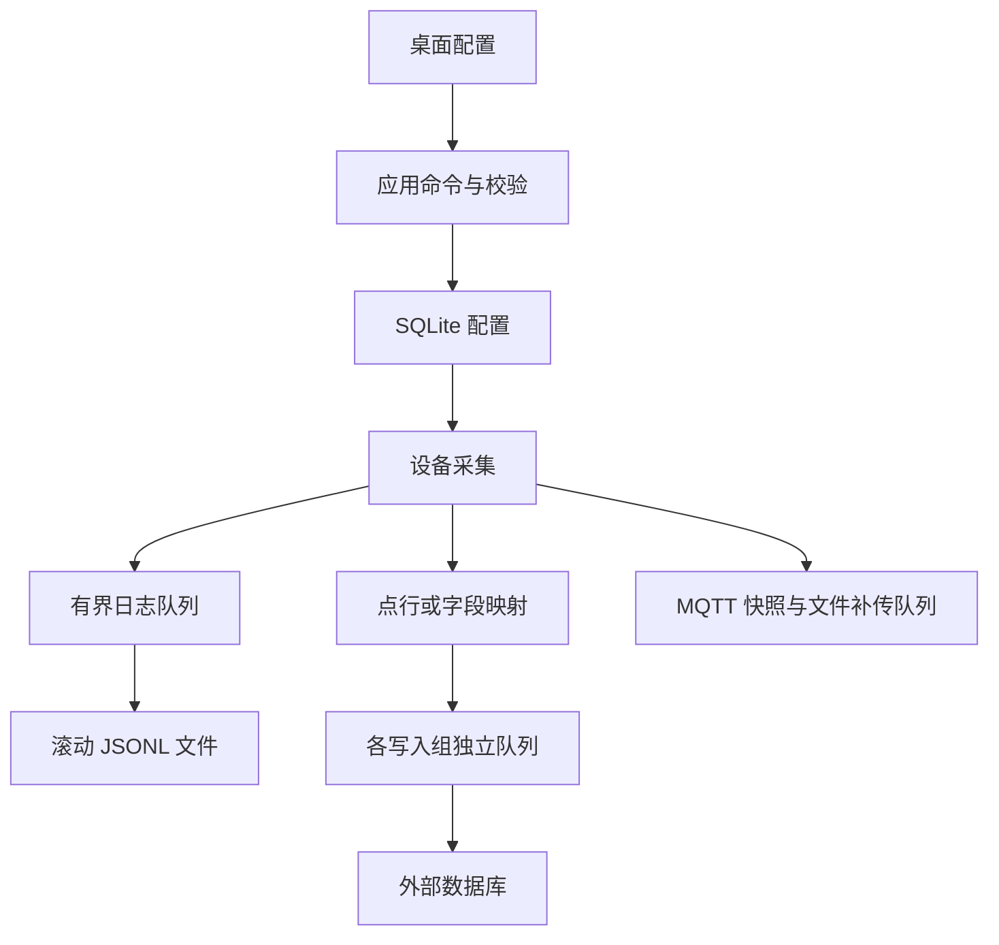

# 配置、采集日志与外部数据库

## 当前版本的存储边界

本版本按开发环境重新定义存储，不保留旧 SQLite 采集历史，不提供旧数据库、旧配置版本的迁移或兼容层。配置只接受 **schema 3**；导入 JSON 和 SQLite 中的配置内容都必须显式声明 `schemaVersion: 3`，缺少版本字段同样明确拒绝，不按模型默认值接纳。开发部署请使用新的空数据目录；旧 `gateway.db`、`gateway.json` 不再作为应用数据源读取。

| 内容 | 当前存放位置 | 说明 |
|---|---|---|
| 网关、通道、设备、点位、MQTT、日志、数据库及字段映射配置，以及驱动元数据 | `AppData/gateway.config.db` | `configuration_versions` 保存当前与上一份同版本配置，`driver_plugins` / `driver_catalog` 保存插件登记和可用驱动清单；配置版本在一个事务内更新 |
| 采集数据的默认输出 | `logs/gateway-*.log` | JSON Lines 滚动日志，默认开启；不创建 SQLite 采样表 |
| 启用后的业务采集记录 | 用户配置的 MySQL / PostgreSQL / Oracle | 支持标准点表与自定义字段映射；默认没有启用的外部连接或写入组 |
| 未确认 MQTT 消息 | `messaging/outbox/*.json` | 独立原子文件；正常重启后继续补传 |
| RPC 写入占位及结果 | `messaging/rpc/*.json` | 独立原子文件；在下发写指令前记录占位，避免重复执行 |
| 手工导入 / 导出配置 | 用户选择的 JSON 文件 | schema 3 交换文件，不是运行时的配置主存储 |

旧 `SqliteGatewayStore`、本地采集历史查询、历史天数/条数设置以及旧 JSON 配置存储类已移除。SQLite 不再保存 `samples`、`outbox` 或 `rpc_commands`。

## 日志配置

在“运行日志 → 日志设置”修改并保存。日志设置可以在采集运行中应用，不重启设备；保存失败保留原有设置和编辑输入。

| 设置 | 默认值 | 作用 |
|---|---|---|
| 最低等级 | Information | Debug / Information / Warning / Error；低于阈值的记录不输出 |
| 记录采集样本 | 开启 | 采集记录为 Information；选择 Warning / Error 时采样日志也会被过滤 |
| 单文件大小 | 10 MiB | 达到大小上限轮转；单条过大记录拒绝并增加丢弃计数 |
| 保留文件数 | 30 | 包括当前文件；超过数量时先删除较旧文件 |
| 保留天数 | 30 | 按文件时间清理；数量和天数同时生效，不能把它理解为保证保存 30 天 |

采样日志为一条样本一行 JSON，包含设备/点位身份、原始值、工程值、质量、UTC 采样时间、单位和错误。字符串/64 位整数/结构值按原类型序列化，日志不会把所有值强制转为 double。

内存查看区保留运行事件，避免采样量较大时刷掉通信和保存错误；采样记录在日志文件中，可通过“打开日志目录”查看。日志配置页显示待写、累计丢弃、累计失败及当前文件错误。

采集线程不执行日志磁盘 I/O。日志后台队列最多 8,192 条、估算有效载荷最多 64 MiB；单条采样预检上限 1 MiB、结构上限 4,096 个节点 / 16 层。容量不足拒绝新记录并保留可见计数。正常退出排空已接收的日志，突然终止可能丢失尚在内存的记录。滚动文件是诊断输出，不承诺完整历史归档。

## 新建外部数据库连接

1. 停止全部设备，进入“数据库”。
2. 新增连接，选择 MySQL、PostgreSQL 或 Oracle，填写名称、主机、端口、数据库/服务名、账号、密码与 TLS 设置。
3. 直接在“密码”输入框填写密码；可包含空格、引号与分号，程序保留原值，无密码时留空。
4. 点击“测试连接”。成功表示使用当前草稿参数完成数据库连接及测试查询，不会自动保存草稿或证明业务表有写入权限。
5. 保存连接，再新增写入组、选择目标表和存储方式，确认启用连接及写入组。
6. 启动设备，从数据库页观察写入、积压、失败、丢弃、跳过和最近成功时间。

Oracle 的“数据库”填写 **Service Name**，不是连接字符串或任意 TNS 描述符；使用托管 ODP.NET 驱动，不依赖另外安装的 Oracle 原生客户端。连接默认端口分别为 3306 / 5432 / 1521。

配置 SQLite 和导出 JSON 直接保存密码字符串；输入框使用掩码，日志与诊断不输出密码。MySQL / PostgreSQL 启用 TLS 时验证服务器证书及主机名；Oracle 使用 TCPS 和服务端身份匹配，证书信任由部署环境配置，不接受全部证书。

数据库连接和写入组属于全局设置，保存要求全部设备停止。连接测试、表结构读取和显式建表是用户单独触发的动作；关闭编辑器不会撤回已经执行的建表。设备/点位编辑仍按稳定 ID 进行，自定义映射引用的点位删除前须先解除映射。

## 方式一：每个点位一行

默认写入组使用标准点表 `gateway_samples`。可选择一部分点位，点位选择为空表示所有启用设备的启用点位；是否向 MQTT 上传与数据库选择相互独立。

如果表不存在，用户可以点击“创建标准点表”，明确确认后创建。程序不会在采集过程中自动建表、改表或修改业务字段。已有表必须符合标准点表要求。

| 字段 | 内容 |
|---|---|
| `event_id` | 本次样本记录的稳定唯一键；同一批重试保持不变 |
| `sample_time` | 源采样时间，按 UTC 保存 |
| `device_id` / `device_name` | 设备稳定 ID / 名称 |
| `tag_id` / `tag_name` | 点位稳定 ID / 名称 |
| `address` | 点位地址 |
| `raw_value` | 原始值的 JSON 文本，保留类型和精度 |
| `value_text` | 工程值的 JSON 文本，保留类型和精度 |
| `numeric_value` | 可转换为有限 double 的数值索引/趋势值；精确原值仍以 JSON 字段为准 |
| `quality` | Good / Uncertain / Bad |
| `unit` / `error` | 单位和本次错误 |

读取失败也形成记录，`quality=Bad`，值为空并带错误，不把上一次成功值补成新值。数据库 `sample_time` 使用 PostgreSQL timestamptz、MySQL datetime(6)、Oracle timestamp(6)，后两者按 UTC 约定保存。

标准表具有 `event_id` 主键以及采样时间、点位+采样时间索引。标准点表重试按 `event_id` 去重；这保证同一已接收记录的重试不会重复插入，不代表队列溢出或突然退出时所有采样都能保存。

Oracle 标准字段使用大写列名，例如 `EVENT_ID`；通过界面读取的表 / schema 名按真实大小写引用。不要在其他工具中擅自创建大小写不同的同名表。

## 方式二：已有业务表的字段映射

选择“自定义字段映射”，读取真实数据库的表及字段，再逐列选择是否写入、值来源、关联点位和转换类型。界面显示数据库类型、是否允许 NULL、是否有默认值及是否自动生成；不能写入生成列，不能遗漏既不可空又无默认值的必需列。保存配置时进行离线校验，实际写入时再次核对数据库结构和权限。

例如已有业务表：

| 目标字段 | 来源 | 关联点位 | 转换 |
|---|---|---|---|
| `event_key` | EventId | 无 | Text |
| `recorded_at` | RecordTime | 无 | Timestamp |
| `machine_code` | Constant | 无，常量 `CNC01` | Text |
| `temperature` | EngineeringValue | 温度 | Decimal |
| `pressure` | EngineeringValue | 压力 | Double |
| `counter` | RawValue | 产量计数 | Decimal |
| `temperature_quality` | Quality | 温度 | Text |

值来源还包括原始值、工程值、数值、源采样时间、质量、设备/点位 ID 与名称、地址、单位和错误。字段类型可为 Auto、Text、Int64、Decimal、Double、Boolean、Timestamp。

Int64 不允许把小数静默四舍五入；UInt64 可映射到 Decimal 保留精度，decimal 转换发生精度损失或非零下溢时明确拒绝。目标数据库列的 precision / scale 仍须与业务值匹配，数据库自身的舍入规则不能由转换选项消除。需要完整结构的值可转成 JSON 文本，不执行任意 SQL 表达式或脚本。表 / schema / 字段名支持字母（含中文）、数字、下划线，字母或下划线开头，UTF-8 总长度不超过 63 字节；数据库标识符由驱动正确引用，数据值使用参数绑定。

### 组合成一行的时机

- 默认写入间隔 1,000 ms，表示最大频率；至少一个关联点位收到新的采样后，才考虑生成下一行。
- 一行所需的全部点位都必须启用并处于采集运行状态。
- 每个点位必须有真实已收到的样本，且不超过“最大数据年龄”（默认 10,000 ms）。
- 默认要求所有关联点质量为 Good；关闭此条件后，可将 Bad / Uncertain 及其空值、质量字段写入业务表。
- 条件不足时跳过该行并显示计数 / 原因，不用旧值或任意 NULL 拼成看似成功的新快照。
- 停止、重启或修改设备会使该设备的映射缓存失效；输出缓冲中迟到的旧会话样本不能重新填充新会话的映射缓存。

多个点位的采样时间可能不同，这种组合是“足够新鲜的最新值快照”，不代表 PLC 多寄存器在同一物理时刻原子采样。写入间隔建议不小于实际点位扫描能力，最大数据年龄应覆盖合理的采集偏差。

自定义业务表执行参数化事务 INSERT。若发生“数据库已提交但客户端没有收到确认”，重试仍可能产生重复业务行；建议映射 `EventId` 到业务唯一键并按数据库业务规则处理重复。自定义表不会被网关自动修改，也不声称对任意表提供恰好一次语义。

## 写入性能与故障边界

| 连接设置 | 默认值 | 规则 |
|---|---|---|
| 批次大小 | 200 行 | 1–5,000 行，驱动按报文/参数限制继续分块；一个事务提交一批 |
| 刷新间隔 | 1,000 ms | 不足一批时等待至此间隔后发送 |
| 队列容量 | 10,000 行 | 同一连接的全部写入组共享，包括正在发送或重试的批次 |
| 队列载荷限额 | 64 MiB | 同连接共享的保守估算限额，先达到行数或字节上限都拒绝新记录 |
| 最大尝试次数 | 5 | 首次也计入；指数退避，达到次数后明确增加丢弃计数 |
| 连接 / 命令超时 | 10 秒 / 30 秒 | 有限超时与取消；停止时还受总排空宽限限制 |

每个写入组有独立后台任务，某张表或一个连接失败不等待其他连接。采集仅执行有界内存入队，不等待外部数据库 I/O。默认日志输出与数据库写入同时存在，可在日志设置中关闭样本日志。

MySQL / PostgreSQL 使用真正的多行 INSERT，Oracle 同类型列使用 ArrayBind，异构 Auto 列改逐行绑定以免强制转成 double。已验证的表元数据缓存 30 秒，最多 256 项，写入失败使对应缓存失效。MySQL 要求事务表 InnoDB，并在当前会话添加严格模式，不能因服务器默认宽松而把超长值静默截断。

单条样本在 JSON 序列化前做大小和结构复杂度预检；超限拒绝并计数。自定义映射只缓存实际引用的点位，全部映射最新值另设 64 MiB 估算配额，不能通过选取大量大值绕过队列限制。这些是有效载荷预算，不是精确的 CLR 堆或进程工作集上限。

正常停止先结束采集，再处理已接收输出，给数据库队列 5 秒排空时间；超时后取消，另外等待最多 3 秒。无法及时退出的连接器操作被隔离，完成前禁止重启，防止重复积累后台数据库调用。没有写入的内存记录会明确计入丢弃；所有设备停止后，迟到完成不会把状态重新标为活动连接。

**外部数据库队列不使用 SQLite，也不落本地补偿数据文件。** 长时间断网、容量溢出、重试耗尽或突然终止可能丢记录；状态和日志明确暴露这个边界。MQTT 的持久化补传队列是独立机制，不能替代外部数据库采样队列。

## 历史与趋势

“历史与趋势”从选定的外部标准点表查询，可按设备、点位、时间范围过滤，单次最多 10,000 条，时间边界为 `From <= sample_time <= To`，按时间倒序。尚未配置标准点表时显示说明，不会查询不存在的本地 SQLite 历史。自定义业务表结构任意，需使用该业务数据库的查询工具。

## 验证与实施边界

自动测试覆盖默认日志输出、精确整数与 UTC、完整/新鲜快照、停止与重启的旧值隔离、数据库故障隔离、队列容量、重试事件 ID、失败计数、参数绑定、配置事务及文件状态恢复。数据库连接器的单元测试不等同于真实数据库或现场长期验收。

独立的 [真实数据库验证程序](../tests/EdgeGateway.DatabaseIntegration/README.md) 与 [数据库 CI](../.github/workflows/database-integration.yml) 使用专用 PostgreSQL / MySQL 测试库；无环境直接失败，不以跳过或假通过代替连接。

**2026-10-24 实际数据库 CI 已通过。** [运行 40073723150](https://github.com/kingtentx/edge-gateway/actions/runs/40073723150) 对应功能提交 [`22113dafcc51e22f6e82d2cb953c3728b5cb1816`](https://github.com/kingtentx/edge-gateway/commit/22113dafcc51e22f6e82d2cb953c3728b5cb1816)，在 Ubuntu 24.04 runner 上运行官方 PostgreSQL / MySQL 服务容器。原始 checkout 日志记录实际构建的 PR 合并提交为 `5befabdcaca4ddb69ea97bec8b6a54fb1198ba8a`，基线为 `efd0985217aecf9500a674f83a2ae797a00022cf`。独立验证工程 Release 构建为 0 警告、0 错误；数据库作业全部步骤成功。

| 实际服务端 | 版本 | 集成检查 |
|---|---|---:|
| PostgreSQL | `16.15 (Debian 16.15-1.pgdg13+2)` | 22 项通过 |
| MySQL | `8.0.46` | 24 项通过 |

检查包含显式建表、普通写入不建表、元数据读取、稳定事件重放幂等、中文与 JSON 类型还原、UTC 微秒时间、64 位整数与匹配目标列的 decimal 精度、跨写入块的事务回滚、锁等待取消，以及历史过滤和数量上限。MySQL 额外验证元数据缓存期间新增业务唯一键不会吞掉新行，并在服务器默认 `sql_mode=''` 的故障基线下，确认连接器仍拒绝向 `varchar(120)` 写入 300 字符、整批回滚。宽松模式只设置在一次性 CI 容器；生产连接器保留严格会话设置。

结果依据为[原始作业日志](https://github.com/kingtentx/edge-gateway/actions/runs/40073723150/job/120812494291)及[数据库结果 artifact 12551698647](https://github.com/kingtentx/edge-gateway/actions/runs/40073723150/artifacts/12551698647)。已下载 artifact、通过 ZIP CRC 核对，并确认 SHA-256 与 GitHub 元数据一致；其中 `postgres.json` / `mysql.json` 与作业日志输出逐项相符。提交身份、完整检查列表、原始计时、文件哈希和验收边界保存于 [数据库验证 JSON](data-recording-verification.json)。Actions artifact 有保留期限，仓库 JSON 保留本轮结果与来源。

本次短时烟测每批 200 行，预热 200 行后计时写入 3,800 行：PostgreSQL 为 290.3727 ms，MySQL 为 400.9349 ms。计时仅覆盖同一 runner 上连接器向容器数据库的批量写入，不包含设备采集、运行时排队、默认日志输出、建表、历史查询和断言。**该本机回环结果不能推断现场吞吐、延迟分位数、生产容量或长期稳定性**；现场网络、多网关并发和长稳负载仍需按实际部署验证。

**Oracle 尚未连接真实实例验证。** 当前证据限于托管驱动参数、数组绑定、SQL 和错误分支单元测试；本次数据库 CI 没有运行 Oracle。部署前应针对目标 Oracle 版本、实际字段 precision / scale、权限、网络与 TLS 配置完成集成验收。

WinForms 门禁覆盖 8 个主页面、7 类弹窗、20 个等效工作区和 149 张截图；实际通过状态应查看对应提交的 Windows Actions 运行记录。本地 Linux 能交叉编译 WinForms，不能替代 Windows 原生交互检查。生产容量取决于点位数量、实际采样频率、字段长度、目标库版本、索引与网络延迟，不能仅根据配置上限推定可靠吞吐。

## SQLite 连接生命周期修复（2026-10-25）

基线为 `main` 的 `221986b`，开始前与 `origin/main` 一致。启动会先持久化默认配置并刷新驱动目录；此前 `ReplaceDriverInventoryAsync` 用 `using` 释放了 `OpenCore()` 返回的共用连接，存储仍缓存该已关闭实例，随后的 `SaveAsync → SaveCore → BeginTransaction` 因而抛出 `BeginTransaction can only be called when the connection is open`。本次去掉刷新方法对连接的局部释放，保留事务和命令的局部释放、存储级串行锁及宿主退出时的统一释放。

新增真实 SQLite 回归覆盖未保存/已保存配置的驱动刷新、刷新后保存与插件登记、再次清空目录并保存、重开数据库后的当前/上一版本，以及重复驱动主键触发事务回滚后继续保存。宿主测试也核对启动刷新后的设备编辑与重启持久化，并按新的运行目录约定隔离锁、日志和消息文件、提供实际内置驱动 DLL。原插件登记测试调用同步为当前的 `SaveDriverPluginAsync` 接口。

| 验证 | 本次结果 |
|---|---|
| 修复前复现 | 配置存储测试 4 失败 / 15 通过；其中两个新增保存场景均出现与用户相同的 `SaveCore` / `BeginTransaction` 堆栈；`artifacts/sqlite-connection-20261025/before-fix.trx` 保留这两个场景 |
| 配置存储专项 | 19 / 19 通过，0 跳过；`configuration-tests.trx` |
| 完整 Release 构建 | 成功，最终增量构建 0 警告、0 错误；驱动清单和架构门禁通过 |
| 完整核心测试 | 最终 423 / 423 通过，0 失败、0 跳过；`after-fix-all-tests.trx`。首次完整回归的两个宿主失败来自旧运行目录/驱动部署测试夹具，已修正并保留原结果 `all-tests.trx` |
| Windows 原生烟测 | **未通过**。程序进入主窗体，新增隐藏页签导航回归通过；随后最小宽度检查中，标题栏“采集已停止”标签被宽度仅 1 px 的 `HeaderStatus` 容器裁剪。失败位于 `AssertHeaderStatusFits`，不再是 SQLite 事务异常；完整布局矩阵尚未进入，不记为 20 / 20 通过 |
| 证据位置 | 上述 TRX 位于 `artifacts/sqlite-connection-20261025/`；UI 失败截图及 stdout/stderr 位于该目录的 `ui/` 子目录 |
| 验收边界 | 本次未执行双 Windows Server CI、真实多 DPI/跨屏、外部数据库现场连接或发布打包；现有运行配置未重置 |

首次修复测试过程中的 Windows DLL 映射也会阻止删除临时驱动文件；宿主夹具现在将 DLL 放在测试输出目录，只将可写运行数据放入独立临时目录。保持实际文件、事务与身份断言，未通过吞掉连接异常或重置数据库取得通过结果。
