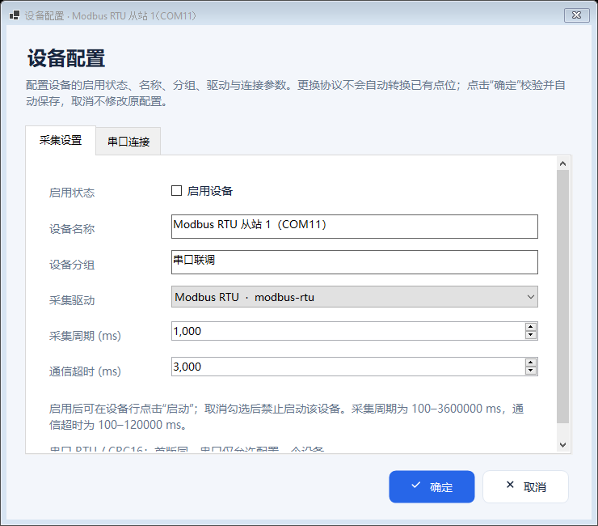

# 统一设备配置窗与启用状态

> **历史版本说明：** 本页完整保留源码 `6419274` / CI `39916897490` 的窗体合并行为、截图和验收事实。下文“全部停止才能修改”“运行时只读”和平台草稿影响启动等规则仅适用于该历史版本。当前源码已支持运行中维护设备与点位、仅重启变更目标、失败保留弹窗输入，且平台草稿不阻止启动；请按 [运行中配置与数据闭环](live-configuration.md) 操作。本页历史运行包不包含这些后续功能。

添加设备、编辑设备、设备行“配置”和普通数据列双击统一使用 `DeviceConfigurationDialog`。原 `Editors.cs` 中重复的 `DeviceEditor` 类移除，四种入口使用相同的字段、页签和保存规则。“采集设置”默认打开，首行恢复“启用设备”，不再因入口不同而缺少启用、名称、分组或驱动选择。

**本轮已完成验证：** 源码 [`6419274`](https://github.com/kingtentx/edge-gateway/commit/64192748e37368402c7eb0c78592f184cda9c8f3) 的 [Windows CI 39916897490](https://github.com/kingtentx/edge-gateway/actions/runs/39916897490) 首次执行全部通过。[下载 Windows x64 自包含运行包](https://github.com/kingtentx/edge-gateway/actions/runs/39916897490/artifacts/12485477098)，完整解压后运行 `EdgeGateway.WinForms.exe`。详细执行结果见下文及 [机器可读记录](device-configuration-unification-verification.json)。

## 入口与字段

| 入口 | 操作目标 |
|---|---|
| 工具栏“添加设备” | 使用同一窗体的新建模式建立设备草稿 |
| 工具栏“编辑设备” | 编辑设备表中当前选中的设备 |
| 设备行“配置” | 编辑被点击行的设备，按稳定设备 ID 定位 |
| 双击普通数据列 | 与点击该行“配置”一致，不依赖此前选中的行 |

“启动”“停止”“配置/查看”等操作列不走普通数据列的双击入口，避免处理单击后额外打开弹窗。

默认“采集设置”页按以下顺序显示：

| 字段 | 用途 |
|---|---|
| 启用设备 | 首行复选框，读取和提交设备的 `Enabled` |
| 设备名称 | 设备表及监控中显示的名称 |
| 分组 | 设备分组 |
| 采集驱动 | 下拉选择已注册驱动，并切换对应连接或参数页 |
| 采集周期 | 设备采集间隔 |
| 通信超时 | 通信与采集超时设置 |

内置 Modbus TCP 显示“网络连接”，Modbus RTU 显示“串口连接”，迁移驱动使用原驱动元数据生成“驱动参数”。具体参数、枚举及绑定规则见 [设备配置参数说明](device-configuration.md)。

## 启用、保存与设备行同步

1. 停止全部正在采集的设备，再从任一入口打开配置窗。
2. 在“采集设置”首行勾选或取消“启用设备”，按需要修改其他字段。
3. 点击“确定”。程序构造独立的完整候选配置，校验通过后原子保存，保存成功才应用到当前配置。
4. 设备行同步显示“启用：是/否”，启动按钮根据启用状态及当前运行、忙碌和平台草稿状态更新。
5. 需要采集时，点击目标设备行的“启动”；取消勾选则禁止启动该设备。

**启用不会自动开始采集。** 启用是保存在配置中的许可，与当前运行状态分别显示。已有“程序启动时自动启动已启用设备”的系统设置保留，勾选复选框本身不触发该流程。

取消或关闭弹窗不修改来源设备，包含启用切换、名称修改、驱动切换及各参数草稿。完整配置校验失败或文件保存失败时，原配置和设备行状态保持不变。启用设备仍经过同串口冲突等既有校验，无需再点击顶部保存按钮。自动保存、平台草稿与单设备启停的完整规则见 [单设备启停与自动保存](device-control-autosave.md)。

## 新建与编辑的区别

新建使用统一窗体的 `isNew` 模式，仅调整新建标题与确认时的默认点位生成行为。切换驱动时先编辑草稿，确认时才按最终选择的驱动生成默认点位，并纳入完整配置校验。取消新建不添加设备或点位。

编辑已有设备保留原设备 ID 和已有 `Tags`，允许修改名称、分组及驱动。切换驱动不会自动转换、清空或重新生成已有点位；地址、读取方法、类型等若与目标驱动不兼容，完整配置校验会拒绝保存。配置窗不会为通过校验而自动删除旧点位或跳过校验。

在同一弹窗中切换不同驱动时，按驱动分别保留连接和参数草稿；切回先前的驱动可继续原草稿。草稿在确认保存前不修改来源对象，也不启动对应驱动。

对于已有 COM11 示例，使用同一窗体编辑时保留其设备 ID 和 10 个点位。通过“添加设备”新建 RTU 时生成的是所选驱动的默认点位，不会自动复制示例的 10 个点位；复现示例可使用 [COM11 RTU 配置与导入步骤](modbus-rtu-com11.md)。

## 采集期间的限制

任意一台设备正在采集时，仍禁止新增、修改或导入配置。设备行“配置”显示为“查看”，双击普通数据列也打开相同的只读窗体；启用、名称、分组、驱动下拉框、周期、超时和协议参数都不可修改，只提供“关闭”。即使目标设备已停止，只要其他设备仍在采集，这一限制仍生效。

需要修改时先停止全部运行设备。单设备启停与此次窗体合并均未引入运行时热配置。

## 实现约束

- `DeviceConfigurationDialog` 接收驱动注册表，由一个窗体负责通用字段、驱动选择和动态参数，不复制第二套设备编辑控件。
- 四种入口共用相同的候选配置提交路径；行内操作以被点击行的设备 ID 为准，保存后保持正确的目标选择。
- 新建与已有设备编辑分别处理默认点位生成和原点位保留，设备 ID 不因编辑或驱动切换而变化。
- 继续使用已有 DPI 基类、滚动内容和固定操作栏；切换驱动重建参数页后仍需正确继承字体和当前 DPI，避免重复缩放。

## 本轮验证范围

以下行为已纳入本轮检查，实际执行结果与环境记录见下一节。

| 检查范围 | 需要核对的行为 |
|---|---|
| 四种入口 | 均打开同一窗体类型及字段布局；先选中 A 再操作 B 行时，正确编辑 B |
| 启用状态 | 未启用和启用值正确回显；确认后保存、重新打开及设备行显示一致；启用不触发采集 |
| 取消与只读 | 修改多个字段后取消不污染来源；只读模式禁止修改及提交 |
| 新建模式 | 最终所选驱动决定确认时生成的默认点位；原草稿保持隔离 |
| 驱动切换 | 来回切换恢复各驱动草稿，名称、分组、启用、周期和超时不丢失；已有设备 ID、点位和点位 ID 保留；不兼容配置拒绝保存 |
| 自动保存 | 校验或真实文件写入失败时，内存、磁盘及设备行保持原状态 |
| 动态布局 | 各驱动参数页与默认“采集设置”可访问，小工作区保持输入、滚动和确认操作可达 |

以下合并检查已在两套 Windows 环境通过：

- 从添加设备、编辑设备、设备行“配置”和普通数据列双击四种实际入口打开同一个模态窗，经过真实确认与自动保存路径核对结果。
- 在动态驱动切换循环中，核对 `Name`、`Group`、`Enabled`、`PollIntervalMs` 和 `TimeoutMs` 等公共字段不丢失。
- 将含有 `ramp` 点位的已有 `simulator` 设备切换为 `modbus-tcp`，核对候选配置保留原设备 ID 和 `Tags`，完整配置校验拒绝不兼容地址，磁盘配置保持不变。

Windows 烟测使用隔离配置和本地模拟设备，不连接现场设备。启用选项的回显、取消、只读和行状态检查已在合并后的最终源码上重新通过。串口冲突由既有导入检查覆盖；本轮没有直接通过新增复选框制造串口冲突的完整 UI 用例。

## 实际执行结果

以下结果对应源码 `64192748e37368402c7eb0c78592f184cda9c8f3`，工作流 `39916897490`，执行次数 1。后续补充说明和验证文件的提交不改变运行包的程序源码。

| 检查 | Windows Server 2022 | Windows Server 2025 |
|---|---|---|
| Release 构建 | 通过，0 错误 | 通过，0 错误 |
| 自动测试 | 107 / 107 通过 | 107 / 107 通过 |
| 15 个驱动的新建及已有配置 | 字段、绑定、默认点位与布局通过 | 字段、绑定、默认点位与布局通过 |
| 添加、编辑、配置和双击入口 | 同一窗体及自动保存检查通过 | 同一窗体及自动保存检查通过 |
| 启用、取消与只读 | 通过 | 通过 |
| 驱动草稿与已有点位保护 | 来回切换保留；不兼容切换拒绝保存 | 来回切换保留；不兼容切换拒绝保存 |
| 单设备启停、自动保存与导入 | 通过 | 通过 |
| 等效工作区布局 | 20 / 20 通过 | 20 / 20 通过 |
| 实际窗口 DPI | 96 | 96 |
| 布局焦点恢复次数 | 0 | 0 |
| 实际截图 | 97 张，无失败截图 | 97 张，无失败截图 |
| 界面检查标准错误输出 | 空 | 空 |

两套系统均使用 .NET 8.0.32，实际屏幕为 1024×768，工作区分别为 1024×728 和 1024×720。完整构建均有迁移驱动既有的 419 项编译警告，没有新增构建错误。布局矩阵检查的是不同名义分辨率/缩放对应的可用窗口空间，实际 DPI 始终为 96。

下图来自本轮 Windows Server 2022 的原生 WinForms 运行，图像未修改。它展示已有 COM11 示例默认打开的“采集设置”页；首行“启用设备”未勾选，对应示例的默认停用配置。



运行包 `EdgeGateway-win-x64.zip` 大小为 **79,028,014 字节**，含 596 项文件/目录条目；全部 12 个迁移驱动以及 23 个必要网关/驱动依赖程序集齐全，外层构建制品与运行包 ZIP 的 CRC 检查均通过。RTU 示例、README、配置说明和开发 Skill 与上述源码提交一致（忽略换行符差异）。

运行包 SHA-256：

```text
746c840d9570bccc2f573d8893d094998718ba437dac0f730414eab3ce32329d
```

包内文档反映源码提交时的状态，本页与 [验证记录](device-configuration-unification-verification.json) 补充最终执行结果。源码中的 `DeviceEditor` 定义与引用已清理；点位编辑和数值写入窗体仍有独立业务调用。

此前 [行内配置记录](device-configuration.md#历史版本验证记录)、[单设备启停记录](device-control-autosave.md#此前版本验证与运行包) 和 [RTU 初始记录](modbus-rtu-com11.md#rtu-初始交付版本验证与下载) 保留供追溯，不代表本轮通过。最新交付导航见 [README](../README.md)。

## 验证边界

等效工作区按名义分辨率和缩放比例调整可用窗口，不能替代真实 Windows DPI 切换或多显示器往返测试。实际系统版本、工作区及窗口 DPI 需随最终结果记录。

尚未据此完成用户 COM10 ↔ COM11 虚拟串口、现场 PLC、厂商本机依赖或现场 MQTT 的实测。配置可保存、模拟采集和界面检查均不能证明现场通信已经连通。
