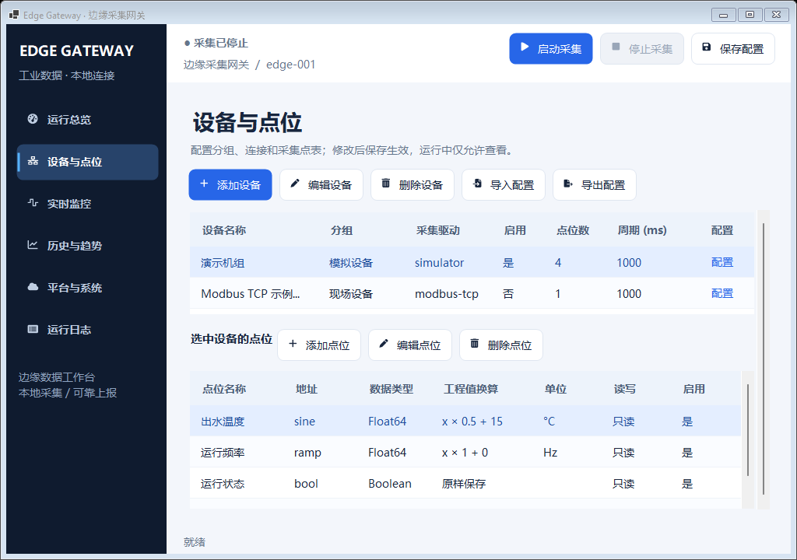
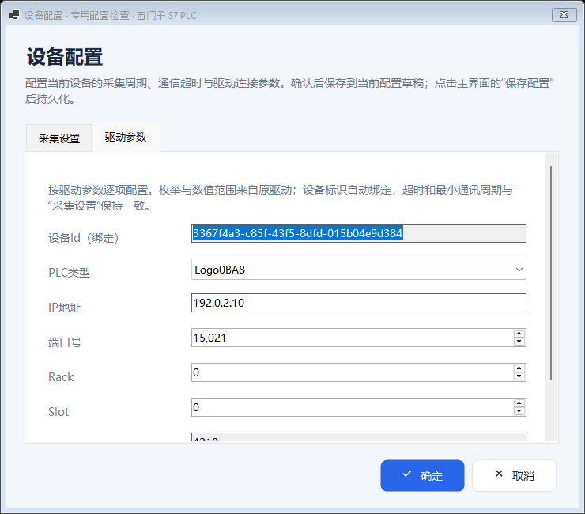
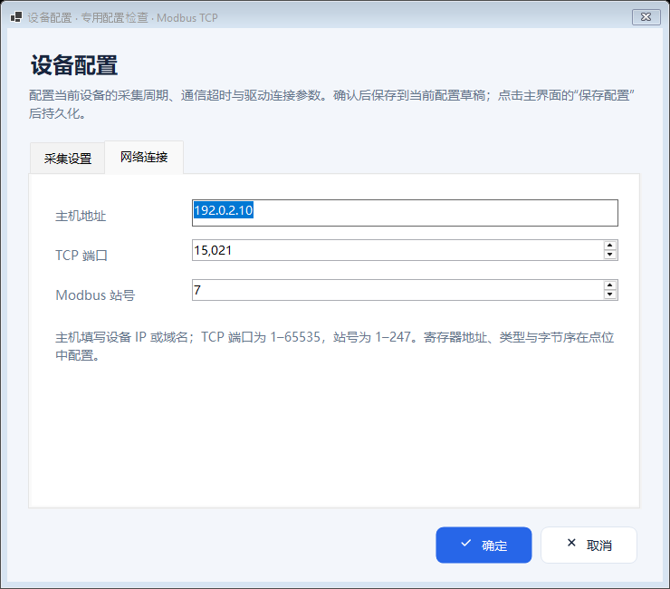

# 设备表行内配置

日期：2026-10-23（Asia/Shanghai）。适用于 .NET 8 WinForms 采集网关。

## 使用方式

1. 打开“设备与点位”。设备表最右侧、周期列后新增“配置”列。
2. 点击需要配置的那一行的“配置”。弹窗标题显示设备名称，当前驱动固定。
3. 在“采集设置”修改采集周期、通信超时；在默认打开的连接或驱动参数页配置该设备的协议参数。
4. 点击“确定”更新当前配置草稿，再点击主界面的“保存配置”落盘。点击“取消”或关闭弹窗不会修改原设备。

采集运行期间，行内入口显示“查看”，弹窗只读并仅提供“关闭”；停止采集后可修改。设备名称、分组、驱动切换、启用状态继续使用“编辑设备”，点位仍在下方点位表维护。

## 实际界面

以下为提交 `caf169abc22e91d116212ee4513b8c5fadd95a5b` 在 Windows Server 2025 上实际运行的 WinForms 截图，实际 DPI 为 96。设备表使用默认演示配置，弹窗使用独立验证配置，均未启动采集。

设备表最右侧的逐行配置入口：

Siemens S7 读取迁移驱动元数据，展示 PLC 类型、IP、端口、Rack、Slot 等专用字段；长页面可滚动：

内置 Modbus TCP 使用其网络连接字段：

## 参数来源与差异

源项目基准固定为 [`iioter/iotgateway@8de442a7`](https://github.com/iioter/iotgateway/tree/8de442a7dec52d2993d1e9667d799846936d681b)。源项目 `DriverService.AddConfigs()` 反射驱动的 `ConfigParameterAttribute`，使用属性名作为键、描述作为标签、真实实例值作为默认值，枚举按名称保存。新窗口复用本项目已迁移的同一份元数据，不维护第二份硬编码的迁移驱动参数表。

| 当前驱动 | 配置字段示例 |
|---|---|
| 内置 `modbus-tcp` | 主机地址、TCP 端口、站号 |
| 内置 `modbus-rtu` | 串口、波特率、数据位、校验位、停止位、站号 |
| 内置 `simulator` | 采集周期、超时；无需网络或串口连接参数 |
| `PLC.SiemensS7` | CPU 类型、IP、端口、Rack、Slot |
| `PLC.MelsecMc` | CPU 类型、IP、端口 |
| `PLC.ModBusMaster` | 主站类型、IP/端口、串口参数、从站号 |
| `PLC.OmronFins` / `PLC.AllenBradley` | IP、端口 |
| `OPC.UaClient` | URI、迁移版已有的安全策略与 PKI 目录 |
| `OPC.DaClient` | 服务器 IP、OPC Server 名称 |
| `CNC.Fanuc` / `CNC.Fanuc.H` | IP、端口；Hsl 版本保留授权码环境变量名 |
| `CNC.MTConnect` | MTConnect URI |
| `Other.Toledo` | IP、端口、帧长度及源驱动元数据字段；其 DataBits 表示 TCP 帧长度 |
| `Mock.TcpClient` | IP、端口、连接类型 |

所有迁移驱动原有参数均继续保留；既有值优先回显，缺失键才使用驱动默认值。未知参数不会被弹窗静默删除，仍交由工厂验证报告。无效导入枚举或越界初始值保留显示，确认时明确报错，不自动替换成另一个值。

设备标识 `DeviceId` 只读绑定设备 ID；`Timeout` 和 `MinPeriod` 绑定“采集设置”中的超时、采集周期，修改后同步刷新。这些绑定字段不重复写入 `Properties`。枚举、整数、布尔、文本、密码遮罩和参数说明沿用统一参数面板。

本轮不引入源 Web 项目的 `DataSide` 云端属性上传范围或其它平台消息功能。协议参数与现有网关采集、保存流程保持一致。

## 实现与保护

- `MainForm.Configuration.cs`：新增行内链接列，通过被点击行的稳定设备 ID 定位；配置列双击不会再触发通用设备编辑器。
- `DeviceConfigurationDialog.cs`：使用内部深拷贝，配置成功前不发布结果；设备身份与点位集合保持不变。提交时仅隔离与此窗无关的点位校验，所有驱动参数仍由原工厂校验，完整配置继续在主界面保存时统一验证。
- `DriverParameterPanel.cs`：复用驱动元数据与现有值，支持明确的只读模式和“采集设置”提示。
- 新列使用随 DPI 调整的最小宽度，弹窗复用 `EditorDialog` / `DpiAwareForm` 的滚动、工作区约束及固定操作栏。
- 标题行与长说明使用独立布局，避免说明文字挤压标题导致中文竖排；界面检查同时核对中文列标题及弹窗标题的实际可见尺寸。
- 自绘按钮在前景绘制开始时完整填充背景，处理 `ButtonBase` 的 Opaque 绘制路径下圆角外区域可能残留像素的问题。

## 验证记录

程序提交：[`caf169a`](https://github.com/kingtentx/edge-gateway/commit/caf169abc22e91d116212ee4513b8c5fadd95a5b)。[双系统 CI 39889634176](https://github.com/kingtentx/edge-gateway/actions/runs/39889634176) 最终成功；[Windows x64 自包含运行包](https://github.com/kingtentx/edge-gateway/actions/runs/39889634176/artifacts/12474760624) 已生成。完整解压后运行 `EdgeGateway.WinForms.exe`。

| 检查 | Windows Server 2022 | Windows Server 2025 |
|---|---|---|
| Release 构建 | 0 错误 | 0 错误 |
| 自动测试 | 101 / 101 通过 | 101 / 101 通过 |
| 15 种专用配置窗，已保存参数回显与布局 | 通过 | 通过 |
| S7、原 Modbus、内置 TCP 修改后重开 | 通过 | 通过 |
| 取消隔离、只读拒绝修改、工厂拒绝非法站号 | 通过 | 通过 |
| 当前选中 A、点击 B 行配置，正确更新 B | 通过 | 通过 |
| 中文配置列标题、弹窗标题实际宽高 | 通过 | 通过 |
| 等效工作区矩阵 | 20 / 20 通过 | 20 / 20 通过 |
| 683×336 最小等效工作区专用 Modbus 窗 | 字段可滚动、操作按钮可达 | 字段可滚动、操作按钮可达 |
| 实际 DPI / 窗口截图 | 96 / 92 张 | 96 / 92 张 |

Windows 完整构建仍有迁移驱动的 419 条既有警告，没有新增 UI 编译警告；本次最终 UI 增量构建为 0 警告、0 错误。驱动清单校验确认全部 12 个原项目、65 个读取方法、74 个原配置参数及 176 份源文件保留。配置界面总共显示的反射参数为 77 个，包含迁移适配层已有的 3 个扩展参数。

**重跑记录：** Windows Server 2022 首次在第 19 个工作区 `3200x2000-175pct` 的设备工具栏焦点检查中断，之前 18 个场景及全部新配置检查均通过；当时控件的托管可见、启用状态为真，但 `CanFocus` 为假，根因未确定。仅重跑该失败任务，程序代码和断言均未修改，随后 20 个场景全部通过。Server 2025 首次全部通过。保留 [首次失败证据](https://github.com/kingtentx/edge-gateway/actions/runs/39889634176/artifacts/12473799228)、[2022 最终通过证据](https://github.com/kingtentx/edge-gateway/actions/runs/39889634176/artifacts/12473709130) 与 [2025 通过证据](https://github.com/kingtentx/edge-gateway/actions/runs/39889634176/artifacts/12474501776)，不将重跑解释为已定位该异常的根因。

运行包的内外两层 ZIP 均通过 CRC 检查；所有 12 个迁移驱动 DLL、原生 Modbus/模拟驱动、OPC COM 互操作组件、图标库和新配置功能程序集均已核对。包的 SHA-256、文件计数、测试与界面结果见 [机器可读验证记录](device-configuration-verification.json)。验证程序使用独立临时配置，不连接现场设备、不启动采集。

原有界面与 DPI 验证范围见 [界面验证](ui-dpi.md)。等效工作区验证与真实多显示器 DPI 切换验收分别记录。
