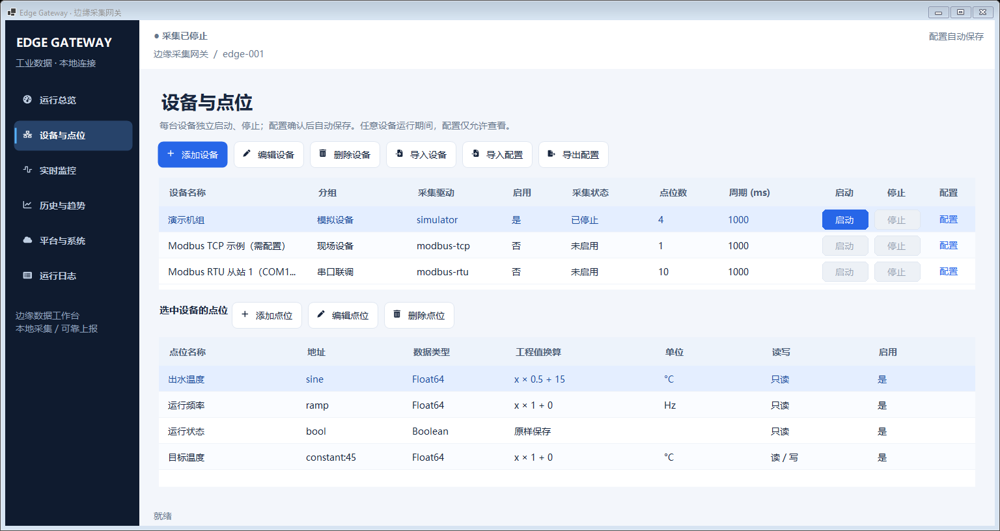
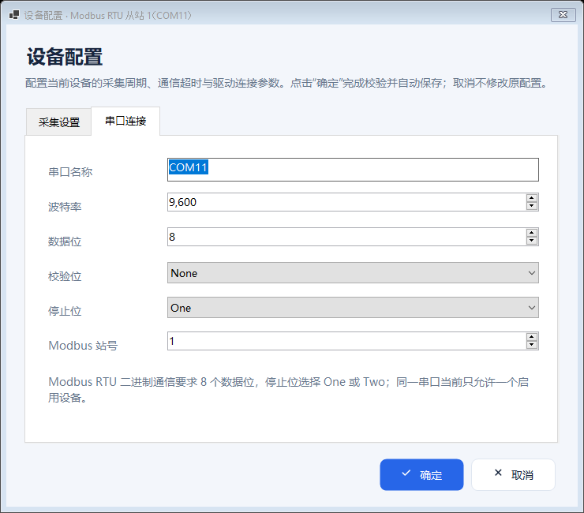

# 单设备启停与配置自动保存

> 本页操作说明已同步运行中配置行为，完整事务和失败语义见 [运行中配置与数据闭环](live-configuration.md)。后半部分截图、测试数量和运行包仍对应各自历史提交，不作为本轮新功能的验收结论。

“设备与点位”中的每台设备分别提供运行状态、“启动”“停止”和“配置”。顶部仅保留采集汇总与配置状态，移除全局“启动采集”“停止采集”和“保存配置”按钮。

## 每台设备独立启停

1. 在“设备与点位”找到目标设备，确认“启用”为“是”。未启用时点击该行“配置”、双击普通数据列，或选中设备后点击工具栏“编辑设备”，均打开同一个配置窗，其他设备可以继续采集。在默认的“采集设置”页勾选首行“启用设备”，点击“确定”自动保存。
2. 点击该设备行的“启动”。只有这一台设备建立采集会话；其他设备保持各自状态。
3. 在本行状态、“实时监控”或“运行日志”查看连接与采集结果。
4. 点击同一行的“停止”。程序取消并等待这台设备的采集与写入，再释放其驱动；其他已启动设备继续工作。

| 项目 | 行为 |
|---|---|
| 启用 | 在统一配置窗的“采集设置”首行设置，保存后决定是否允许启动及自动启动范围；勾选本身不会开始采集 |
| 启动 | 仅启动该行设备；未启用或已有活跃会话时不可重复启动 |
| 停止 | 仅停止该行会话；不取消设备的“启用”配置 |
| 连接中 / 重连中 | 仍属于已启动的会话，可通过该行“停止”取消 |
| 配置 | 运行期间仍可编辑；完整校验及保存后，仅重启有变更的运行目标，停止目标仍保持停止 |
| 手动写入 | 目标设备必须正在运行，且目标点位启用、允许写入；其他设备运行不能使已停止设备获得写权限 |

共享历史存储与 MQTT 任务在第一台设备启动时建立，停止中间某台设备不会中断这些共享任务。最后一台停止时，程序处理已接收的历史缓冲并关闭共享任务，未确认的 MQTT 消息仍保留在 outbox。

同步厂商调用未在关闭宽限内退出时，仍沿用隔离线程和设备租约保护，待原调用退出后清理；取消采集不等于强制终止本机库调用。

“平台与系统”的自动启动设置仍然有效：启动程序后自动启动全部已启用设备。默认配置未开启自动启动。关闭程序会等待全部运行设备停止；当前产品仍是桌面程序，不是 Windows Service。

## 配置何时保存

添加设备、编辑设备、行内“配置”和普通数据列双击共用同一个 `DeviceConfigurationDialog`。弹窗默认打开“采集设置”，首行“启用设备”复选框读取并提交设备的 `Enabled`，下方统一提供名称、分组、驱动选择、采集周期与通信超时；驱动参数在对应页中配置。行内操作按被点击行的设备 ID 定位，“启动”“停止”“配置”等操作列不走双击配置入口，避免额外弹窗。其他设备运行时，仍可新增、编辑、删除及追加导入设备或点位。

新建设备在确认时生成所选驱动的默认点位，保存后保持停止；编辑已有设备保留设备 ID 与已有点位，切换驱动不自动转换点位，仍需完整校验。同一弹窗中来回切换驱动会保留各自参数草稿。字段来源见 [设备配置](device-configuration.md)，此前窗体合并过程见 [历史合并说明](device-configuration-unification.md)。

设备、点位和导入操作使用同一个提交流程：构造独立候选配置 → 生命周期锁内校验完整配置 → 原子保存 → 同步受影响设备会话 → 更新当前配置与界面。设备、点位和点位导入弹窗等待完整流程成功后才关闭，失败时保留输入。成功保存保留上一版 `gateway.json.bak`，无需额外点击保存按钮。

| 操作 | 提交时机 |
|---|---|
| 添加 / 编辑设备 | 统一配置窗点击“确定”后；仅新建模式生成对应驱动的默认点位 |
| 设备行“配置” / 普通数据列双击 | 同一个统一配置窗点击“确定”后 |
| 添加 / 编辑点位 | 点位编辑器点击“确定”后 |
| 删除设备 / 点位 | 确认删除后 |
| 导入设备 | 读取文件、构造完整合并配置并校验后，仅追加设备 |
| 导入点位 | 预览完整候选并确认后，追加或按名称更新，不删除文件未列出的原点位 |
| 导入配置 | 全部设备停止并确认整份替换后，校验并保存文件中的网关、MQTT 和设备配置 |

取消对话框不会修改原对象，包括尚未确认的启用或停用操作。参数无效、重复标识、串口冲突或文件写入失败时，原配置、启用状态及运行会话保持不变，弹窗显示失败原因并保留输入供修改重试。启用设备也经过完整配置校验，不会绕过同串口启用设备冲突等检查。首次直接启动默认设备前也会保存配置，避免默认设备与点位的 ID 在重启后变化。

运行设备的配置或点位发生变化时，保存后仅重启该设备；禁用或删除则只停止该设备。其他设备的连接、最新数据和共享任务保留。新设备与原本停止的设备不会因保存而启动。保存完成后的连接失败通过采集状态、错误和退避重连显示，不自动回滚已经保存的配置；具体结果集合和取消边界见 [保存与运行时应用](live-configuration.md#保存与运行时应用)。

## 平台与系统设置

平台输入先保留在页面草稿中，避免在输入主机、主题或网关名称的中间状态立即改变生效配置。

- **应用设置**：全部设备停止后，对完整候选配置校验并保存，成功后应用本页网关、历史和 MQTT 设置。
- **重置修改**：可以在采集期间恢复最近一次已保存的值；平台输入也可随时编辑。
- 有未应用的平台输入时，仍可按已保存的平台设置启动设备，草稿不参与当前采集和上报。
- 普通设备、点位保存与“导入设备”保留未应用的平台输入；应用平台时从最新配置开始，仅覆盖全局与 MQTT 字段，不覆盖后来新增的设备。
- “导入配置”要求全部设备停止后整份替换，确认并保存成功后也更新平台输入。

变更 MQTT 连接目标时，如果已有待发送消息，仍需确认是否让这些消息使用新连接发送；拒绝确认时保留原配置。该提示与移除顶部保存按钮无关，避免在变更目标时误发积压消息。

## 现有配置与 RTU 示例

配置格式仍为 schema 2；已有设备、点位 ID、地址与驱动参数保留。新增可选上传字段缺省为 true，旧文件保持原上传行为。默认 RTU 示例仍为未启用的 COM11 / 从站 1 / 9600 / 8N1，启用后点击其所在行“启动”。完整步骤见 [COM11 Modbus RTU 示例](modbus-rtu-com11.md)。

所有迁移驱动的专用字段继续按元数据生成，参见 [设备行内配置](device-configuration.md)。单设备启停不改变串口独占校验：两个启用设备不能同时配置同一串口；当前未提供共享串行总线调度。

## 此前版本实际截图

以下图片来自恢复“启用设备”选项及合并设备窗体之前的 Windows Server 2022 原生 WinForms 检查，实际 DPI 为 96，图像未修改。设备页使用默认配置、全部设备停止，窗口为 1536×816 的等效工作区；RTU 弹框展示 COM11 / 从站 1 / 9600 / 8N1 示例。这些旧图不展示本轮统一配置窗的完整字段或默认打开的“采集设置”页。



下图展示此前版本的 RTU 串口页，当时仅行内配置与双击共用该弹框。当前版本的添加、编辑、配置及双击已统一到同一个窗体，均提供启用、名称、分组、驱动选择和采集参数。



## 此前版本验证与运行包

以下结果与运行包对应恢复“启用设备”选项及合并设备窗体之前的版本，不代表本轮变更已通过验证。程序源码提交 [`e5f55a8`](https://github.com/kingtentx/edge-gateway/commit/e5f55a866d10f0adfc2daf48f2665a7d9d6f1dfc) 的 [Windows CI 39908629770](https://github.com/kingtentx/edge-gateway/actions/runs/39908629770) 首次执行全部通过。机器可读证据见 [该版本验证记录](device-control-autosave-verification.json)。本页保留执行结果，不改变运行包的程序源码。

| 检查 | Windows Server 2022 | Windows Server 2025 |
|---|---|---|
| 干净 Release 构建 | 通过，0 错误 | 通过，0 错误 |
| 自动测试 | 107 / 107，0 失败、0 跳过 | 107 / 107，0 失败、0 跳过 |
| 配置链接 / 数据行双击 | 同一弹框，按被点击行 ID 操作，自动保存通过 | 同左 |
| 独立启停与自动保存检查 | 通过 | 通过 |
| 驱动专用配置弹框 | 15 / 15 | 15 / 15 |
| 等效工作区布局 | 20 / 20 | 20 / 20 |
| 实际 DeviceDpi / 原生窗口 DPI | 96 / 96 | 96 / 96 |
| 真实程序截图 | 97 张 | 97 张 |
| 错误输出 / 失败截图 | 0 字节 / 0 张 | 0 字节 / 0 张 |

两套干净构建各保留 419 个迁入源码警告，类别与 [驱动迁移基线记录](verification.md#保留源码的编译警告) 一致；没有为消除这些警告改动厂商 ABI 或全局屏蔽。

界面检查实际打开两个入口，先选中 A、再操作 B，核对同一个专用弹框及 B 的参数保存。独立启停使用两台本地模拟设备，验证停止 B 后 A 继续采样、B 的旧值变为不确定且写入按钮禁用。自动保存检查使用真实文件排他锁制造保存失败，并核对原配置和磁盘内容不变；还覆盖校验失败、平台草稿保持和应用时不覆盖之后的设备修改。全过程不连接现场设备，模拟采集结束后执行布局矩阵。

- [下载 Windows x64 自包含运行包](https://github.com/kingtentx/edge-gateway/actions/runs/39908629770/artifacts/12481628960)：解出 artifact 内的 `EdgeGateway-win-x64.zip`，完整解压后运行 `EdgeGateway.WinForms.exe`。
- [Server 2022 完整证据](https://github.com/kingtentx/edge-gateway/actions/runs/39908629770/artifacts/12482151823) · [Server 2025 完整证据](https://github.com/kingtentx/edge-gateway/actions/runs/39908629770/artifacts/12481797133)：包含 TRX、标准输出、实际截图及完整布局 JSON。

运行包已核对内外层 ZIP CRC、592 个条目、23 个项目及驱动依赖程序集（含全部 12 个迁移驱动）、Windows Desktop 运行时、COM11 示例、操作说明和开发 Skill。应用 ZIP 为 78,938,628 字节，SHA-256：

```text
9141caad243859ca465aa6091f035761bb2de5347dcb1f1c0cf867a7f651a214
```

包内文档反映该代码提交时的状态，该版本验证结果以本节与上述 CI 为准。两套 CI 的实际屏幕均为 1024×768；矩阵按不同名义分辨率/缩放调整窗口，实际 DPI 始终为 96。真实 Windows 缩放切换、多显示器往返、用户 COM10 ↔ COM11 虚拟串口及现场设备通信仍需在对应环境验收。

## 验证边界

历史配置窗合并版本的四入口、启用回显、保存及设备行同步、取消隔离、驱动草稿、默认点位、已有 ID 与点位保留、失败无修改、当时的运行时只读及小工作区检查，已在源码 `6419274` 的两套 Windows CI 上通过。实际执行结果见 [配置窗合并历史验证](device-configuration-unification.md#实际执行结果)，与上节历史验证分别记录。该版本的全局只读规则已由当前运行中配置流程替代；本轮结果见 [验收证据入口](live-configuration.md#验收用例与证据)。

此前的 [行内配置验证](device-configuration-verification.json)、[RTU 初始交付验证](modbus-rtu-com11-verification.json) 和上节的单设备启停验证对应各自历史提交。运行包与最新验证入口见 [README](../README.md)。

等效工作区布局验证与真实多 DPI、多显示器切换分别记录。自动测试和界面截图不能替代用户虚拟串口、真实 PLC 或现场 MQTT 的通信验收。
