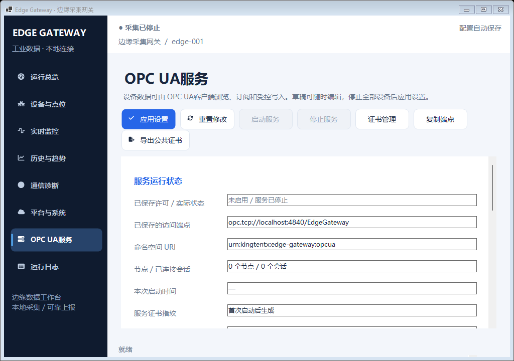
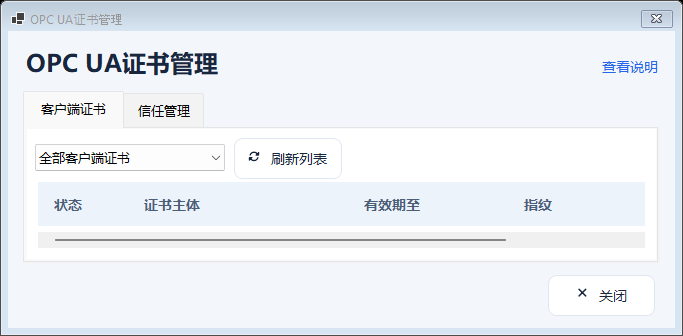

# Kepware 核心能力与 OPC UA 本轮验收记录

本记录对应 2026-10-23 的六项差距补齐、通道与扫描策略、OPC UA 对外服务，以及相关 WinForms 操作和 DPI 布局验证。它区分源码实现、核心测试、Windows 原生运行、发布包复核与现场验收，不以其中一项代替另一项。

**当前状态：源码 `b5ac830…` 在 Windows CI `39972261116` 的 Windows 2022、Windows 2025 两个作业均成功，两个验证产物已下载并通过完整性及严格证据校验。两边各自通过 330/330 核心测试（含 11 项 UA TCP 测试）、20/20 等效布局、8 个页面、6 类弹窗和 143 张 PNG 检查；实际窗口与原生 DPI 均为 96，焦点恢复次数为 0。Windows x64 自包含发布包也已完成完整性、依赖及来源核验，见第 7 节。** 上一版 `15049db…` 的 Windows 2025 成功与 Windows 2022 两次焦点失败均保留为历史；本轮增加诊断后通过，不代表旧焦点失败根因已经确认或修复。

完整的来源、计数、产物哈希、失败历史和诊断统计同时保存在[机器可读验收证据](kepware-opcua-verification.json)中。

## 1. 源码与证据基线

| 项目 | 基线与状态 |
| --- | --- |
| 功能实现提交 | [`1e97946ca7afb05509dfc1caf8cb6502ad7ec934`](https://github.com/kingtentx/edge-gateway/commit/1e97946ca7afb05509dfc1caf8cb6502ad7ec934)：六项能力、通道与扫描、真实 OPC UA 服务、证书 SAN 修复及相关验证代码 |
| 写入结果修复 | [`170c8c221e41605048d85106b0024dfe8ed31fa3`](https://github.com/kingtentx/edge-gateway/commit/170c8c221e41605048d85106b0024dfe8ed31fa3)：修复确认值依赖已释放文本框的问题，保留原断言并增加模态回读验证；不是本轮最终候选 |
| 导航宽度修复 | [`4e5396a1224a19ae1008f138eccbc538a52834bd`](https://github.com/kingtentx/edge-gateway/commit/4e5396a1224a19ae1008f138eccbc538a52834bd)：按按钮实际首选宽度、边距及当前 DPI 滚动条计算导航列宽下限 |
| 静态 UA 表单修复及已测试历史基线 | [`15049dbc449321c080c3681fdcda5d8f23419879`](https://github.com/kingtentx/edge-gateway/commit/15049dbc449321c080c3681fdcda5d8f23419879)：在上述提交上将静态 UA 表单改为普通滚动 Panel，消除嵌套焦点容器引起的外层滚动覆盖；2025 已完整通过，2022 焦点验收未完成 |
| 当前验收源码 | [`b5ac830cf55483f6b28f65918403b235799772b4`](https://github.com/kingtentx/edge-gateway/commit/b5ac830cf55483f6b28f65918403b235799772b4)，tree `a9fdede3d158de439726068b1b9611421d9b55fe`：增加矩阵期间的原生窗口诊断，并修正 UA 首次连接、启用、证书信任和密码进程环境说明；两个 Windows 作业均已成功并核验验证产物 |
| 首轮 Windows CI | [运行 39964905796](https://github.com/kingtentx/edge-gateway/actions/runs/39964905796)，源码为 `1e97946…`；两个系统均在界面烟测失败，不能作为本轮发布通过依据 |
| 第二轮 Windows CI | [运行 39966318400](https://github.com/kingtentx/edge-gateway/actions/runs/39966318400)，源码为 `170c8c2…`；两个系统均因导航宽度不足在布局矩阵失败 |
| 第三轮 Windows CI | [运行 39967621326](https://github.com/kingtentx/edge-gateway/actions/runs/39967621326)，源码为 `4e5396a…`；两个系统均因小工作区 UA 字段裁剪在布局矩阵失败 |
| 静态表单修复后 Windows CI | [运行 39968790193](https://github.com/kingtentx/edge-gateway/actions/runs/39968790193)，源码为 `15049db…`；2025 第一次执行已全通过并核验产物，2022 两次执行均在工具栏焦点检查失败 |
| 本轮通过的 Windows CI | [运行 39972261116](https://github.com/kingtentx/edge-gateway/actions/runs/39972261116)，源码为 `b5ac830…`，attempt 1；[2022 job 120477725506](https://github.com/kingtentx/edge-gateway/actions/runs/39972261116/job/120477725506) 与 [2025 job 120477724854](https://github.com/kingtentx/edge-gateway/actions/runs/39972261116/job/120477724854) 均成功，结果独立取自本轮产物 |
| 工作流和门禁 | [Windows 构建工作流](../.github/workflows/build.yml)、[原生窗体烟测及证据校验](../scripts/smoke-test-winforms.ps1)、[Windows x64 发布脚本](../scripts/publish-win-x64.ps1) |
| 能力定义 | [Kepware 核心能力说明](kepware-core-capabilities.md)、[OPC UA 服务说明](opc-ua-server.md)、[平台协议与 RPC](platform-protocols.md) |

最终验收文档可能由后续仅文档提交补充。判断二进制来源时，以发布包 `build-info.json` 中的 `sourceCommit`、`workflowRunId` 和对应 CI 产物为准；不要把文档提交 SHA 当作已经重新构建过的程序提交。

## 2. 已执行的本地验证

| 验证 | 实际结果 | 适用范围 |
| --- | --- | --- |
| 功能实现的最终 Release 构建 | 成功，0 个警告、0 个错误 | `1e97946…` 对应功能代码；这是该次构建日志结果，不表示从干净目录编译所有迁移源码均无警告 |
| 全套核心测试 | **330/330 通过，0 失败、0 跳过** | 包含配置事务、驱动故障、采集策略、真实网络回环、平台与 RPC，以及 11 项 OPC UA 集成测试 |
| OPC UA 实际 TCP 集成测试 | **11/11 通过，0 失败、0 跳过** | 使用官方客户端、隔离 PKI、加密回环连接与确定性采集驱动；不是现场 PLC 或商业客户端联调 |
| 写入弹窗快照修复的 Release 构建 | 成功，0 个错误；记录了 419 个继承上游源码的警告 | `170c8c2…` 修复代码；未把前一轮的 0 警告套用到本次构建 |
| 导航宽度修复的 Release 构建 | 成功，419 个继承上游源码的警告、0 个错误；耗时 2 分 50.49 秒 | `4e5396a…` 修复代码；没有改写成无警告构建 |
| 静态 UA 表单修复的 UI 项目构建 | 成功，0 个警告、0 个错误；耗时 1 分 8.25 秒 | `15049db…`，使用 `BuildProjectReferences=false`，引用依赖此前已编译；这是 UI 单项目验证，不是干净的全方案构建 |
| 原生焦点诊断候选的 UI 项目构建 | 成功，0 个警告、0 个错误；耗时 28.01 秒 | `b5ac830…`，使用 `BuildProjectReferences=false`；引用既有依赖，这是 UI 单项目构建，不是干净的全方案构建或 Windows 运行验收 |
| Windows 原生运行 | `b5ac830…` 的 2022、2025 两个作业均完整通过；完整构建各记录 419 个上游警告、0 个错误 | 结果来自本轮 Windows 产物；保留此前失败记录，详见第 5、6 节 |

全套本地测试的原始文件为 `capabilities-opcua.trx`。已直接读取其 `Counters`：`total=330`、`executed=330`、`passed=330`、`failed=0`、`notExecuted=0`；11 条 `EdgeGateway.Tests.Integration.OpcUaServerTests` 记录均为 `Passed`。文件 SHA-256 为：

```text
7e5c204f8db51fa798222875ce9371b98b9ceb69dd21cb4382baf3d6d0c47752
```

此摘要用于保留本地验证依据。修复后提交的 Windows 测试数量与结论独立取自下载的 CI TRX，详见第 6 节，不是复制本地计数。

## 3. 六项差距与核心采集能力

下表记录已落地的功能和测试入口。相关核心测试包含在上述 330 项通过记录中；Windows 界面操作的实际结果与执行范围见第 6 节。

| 原差距 | 本轮实现 | 证据入口与边界 |
| --- | --- | --- |
| 停止设备的连接诊断、单点读取 | 停止时创建短生命周期真实驱动，连接、读取并释放；运行时复用设备会话及锁。返回操作编号、原值、工程值、质量、时间和错误 | [操作服务](../src/EdgeGateway.Service/GatewayRuntime.Operations.cs)、[操作测试](../tests/EdgeGateway.Tests/RuntimeStorage/DeviceOperationTests.cs)。无启用点位时只能确认连接并返回 Uncertain，不能冒充读点成功 |
| 分组、搜索、设备复制 | 通道/分组筛选与设备、驱动、点位名、地址搜索；深拷贝设备参数和完整点表，设备及点位使用新 ID，副本默认禁用且不自动启动 | [设备管理界面](../src/EdgeGateway.WinForms/MainForm.DeviceManagement.cs)、[完整功能烟测](../src/EdgeGateway.WinForms/MainForm.CapabilitiesSmoke.cs)。不包含分组树或分组级扫描周期 |
| 写入后主动核对 | 一次物理写入后，在同一设备与通道租约内有界读回；分别报告 Submitted、Matched、Mismatched、TimedOut、Failed、Cancelled；整数精确比较，浮点使用实际线类型和显式容差 | [操作服务](../src/EdgeGateway.Service/GatewayRuntime.Operations.cs)、[操作测试](../tests/EdgeGateway.Tests/RuntimeStorage/DeviceOperationTests.cs)。失败不自动重复写；取消或超时不证明现场没有执行 |
| 点位计算表达式 | 倍率/偏移后的 `x` 输入受限 decimal 表达式；预览和采集使用同一解析器；非法计算产生明确错误或 Bad 质量 | [计算器](../src/EdgeGateway.Service/NumericExpression.cs)、[表达式测试](../tests/EdgeGateway.Tests/RuntimeStorage/ExpressionTests.cs)。表达式点只读，不执行任意脚本，不支持跨点依赖或自动反向求解 |
| 变化上报、死区与心跳 | 周期、变化、变化加心跳三种模式；按最后成功持久化快照计算工程量死区；质量变化独立触发；重启重发初值，心跳保留原采样时间 | [上报规划](../src/EdgeGateway.Service/TelemetryReportPlanner.cs)、[采集策略测试](../tests/EdgeGateway.Tests/RuntimeStorage/AcquisitionPoliciesTests.cs)、[遥测链路测试](../tests/EdgeGateway.Tests/RuntimeStorage/TelemetryPipelineTests.cs)。不是对检查周期内每次中间变化逐条补报的事件流 |
| 平台适配与远程读写 | Generic、ThingsBoard、ThingsCloud、ThingsPanel、IoTSharp 各自主题与报文；实际 RPC 订阅/回应；默认关闭远程写；SQLite 写前占位、重复结果重放和未决结果保护 | [平台适配器](../src/EdgeGateway.Service/PlatformMqttAdapter.cs)、[RPC 运行时](../src/EdgeGateway.Service/GatewayRuntime.Rpc.cs)、[平台测试](../tests/EdgeGateway.Tests/RuntimeStorage/PlatformAdapterTests.cs)、[RPC 测试](../tests/EdgeGateway.Tests/RuntimeStorage/RpcRuntimeTests.cs)、[真实 MQTT 回环](../tests/EdgeGateway.Tests/Integration/MqttRpcTransportTests.cs)。PUBACK 或平台回应不等于最终业务入库；真实租户认证及落库仍待现场确认 |

同时完成通道调度、设备/点位扫描模式、故障降速和通信批次统计。采集、诊断和写入按“设备锁 → 通道锁”进入通信；同通道串行，不同通道可并行，通道间隔从上一批完成后计算。通道是调度域，驱动仍各自拥有连接，不能据此声称已支持共享串口多从站。[调度实现](../src/EdgeGateway.Service/GatewayRuntime.Scheduling.cs)与[采集策略测试](../tests/EdgeGateway.Tests/RuntimeStorage/AcquisitionPoliciesTests.cs)覆盖对应行为。

点位 CSV 扩展为 20 列并兼容旧 17 列，保留更新时稳定 ID 与整批失败语义；新增列为 `Expression`、`ScanIntervalMs`、`Deadband`。具体边界由 [CSV 测试](../tests/EdgeGateway.Tests/RuntimeStorage/TagCsvExchangeTests.cs)和[功能说明](kepware-core-capabilities.md)约束。

## 4. OPC UA 对外访问闭环

北向 [EdgeGateway.OpcUa](../src/EdgeGateway.OpcUa/EdgeGateway.OpcUa.csproj) 使用官方 SDK `1.5.378.182`，提供真实 UA TCP 发现、浏览、读取、订阅与受控写入，独立于迁移的南向 `OPC.UaClient` 驱动。它消费运行时当前采样和真实源时间戳，不额外创建一套设备采集连接。节点由设备/点位 Guid 生成，重命名保留身份，保存配置后热更新地址空间。[服务实现](../src/EdgeGateway.OpcUa/GatewayOpcUaServer.cs)、[节点管理](../src/EdgeGateway.OpcUa/GatewayNodeManager.cs)、[类型映射](../src/EdgeGateway.OpcUa/GatewayUaValueCodec.cs)。

数据会话仅开放 Basic256Sha256 / SignAndEncrypt；标准发现操作可能使用未加密发现通道，不能将其描述为所有网络通信均加密。客户端应用证书与服务器应用证书需要双向建立明确的信任。匿名会话始终只读；用户名写入还需全局许可、点位可写、有效运行设备及取得锁后的权限复核，写入成功以实际主动读回为依据，不把请求值直接填成 Good。[安全与操作说明](opc-ua-server.md)。

WinForms 提供独立 UA 草稿、应用/重置、服务启停、实际状态、端点复制、公共证书导出和客户端信任管理。停止 UA 不停止设备，设备停止也不自动关闭 UA；端口、证书或密码环境变量错误必须可见。证书信任、撤销和重建均显示具体对象及影响；重建服务端证书保留客户端信任列表和采集会话，客户端需要重新信任新服务端证书。[UA 页面](../src/EdgeGateway.WinForms/MainForm.OpcUa.cs)、[证书窗口](../src/EdgeGateway.WinForms/OpcUaCertificatesDialog.cs)、[真实操作烟测](../src/EdgeGateway.WinForms/MainForm.OpcUaSmoke.cs)。

### 已通过的 11 项真实协议测试

以下名称均来自本地 TRX，与 [OpcUaServerTests.cs](../tests/EdgeGateway.Tests/Integration/OpcUaServerTests.cs) 对应。本地结果列只表示第 2 节记录的那次执行。

| 测试方法 | 核对行为 | 本地结果 |
| --- | --- | --- |
| `SecureClientBrowsesReadsExactTypesAndReceivesRealSubscriptions` | 安全端点、浏览、精确类型、真实读取和订阅 | Passed |
| `AuthenticatedWriteIsExplicitlyDisabledByDefaultAndAnonymousNeverWrites` | 默认拒绝远程写、匿名始终拒绝、授权写入核对 | Passed |
| `BadPasswordAndUntrustedApplicationCertificatesCannotOpenSessions` | 错误密码和不可信应用证书拒绝 | Passed |
| `ReadbackMismatchCannotReturnGoodOrInventTheRequestedValue` | 不匹配时不得假报写入 Good 或伪造请求值 | Passed |
| `LaterLocalSubmissionAndDeviceRestartCannotExposeAnOldVerifiedGoodValue` | 后续本地写入、停止及重启不能被旧核对值覆盖 | Passed |
| `FaultAndStoppedValuesAreBadAndEndpointRemainsAvailable` | 设备故障/停止质量与 UA 独立运行 | Passed |
| `HotAddRenameAndDeleteKeepTheSameUaSessionAndStableNodeIdentifiers` | 同会话热增删/重命名、稳定身份和删除通知 | Passed |
| `UaCancelWhileWaitingForTheDeviceLockCancelsEveryPendingWriteWithoutSubmission` | 真实 UA Cancel 取消排队批量写，后续点不下发 | Passed |
| `ManualStopPersistsAcrossDeviceEditsAndReleasesTheListeningPort` | 手动停止保持、设备编辑不复活服务、监听端口释放 | Passed |
| `CertificateManagementUsesExactPublicTrustAndRegenerationPreservesAcquisition` | 精确信任、公共导出、撤销与重建，采集会话保持 | Passed |
| `EndpointHostChangeRequiresExplicitNewCertificateAndDisabledServerDoesNotStart` | 主机名变更要求显式新证书，禁用服务不监听 | Passed |

## 5. 实际失败、修复与重测要求

### 5.1 首轮 UA 主机名校验失败

第一次真实 TCP 测试的 11 项中有 9 项失败，共同错误为 `The domain '127.0.0.1' is not listed in the server certificate.`。这次失败保留为验证过程的一部分，不能将最初执行写成通过。

对照官方 SDK `1.5.378.182` 源码后确认：默认服务端证书生成使用端点域名列表，而客户端对 `localhost`、`127.0.0.1`、`::1` 的域名匹配会归一化为本机主机名/FQDN。仅有回环 IP 的 SAN 可能因此不满足客户端实际匹配名称。相关官方实现为 [ApplicationInstance](https://github.com/OPCFoundation/UA-.NETStandard/blob/1.5.378.182/Libraries/Opc.Ua.Configuration/ApplicationInstance.cs) 与 [CertificateValidator](https://github.com/OPCFoundation/UA-.NETStandard/blob/1.5.378.182/Stack/Opc.Ua.Core/Security/Certificates/CertificateValidator.cs)。

修复通过官方 `CertificateFactory` 在首次生成和明确重建时加入实际端点 DNS/IP、本机主机名与 FQDN，并继续执行正常 SDK 证书检查。客户端 `checkDomain=true` 保留，没有使用 AcceptAll、无加密数据端点或关闭主机名校验。已有证书不静默替换；用户改变端点名称后仍需明确重建并更新客户端信任。[证书实现](../src/EdgeGateway.OpcUa/GatewayOpcUaServer.Certificates.cs)。修复后的本地 11 项 UA 测试及全套 330 项已通过，见第 2、4 节。

### 5.2 首轮 Windows 写入弹窗回读失败

[运行 39964905796](https://github.com/kingtentx/edge-gateway/actions/runs/39964905796) 的 `windows-2022` 与 `windows-2025` 均完成 330/330 核心测试，随后在原生界面烟测中出现同一错误：

```text
Capabilities smoke: write verification dialog did not preserve the operator's options.
```

失败点是 `SmokeCapabilityWriteOptions` 在非模态 `Show`、确认按钮和 `Close` 之后读取结果。该轮未完成完整功能烟测、后续 UA 操作烟测及布局矩阵，不能从已经生成的部分截图推断这些阶段通过，也不能给它补填 143 张截图或 20 个组合的成功记录。

原 `WriteValueDialog.Value` 直接读取文本框 `Text`。官方 [Form.Close 文档](https://learn.microsoft.com/en-us/dotnet/api/system.windows.forms.form.close?view=windowsdesktop-8.0)说明普通关闭会释放窗体资源，模态 `ShowDialog` 属于例外。进一步核对 .NET 8 [Form.cs](https://github.com/dotnet/winforms/blob/v8.0.0/src/System.Windows.Forms/src/System/Windows/Forms/Form.cs) 和 [Control.cs](https://github.com/dotnet/winforms/blob/v8.0.0/src/System.Windows.Forms/src/System/Windows/Forms/Control.cs)：非模态关闭进入 Dispose；层级处于释放状态时，销毁句柄不再保存当前原生文本，随后读取可能回到旧托管缓存。因此确认后的业务结果不能继续依赖文本框句柄生命周期。旧失败日志未逐项打印实际值，本记录不把具体回退文本声称为当时已经输出的日志。

修复提交 `170c8c2…` 在原有空值及容差校验成功后、关闭前保存独立确认值快照。数值 Trim、字符串前后空白和空字符串语义保持；原容差规则与写权限不变。验证仍保留 `OK`、`42.5`、启用核对、`4000 ms`、绝对容差 `0.01`、相对容差 `0.001` 的所有期望，并执行：

1. 原非模态确认、关闭与释放后回读，增加确实 `IsDisposed` 的断言。
2. 真实 `ShowDialog(this)`，在模态循环返回后检查相同结果，与生产调用顺序一致。
3. 原输入框及按钮焦点、滚动可达性断言，并在失败时打印结果值、各核对选项和窗口状态。

对应代码为 [WriteValueDialog](../src/EdgeGateway.WinForms/Editors.cs) 与[完整功能烟测](../src/EdgeGateway.WinForms/MainForm.CapabilitiesSmoke.cs)。第二轮 Windows 已通过该功能烟测；后续布局失败另行记录，不能把阶段通过扩展为整轮成功。

### 5.3 第二轮 Windows 导航文字截断

[运行 39966318400](https://github.com/kingtentx/edge-gateway/actions/runs/39966318400) 的两个 Windows 作业再次完成 330/330 核心测试；构建均记录 419 个警告、0 个错误。原生程序通过完整功能与 OPC UA 服务操作烟测后，在 `1366x768-150pct` 的导航检查失败：`OPC UA服务` 按钮实际为 133×48，而无截断首选尺寸为 140×48。两个系统出现相同断言，没有放宽为允许省略文字。

已下载的 2022 产物中，stdout 明确包含 `Completed capabilities smoke passed` 与 `OPC UA service UI smoke passed`。布局报告记录 `expectedCases=20`、`executedCases=3`、`passedCases=2`，前两个 100%/125% 等效视口通过；实际窗口及原生 DPI 均为 96，焦点恢复次数为 0。失败截图显示侧栏垂直滚动条已经出现，菜单实际绘制成 `OPC UA服…`。这些是第二轮的阶段性结果，不是第三轮结果，也不是 20 组合全通过。

原因是紧凑导航列固定为 172 个逻辑像素：本次 96 DPI 下，扣除侧栏左右内边距 22 和垂直滚动条 17 后只剩 133，少于新菜单所需的 140。修复提交 `4e5396a…` 仅调整 [MainForm 的导航布局](../src/EdgeGateway.WinForms/MainForm.cs)：以所有按钮实际 `GetPreferredSize` 最大宽度、按钮/侧栏/视口边距和当前控件 DPI 的滚动条宽度计算下限，再与原 172/206 的缩放布局宽度取最大。本次对应下限为 `140 + 22 + 17 = 179`。

滚动条始终预留，避免显隐时列宽来回变化；已完成自动缩放的首选尺寸和边距不再重复缩放，现有 DPI 事务门控与完成后重排保留。系统指标使用 .NET 8 官方公开方法 [`SystemInformation.GetVerticalScrollBarWidthForDpi`](https://github.com/dotnet/winforms/blob/v8.0.32/src/System.Windows.Forms/src/System/Windows/Forms/SystemInformation.cs)。菜单名称、字体、焦点和文字完整性断言全部保持。第三轮实际越过原导航失败组合，随后发现的 UA 字段裁剪单独记录如下。

### 5.4 第三轮 Windows UA 字段裁剪

[运行 39967621326](https://github.com/kingtentx/edge-gateway/actions/runs/39967621326) 的两个 Windows 作业均完成 330/330 核心测试，构建记录 419 个警告、0 个错误。完整功能与 UA 服务操作烟测通过，布局在 `1366x768-175pct` 检查 `OpcUaField_enabled` 时失败。两系统坐标相同：复选框为 `X=416, Y=338, Width=90, Height=32`，外层 `PageViewport` 为 `X=190, Y=137, Width=563, Height=213`；字段底部 370 超出外层视口底部 350。

2022 的下载报告为 `expectedCases=20`、`executedCases=4`、`passedCases=3`，实际窗口与原生 DPI 均为 96，焦点恢复次数为 0。截图中可以看到表单和整页两条垂直滚动条，复选框被底部裁掉。这不是失焦或名义 DPI 标记导致的误报；导航修复已经让检查到达更小的工作区。

UA 静态表单原先复用了继承 `UserControl` 的 `EditorLayout.FieldViewport`。根据 .NET 8 官方 [ContainerControl 实现](https://github.com/dotnet/winforms/blob/v8.0.32/src/System.Windows.Forms/src/System/Windows/Forms/ContainerControl.cs)，子焦点容器会作为祖先容器的 `ActiveControl`；祖先布局期间又会调用 `ScrollActiveControlIntoView`。因此主窗体最后一次布局以整个 `FieldViewport` 为目标滚动外层页面，可能覆盖此前对实际叶字段的滚动。当该容器高于外层 213 像素视口时，字段仍然可能被裁剪。普通云端设置页使用 Panel，已越过同组合。

修复提交 `15049db…` 只修改 [UA 页面构造](../src/EdgeGateway.WinForms/MainForm.OpcUa.cs)：静态表单使用普通 `AutoScroll Panel` 加 `EditorLayout.Fields(190)`，继承主窗体统一的 DPI 缩放，让祖先焦点和自动滚动直接跟随实际输入字段。保留字段名称、事件、许可状态和原焦点/边界断言；没有改共享布局 helper，也没有更改动态驱动参数所需的独立 DPI 容器。UI 单项目构建通过，第四轮 2022 实际越过 1366×768 的全部五个组合，包括该页 175% 与 200% 等效视口；后续新失败另行记录。

### 5.5 第四轮 2022 工具栏焦点检查未通过

[运行 39968790193 的 2022 作业](https://github.com/kingtentx/edge-gateway/actions/runs/39968790193/job/120465610512) 完成 330/330 核心测试，构建仍为 419 个警告、0 个错误。该次原生运行已通过 1366×768 对应的全部五个等效视口，随后在 `1920x1080-200pct` 的设备页工具栏检查中失败。

这次失败来自焦点断言，不是上一轮的 UA 字段边界裁剪。失败现场记录了托管 `Visible` / `Enabled` 为真、`CanFocus=false`，同时导航 `ContainsFocus=true` 的状态。仅凭这些状态不能确定根因，也不能直接归因 CI 环境；需要继续核对原生窗口、模态关闭和焦点生命周期。当前没有为此改动产品运行行为、强制启用控件或放宽断言。

该失败产物实际记录执行了 10 个组合、通过 9 个。独立只读评审尚未发现已经证实的生产生命周期缺陷，因此没有以猜测更改代码，也不能声称焦点问题根因已修复。

同一源码的 2025 第一次执行已通过全部 20 个组合，详见第 6 节。2022 仅重跑失败作业，第二次执行为 [job 120469650542](https://github.com/kingtentx/edge-gateway/actions/runs/39968790193/job/120469650542)。本次仍完成 330/330 核心测试、419 个警告及 0 个构建错误，但在 `2560x1440-150pct` 设备页工具栏的首个按钮出现相同 `CanFocus=false` 焦点失败。问题发生于不同组合，不能把固定分辨率或一次临时失焦当作已证实根因。

第二次失败 ZIP 已实际下载，SHA-256 与 GitHub 声明值一致，CRC 检查通过。下载产物记录 `expectedCases=20`、`executedCases=13`、`passedCases=12`；核心测试为 330/330、0 失败、0 跳过，11 项 UA 测试均为 `Passed`，功能与 UA 操作完成标记均存在。产物共 114 张 PNG，包含失败截图，不能记为完整成功所需的 143 张。实际环境为 Windows `10.0.20348`、`.NET 8.0.32`、WinForms `8.0.0.0`，屏幕 `(0,0) 1024×768`，工作区 `(0,0) 1024×728`，窗口与原生 DPI 均为 96，`focusRecoveryCount=0`。该工作区与 2025 的 1024×720 分别记录。

两次失败均保留，这两个失败作业没有生成程序发布包，也没有据此声称焦点问题已经修复。后续增加原生窗口诊断并重新执行，结果如下。

### 5.6 原生窗口诊断与第五轮通过

提交 `b5ac830…` 只变更两个烟测诊断文件和 [OPC UA 服务说明](opc-ua-server.md)。[诊断实现](../src/EdgeGateway.WinForms/MainForm.FocusDiagnostics.cs)仅在布局矩阵期间启用：记录主窗体、导航、目标及祖先窗口的原生可见/启用状态、窗口样式、线程焦点和有关窗口消息；在总览截图前后、页面切换、布局及弹窗前后记录快照，焦点失败时保留近期消息。记录采用有上限的 JSONL 和消息队列，结束时释放监听；不修改窗口焦点、启用、显示或重绘状态。

[矩阵接线](../src/EdgeGateway.WinForms/MainForm.DpiSmoke.cs)保留原焦点重试次数、时间限制、可见边界及全部断言。诊断用于区分托管控件状态与原生 HWND 状态，并定位状态在截图、布局或模态生命周期前后的变化；它不是已经确认或修复根因的证据。同期文档补清了首次连接入口、先启用并应用、服务端/客户端证书信任与 CA 配置边界，以及密码环境变量必须进入当前应用进程的说明。

新 CI 为 [运行 39972261116 / attempt 1](https://github.com/kingtentx/edge-gateway/actions/runs/39972261116)：2022 作业 `120477725506`、2025 作业 `120477724854` 均成功。两个验证 ZIP 已实际下载、核对 SHA-256 并通过 CRC 检查，严格校验器确认两边各自 330/330 核心测试、11 项 UA 测试、20/20 布局与 143 张 PNG 均通过；详情见第 6 节。这是新源码独立执行得到的结果，没有继承 `15049db…` 的成功计数。诊断通过只能证明本次执行未复现该失败；没有证据将旧失败根因归于环境或宣称已经完成针对根因的修复。

两份 `focus-native.jsonl` 各记录 181 个检查点，即初始化加 20 个组合各 9 个阶段；主窗体和导航各 181/181 个采样的原生句柄、可见、启用及 `CanFocus` 均正常，设备页显示与布局后的目标状态各 40/40 正常。采样没有观察到 `SysSetRedraw` 非零或原生线程查询错误，焦点失败和恢复记录均为 0，记录数及字节上限均未触发。Windows 2022 / 2025 的消息序列分别到 2395 / 2389，256 条环形队列正常淘汰 2139 / 2133 条；没有失败，所以消息正文 `RecentMessages` 保持空值。由此只能说检查点未观察到关闭重绘，不能声称全过程没有发生 `WM_SETREDRAW`。诊断文件及统计的 SHA-256 见机器可读证据，旧问题根因仍未确认。

### 5.7 失败产物追溯

下表是失败运行的证据归档，不是可交付发布包的校验结果。SHA-256 对应 verification artifact ZIP：五份 2022 失败 ZIP 均已实际下载并复核，第四轮 attempt 2 的 ZIP 也已通过 CRC 检查。前三轮 2025 失败产物采用重新查询确认的 GitHub 声明 digest，不声称已在本地下载校验。历史 2025 成功 ZIP 和本轮两个成功 ZIP 均已下载完整核验，另列于第 6 节；程序发布 ZIP 的哈希在第 7 节单独记录。

| 运行与系统 | verification artifact | SHA-256 |
| --- | --- | --- |
| `39964905796` / 2022 | [12505369238](https://github.com/kingtentx/edge-gateway/actions/runs/39964905796/artifacts/12505369238) | `f1d4816cefe8c9eb6ff6bcfc9d9f96839937c0126e6d04b25d5e19991b8ad73f` |
| `39964905796` / 2025 | [12506467846](https://github.com/kingtentx/edge-gateway/actions/runs/39964905796/artifacts/12506467846) | `7c524d538811e33972104b2b736d71cbb980b39d4843e67229db8a1eb86a975b` |
| `39966318400` / 2022 | [12506329658](https://github.com/kingtentx/edge-gateway/actions/runs/39966318400/artifacts/12506329658) | `3da6224229c76a3bd6f9b4829a065fb320950b7cb77fd1416dde3b5766e021c8` |
| `39966318400` / 2025 | [12507347032](https://github.com/kingtentx/edge-gateway/actions/runs/39966318400/artifacts/12507347032) | `1727976406746af2198ff6f4d08d7fd05b3700bc559def1a4bab1c53f83b8d54` |
| `39967621326` / 2022 | [12507217805](https://github.com/kingtentx/edge-gateway/actions/runs/39967621326/artifacts/12507217805) | `e3f4f67db0c1a27a2e650dbb0e1e113b674a5320e4eb61a35ff1d45c3cd94914` |
| `39967621326` / 2025 | [12507652761](https://github.com/kingtentx/edge-gateway/actions/runs/39967621326/artifacts/12507652761) | `e24b0f430c42d72132758668b208873f3021999cb4b0f408c193c8ee7466db8e` |
| `39968790193` / 2022 / attempt 1 | [12508815425](https://github.com/kingtentx/edge-gateway/actions/runs/39968790193/artifacts/12508815425) | `d23f2df7234303f44b4386f45081d8ce8585b1abd88ec66e9dac86ddc9f91e1d` |
| `39968790193` / 2022 / attempt 2 | [12509051520](https://github.com/kingtentx/edge-gateway/actions/runs/39968790193/artifacts/12509051520)，已下载核验，3,241,666 字节 | `764120d6ea5064e8cb5c623aafcf85dbc79ea2361ea9323161660f7e924ecae9` |

## 6. Windows 原生运行与 DPI 产物核验

### 本轮 `b5ac830…` 的实际通过结果

两个作业均来自运行 `39972261116` 的 **attempt 1**。已分别读取原始测试结果、标准输出/错误日志、布局报告、`ui-smoke-verification.json` 与 PNG，并用严格校验器核对来源、计数、全部预期场景及尺寸。以下为各自产物的实际数据。

| 核验项 | `windows-2022` | `windows-2025` |
| --- | --- | --- |
| 作业 | [120477725506](https://github.com/kingtentx/edge-gateway/actions/runs/39972261116/job/120477725506)，成功 | [120477724854](https://github.com/kingtentx/edge-gateway/actions/runs/39972261116/job/120477724854)，成功 |
| 源码 SHA、运行编号与次数 | `b5ac830…` / `39972261116` / attempt 1 | `b5ac830…` / `39972261116` / attempt 1 |
| 完整 Release 构建 | 419 个继承上游源码的警告、0 个错误 | 419 个继承上游源码的警告、0 个错误 |
| 核心测试总数/通过/失败/跳过 | 330 / 330 / 0 / 0 | 330 / 330 / 0 / 0 |
| 真实 UA TCP 集成测试 | 11 项，全部 Passed | 11 项，全部 Passed |
| 功能、UA 操作及布局完成标记 | 全部 13 个标记存在 | 全部 13 个标记存在 |
| 实际 Windows、.NET 与 WinForms | Windows `10.0.20348`；`.NET 8.0.32`；WinForms `8.0.0.0` | Windows `10.0.26100`；`.NET 8.0.32`；WinForms `8.0.0.0` |
| 实际屏幕范围、工作区 | 屏幕 `(0,0) 1024×768`；工作区 `(0,0) 1024×728` | 屏幕 `(0,0) 1024×768`；工作区 `(0,0) 1024×720` |
| 窗口 `DeviceDpi`、原生 `GetDpiForWindow` | 96 / 96 | 96 / 96 |
| 预期/执行/通过的等效视口组合 | 20 / 20 / 20 | 20 / 20 / 20 |
| 页面与弹窗 | 每组合 8 页、6 类弹窗，最小组合含额外专用配置场景 | 每组合 8 页、6 类弹窗，最小组合含额外专用配置场景 |
| 截图数量与完整性 | 143 张，名称集合、PNG 完整性和对应尺寸通过核验 | 143 张，名称集合、PNG 完整性和对应尺寸通过核验 |
| 每组合 UA / 证书 / 通道 / 写入核对输入指标 | 10 / 7 / 3 / 4，名称、实际 DPI 和尺寸均通过核验 | 10 / 7 / 3 / 4，名称、实际 DPI 和尺寸均通过核验 |
| 焦点恢复、stderr、组合错误字段 | `focusRecoveryCount=0`；stderr 为空；全部组合错误字段为空 | `focusRecoveryCount=0`；stderr 为空；全部组合错误字段为空 |

验证产物和布局报告的哈希分别记录如下；验证 ZIP 与第 7 节程序发布 ZIP 是不同文件。

| 系统 | verification artifact | ZIP 大小 | ZIP SHA-256 |
| --- | --- | --- | --- |
| Windows 2022 | [12509683363](https://github.com/kingtentx/edge-gateway/actions/runs/39972261116/artifacts/12509683363) | 4,018,829 字节 | `6ad16826b1c17fdfe13171d765b50108a3bb96e16400372106fd91851478a987` |
| Windows 2025 | [12509079756](https://github.com/kingtentx/edge-gateway/actions/runs/39972261116/artifacts/12509079756) | 3,882,312 字节 | `e97d8873ddecb6381ff127c0a78d29b987b204cd3979d4e457b1ec55cc81016c` |

`ui-smoke-layout-matrix/layout-matrix.json` 的 SHA-256：

```text
Windows 2022:
a44a9a02fbd50b7f64235a81ccb54478258abc86687ed0f72311ac3dfe2d0d3d

Windows 2025:
88997dded20508e671c50cb7edf6a56bddcea666d66763da6319725073c408e1
```

### 已核验的 `15049db…` 历史结果

本小节的全部数字和产物对应源码 `15049db…`，用于保留前一轮成功与失败的证据；本轮 `b5ac830…` 的通过依据是上一小节独立核验的产物。

已下载并交叉核对运行 `39968790193` 的 2025 原始 TRX、标准输出/错误日志、布局报告、`ui-smoke-verification.json` 和全部 PNG。2022 两次执行均未通过完整界面验收，第二次失败产物已下载并核验；下表保留两次各自的布局数量，环境、控件指标、截图数量和原始测试记录以已核验的第二次产物为准，不把第一次执行的阶段结果代入重跑。

2025 的实际成功执行是 **attempt 1 / [job 120465610734](https://github.com/kingtentx/edge-gateway/actions/runs/39968790193/job/120465610734)**。仅重跑失败作业后，最新作业列表中显示的复用条目 `120469653718` 不代表 2025 又执行了一次；本小节成功记录关联实际第一次执行，第 8 节使用本轮 `b5ac830…` 的新截图。

| 核验项 | `windows-2022` | `windows-2025` |
| --- | --- | --- |
| 作业最终结果、源码 SHA、运行编号 | attempt 1 和 attempt 2 均焦点检查失败；`15049db…` / `39968790193` | attempt 1 完整通过；`15049db…` / `39968790193` |
| Release 构建 | 两次均为 419 个上游警告、0 错误 | 419 个上游警告、0 错误 |
| 核心测试总数/通过/失败/跳过 | 两次均 330/330 通过；第二次完整 TRX 为 330 / 330 / 0 / 0 | 330 / 330 / 0 / 0 |
| 真实 UA 测试数量及结果 | 11 项，全部 Passed | 11 项，全部 Passed |
| 完整功能烟测、UA 服务操作烟测 | 两个完成标记均存在；后续布局仍失败 | 两者均通过，全部 13 个完成标记存在 |
| 实际 Windows 版本、.NET/WinForms 版本 | Windows `10.0.20348`；`.NET 8.0.32`；WinForms `8.0.0.0` | Windows `10.0.26100`；`.NET 8.0.32`；WinForms `8.0.0.0` |
| 实际屏幕范围、工作区、窗口 `DeviceDpi`、原生 `GetDpiForWindow` | 屏幕 `(0,0) 1024×768`；工作区 `(0,0) 1024×728`；窗口/原生 DPI 均为 96 | 屏幕 `(0,0) 1024×768`；工作区 `(0,0) 1024×720`；窗口/原生 DPI 均为 96 |
| 等效工作区组合、页面和弹窗检查结果 | attempt 1 为 9/10 已执行组合通过；attempt 2 为 12/13，预期 20，失败于 `2560x1440-150pct` | 20/20；每组合 8 页、6 类弹窗，最小组合含额外专用配置场景 |
| 截图完整性、数量、PNG 尺寸 | 114 张，包含失败截图；未形成 143 张完整成功证据 | 143 张；名称集合、PNG 文件及对应尺寸已核验 |
| UA 页面/证书窗口控件指标 | 12 个通过组合均为 10 / 7；失败组合在设备工具栏阶段停止，未执行该组合 UA 输入检查 | 每组合分别 10 / 7 个；通道 3、写入核对 4，名称、实际 DPI 与尺寸一致 |
| 焦点恢复记录、stderr、错误字段 | 第二次 `focusRecoveryCount=0`；两次均有设备页工具栏焦点断言错误 | `focusRecoveryCount=0`；stderr 为空；20 个组合错误字段均为空 |

2025 成功产物为 [verification-windows-2025 / artifact 12507694660](https://github.com/kingtentx/edge-gateway/actions/runs/39968790193/artifacts/12507694660)。下载 ZIP 的 SHA-256 与布局报告 SHA-256 分别为：

```text
verification artifact ZIP:
5c7b0a1b1ee3a268a7dd2b7f388b4e7801091ad182281dc1e0ac82d0d317bb26

ui-smoke-layout-matrix/layout-matrix.json:
68b0d68e73d5aa0914ec8c61fa92112d5218c9eef6cf3502bce6ef34493e47cf
```

### 本轮门禁的检查目标

以下数量来自已提交的[矩阵生成器](../src/EdgeGateway.WinForms/MainForm.DpiSmoke.cs)及[统一校验脚本](../scripts/smoke-test-winforms.ps1)，是必须核对的目标，并非执行结论：

| 项目 | 目标及组成 |
| --- | --- |
| 等效视口 | 1366×768、1920×1080、2560×1440、3200×2000 与 100% / 125% / 150% / 175% / 200% 的 20 个组合 |
| 主页面 | 8 页：总览、设备与点位、实时数据、历史趋势、通信诊断、云端设置、OPC UA 服务、日志 |
| 弹窗类型 | 6 类：设备配置、点位编辑、写入、点位导入预览、通道编辑、证书管理；最小组合额外检查专用设备配置场景，不能把该场景重复算作第 7 类窗口 |
| 截图 | 143 张：8 张主页面、15 个驱动各 3 张编辑视图共 45 张、8 张业务场景、20 组各 4 张矩阵图共 80 张、2 张额外场景 |
| 每组合的输入指标 | `opcUaInputMetrics=10`、`certificateInputMetrics=7`、`channelInputMetrics=3`、`writeVerificationMetrics=4`；同时保留既有表头、动态参数和多行写入指标检查 |
| 成功标记 | 完整功能与 UA 服务烟测均须有真实完成标记；核心 TRX 全通过且没有跳过；真实 UA 集成类须存在且全部通过 |
| DPI 一致性 | 每个组合和控件的实际 DPI 必须一致，`DeviceDpi` 必须与 `GetDpiForWindow` 相符；请求窗口范围必须等于实际窗口范围 |

**实际 DPI 与等效视口必须分别报告。** 当前矩阵保留宿主显示器的真实 DPI，通过真实 Win32 窗口调整提供各名义分辨率/缩放对应的逻辑空间，并预留 48 个逻辑像素的任务栏高度。名义 200% 对应的窄视口不代表 Windows 已切换为 192 DPI；这些组合也没有模拟或实测 `WM_DPICHANGED`。

本轮两个 Windows 成功产物已分别读出实际窗口/原生 DPI 均为 96，`viewportSimulation=true`、`nativeWindowResize=true`，各自 20 个组合全部通过。结论是“真实 96 DPI 下的原生窗体及等效空间验证”。真实 125%–200% 启动、100% ↔ 150% ↔ 200% 跨屏及往返缩放仍需相应显示环境检查，不能由名义缩放标签推出已完成。

## 7. 发布包核验

程序发布产物已由本轮 `windows-2022` 成功作业生成并下载。GitHub 外层 artifact 为 [12509917670](https://github.com/kingtentx/edge-gateway/actions/runs/39972261116/artifacts/12509917670)，包含实际程序包 `EdgeGateway-win-x64.zip`。外层 artifact 与内层程序 ZIP 的 CRC 检查均通过；内层共 613 个条目，来源、依赖、文档及门禁元数据均已独立核验。两个 ZIP 的大小与哈希分别记录，避免混用。

| 核验项 | 结果 |
| --- | --- |
| 本次运行的 artifact 下载地址/编号 | [12509917670](https://github.com/kingtentx/edge-gateway/actions/runs/39972261116/artifacts/12509917670)，已下载 |
| 外层 artifact ZIP 大小与 SHA-256 | 79,422,502 字节；`a4fbccf6d732eb51c3c074e20ccf074a5c4d04b2080c4f70d53e05b9a1dd0685` |
| 内层 `EdgeGateway-win-x64.zip` 大小、SHA-256、CRC/解压完整性 | **79,714,613 字节**；`087b1792a5898c1eae4acce693fedb50b2f451af53ecd8818e0876eb729b4bb9`；613 个条目，CRC 全部通过 |
| `build-info.json.sourceCommit` | `b5ac830cf55483f6b28f65918403b235799772b4`，与本轮验收源码一致 |
| `workflowRunId`、运行次数、构建时间 | `39972261116` / attempt `1`；`2026-10-23T14:54:41.5845139+00:00` |
| `runtimeIdentifier` 与 `selfContained` | `win-x64` / `true`；WinForms、`coreclr`、`hostfxr` 等自包含运行时文件存在 |
| 测试计数、UA 集成测试计数、功能/UA 烟测标记 | 330/330、0 失败；11 项 UA 通过；`capabilitiesSmokePassed=true`、`opcUaServiceSmokePassed=true`，均与该作业证据一致 |
| 布局组合、实际 DPI、页面/弹窗、截图与控件指标 | 20/20；实际 96 DPI、`viewportSimulation=true`、焦点恢复 0；8 页、6 类弹窗、143 张 PNG；UA / 证书每组合指标 10 / 7，与该作业报告一致 |
| 迁移驱动、适配层、PluginInterface 与依赖 | 12 个迁移驱动 DLL、29 个必需程序集均核验存在，并与[迁移清单](driver-migration-manifest.json)及发布要求一致 |
| OPC UA 必需程序集 | `EdgeGateway.OpcUa.dll`、`Opc.Ua.Server.dll`、`Opc.Ua.Configuration.dll`、`Opc.Ua.Core.dll`、`Opc.Ua.Types.dll`、`Opc.Ua.Security.Certificates.dll` 六项全部存在 |
| 开发规范、示例、说明与第三方许可证 | README、开发 Skill、说明和示例共 10 份文件与 `b5ac830…` 源码匹配；CSV 保留 BOM 和 CRLF；第三方 NOTICE 与许可证文件已随包保留 |

发布脚本在打包时再次执行证据校验，本轮包内 `build-info.json` 也已与下载的实际 TRX、日志和布局报告交叉核对。后续仅文档提交不会改变本包字节或源码来源；包内说明以其 `b5ac830…` 构建时版本为准。人工本地发布没有对应 CI 证据时，不能将其元数据写成 CI 已验证结果。托管程序集齐全也不能替代 FANUC 本机运行库、Hsl 授权或 OPC DA COM/DCOM 等现场前提。

## 8. 本轮截图

两张截图均重新取自本轮 `39972261116` 的 Windows 2025 **attempt 1 / job 120477724854 / artifact 12509079756** 成功产物，源码 `b5ac830…`，实际 96 DPI。默认状态的像素与上一版相同，因此图片 SHA-256 相同；本节来源已按新产物记录，没有沿用旧运行作为证据。

### OPC UA 服务页面



本图为 1024×720 窗口中的初始“未启用 / 服务已停止”状态，展示独立设置操作与状态字段；它没有冒充运行中端点截图。服务真实启动、失败可见、证书管理和停止保持采集的验证依据是对应 UA 操作烟测及真实 TCP 测试。

### 小等效工作区的证书管理



本图来自 `1366x768-200pct` 矩阵场景：等效逻辑工作区为 **683×336**，实际窗口范围也是 683×336，实际 DPI 仍为 **96**。窗口提供页签、列表滚动与可见关闭命令；它证明该可用空间中的布局，没有将名义 200% 记成真实 192 DPI 实测。

## 9. 仍需现场完成的验证

- **真实 Windows 显示环境：** 高 DPI 初始启动、动态插拔显示器、100% ↔ 150% ↔ 200% 跨屏与往返、现场工作区/任务栏和用户字体设置。当前 Windows Server CI 不能自动代表所有桌面 Windows 版本。
- **现场通信和授权依赖：** 实际 PLC、CNC、串口/COM11、RTU 时序、FANUC 官方本机库、Hsl 有效授权、OPC DA COM/DCOM、断线重连与异常设备。源码迁移、回环通过和真实设备验收分别记录。
- **实际 UA 客户端及网络：** 用户客户端的双向信任、主机名/IP、防火墙、身份验证、订阅重连和现场写入联锁。默认 DNS/localhost URL 不能被解释为仅绑定本机；按[监听范围说明](opc-ua-server.md)配置并实测。
- **平台业务链路：** 五种平台实际租户的认证、设备/子设备标识、业务落库、RPC 权限和平台版本。真实 MQTT 回环与应用回应不自动证明租户业务验收完成。
- **持续运行：** 24–72 小时现场压力、磁盘与 outbox 增长、重启补传、网络抖动和生产采集负载。目前不将短时自动测试写成长稳结论。

本轮对标的是已明确实现的核心采集与数据访问能力，不宣称 Kepware 全产品等价或 OPC 产品认证。UA Historical Access、Alarms & Conditions、冗余服务器、多用户角色库、Windows Service、跨点位计算、共享串口多从站以及全部商业插件不在本轮完成声明中。[能力边界](kepware-core-capabilities.md)、[UA 边界](opc-ua-server.md)。

## 10. 复现入口

在对应源码提交、已安装 .NET 8 SDK 的环境执行核心验证；最后两步需要 Windows 原生桌面与 PowerShell 环境：

```powershell
python scripts/verify-driver-migration.py
dotnet restore EdgeGateway.sln
dotnet build EdgeGateway.sln -c Release --no-restore
dotnet test tests/EdgeGateway.Tests/EdgeGateway.Tests.csproj -c Release --no-build --logger "trx;LogFileName=tests.trx" --results-directory artifacts/test-results
./scripts/smoke-test-winforms.ps1
./scripts/publish-win-x64.ps1
```

单独复现真实 UA 集成测试时使用 `--filter FullyQualifiedName~OpcUaServerTests`。重新执行后应重新读取实际 TRX、窗口报告、日志和发布元数据；本文件的历史成功记录不能替代新执行结果。
