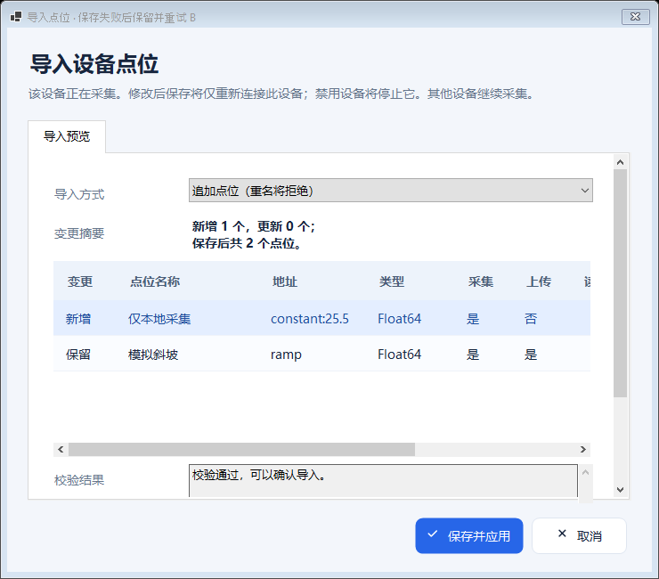
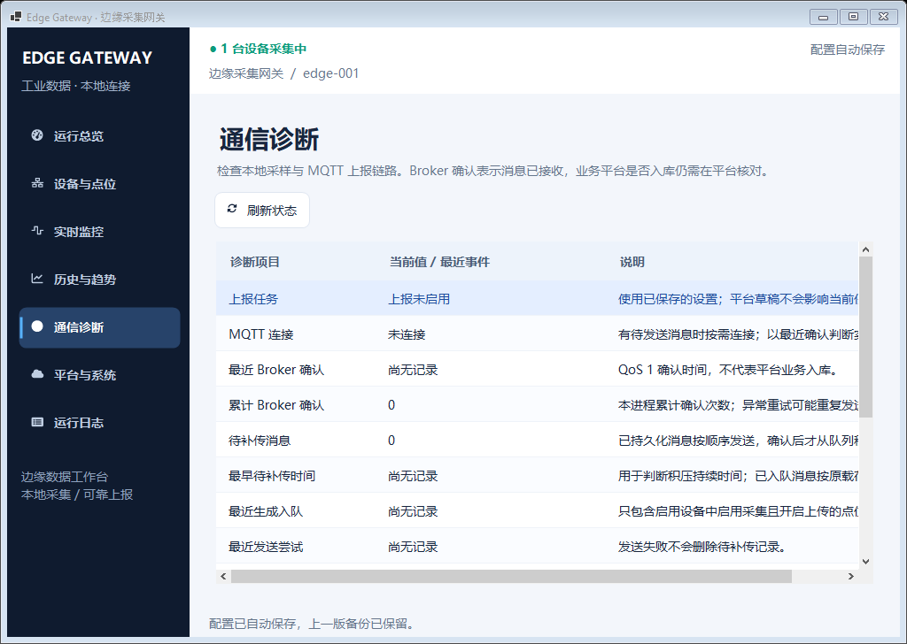

# 运行中配置、点表交换与通信诊断

本页说明当前源码的配置维护流程。设备 A 正在采集时，可以维护设备 B 及其点位；修改运行 B 后只重新连接 B。新增设备保持停止，禁用或删除只停止目标。设备、点位及导入弹窗等待完整校验、原子保存和运行时应用成功后才关闭，失败保留输入。本轮还补充通道/筛选/复制、真实诊断、读回核对、表达式、20 列 CSV、变化上报与平台 RPC。

**当前验证状态：OPC UA 对外服务端已按用户要求完整移除，本地构建和回归已完成，Windows CI 与新发布包仍待执行核验。** 当前范围与门禁目标见 [服务端移除记录](opc-ua-service-removal.md)。本页后半部分的 `f1d398b`、工作流 39923092261 和 163 项测试仍属于历史基线；旧运行包与首次失败/重跑证据保留在 [历史验证说明](live-configuration-verification.md)。

## 操作范围

“启用”是允许采集的配置，“运行”是当前会话的实际状态。勾选启用并保存，不自动启动原本停止的设备。程序启动时的“自动启动已启用设备”仍按已保存的全局设置执行；默认关闭。

| 操作 | 有其他设备运行时 | 目标及共享任务的结果 |
|---|---|---|
| 新建设备、追加“导入设备” | 允许 | 完整校验后保存，新设备保持停止 |
| 筛选、查找与复制设备 | 允许 | 筛选不改变配置；副本生成全部新 ID、默认停用，完整校验后保存 |
| 修改停止设备或其点位 | 允许 | 更新该设备配置，保持停止 |
| 修改运行设备的名称、连接、周期、驱动或点位 | 允许 | 仅对有实质变更的运行目标取消旧会话并建立新会话 |
| 添加、删除点位或导入点表 | 允许 | 所属设备运行时只重启该设备，否则保持停止 |
| 关闭点位上传 | 允许 | 保存后按新上传规则生成快照；所属运行设备按设备变更规则重启 |
| 禁用、删除运行设备 | 允许 | 只停止目标，其他设备继续；最后一台结束后关闭共享任务 |
| 逐行启动、停止 | 允许 | 只作用于被点击行的稳定设备 ID |
| 连接诊断、单点读取、写后读回 | 允许 | 运行目标复用会话与设备/通道锁；停止目标诊断使用短连接，不启动周期采集 |
| 通道新增、编辑和删除 | 要求全部设备停止 | 改变全局通信调度；通道有设备引用时不能删除 |
| 编辑、重置平台草稿 | 允许 | 不改变已应用配置，草稿不阻止启动 |
| “应用设置”提交全局/历史/MQTT 字段 | 要求全部设备停止 | 校验、保存后更新共享服务使用的设置 |
| “导入配置”替换整份 JSON | 要求全部设备停止并确认 | 替换网关、MQTT、设备与点位，成功后重置平台草稿 |

设备变更比较按字段值进行，驱动参数字典的键顺序不触发重启；点位数组顺序仍代表采集顺序。打开后原样确认不会重启未变更设备。变化目标的实时旧样本会清除，重新等待新会话采样；其他设备的最新值保留。编辑、删除配置不会清空已保存的历史记录。相关实现见 [配置应用](../src/EdgeGateway.Service/GatewayRuntime.Configuration.cs) 与 [设备界面](../src/EdgeGateway.WinForms/MainForm.Configuration.cs)。

### 运行 A 时维护 B

1. 在“设备与点位”点击 A 行的“启动”，确认其采样时间持续更新。
2. 点击“添加设备”，或选择已存在的 B 后使用“编辑设备”、B 行“配置”或双击 B 的普通数据列。四个入口使用同一个设备配置窗。
3. 默认“采集设置”首行选择“启用设备”，填写名称、分组、驱动、周期及超时，在连接/参数页填写驱动专用参数。新建设备确认时生成所选驱动的默认点位。
4. 点击“确定”，等待完整提交。失败时弹窗保持打开，按照提示修正后重试；取消不会将输入写入配置。
5. B 原本停止时保存后仍停止，需要采集时点击 B 行“启动”。B 原本运行时，提交会提示只重新连接该目标；在设备行检查“连接中”“重连中”或采集状态及错误。
6. 选中 B 后维护下方点位，或导入 CSV 点表。A 的采样、连接及共享历史/MQTT 工作任务继续运行。

编辑已有设备保留设备 ID、点位及点位 ID。切换驱动不会自动转换或删除已有点位；不兼容的地址、方法、类型或写权限会使整份候选被拒绝。同一弹窗按驱动保存独立参数草稿，切回时恢复，取消时丢弃草稿。参数来源及各驱动差异见 [设备配置](device-configuration.md)。

**串口约束保持不变：同一串口最多配置一个启用设备。** 即使其中一台暂时停止，两台启用设备占用 COM11 仍会被完整校验拒绝；应停用原设备或调整串口。本次未引入共享 RTU 总线调度。

### 通道、扫描与设备副本

设备页顶部可按通道、分组及设备名、驱动、点位名/地址关键字筛选。“添加通道”设置名称、请求间隔和说明；设备配置选择通道或“独立通信”。同通道采集、诊断与写入串行，不同通道可并行；请求间隔从上一批结束起计算。通道提供调度，驱动仍分别持有连接，不共享串口句柄。

“扫描与恢复”页选择设备周期或点位周期，并可启用连续失败后的故障降速。点位周期 0 继承设备，其余为 100–3600000 ms；不补发慢设备期间错过的每一轮。降速阈值为 1–30 次，间隔为 100–3600000 ms，成功读取后恢复正常节奏。默认设备周期、降速关闭，旧行为保持。

“复制设备”深拷贝连接参数和完整点表，为设备及每个点位生成新 Guid，副本默认停用。确认使用同一个设备配置窗，可先修改名称与通信参数；保存后不自动启动。启用后与已有设备的串口冲突仍由完整校验阻止。

### 单次诊断、表达式与读回核对

设备页“连接诊断”和点位栏“单点读取”均执行真实驱动操作。停止目标使用短生命周期驱动，完成即释放；运行目标复用当前会话并与采集/写入串行。结果包括本次原始值、工程值、质量、时间、耗时和错误；没有启用点位时仅报告连接成功，不能当作读点成功。

点位“换算与报警”页配置受限数值表达式并试算，`x` 表示倍率和偏移后的值，例如 `round(x/10,2)`。保存时校验语法与可静态判断的错误，采样计算失败标 Bad；表达式点只读，不会自动反向求值写入设备。允许语法和精度边界见 [表达式说明](kepware-core-capabilities.md#4-计算表达式与-csv)。

实时页“写入选中点位”默认启用立即读回，可设置通信超时与绝对/相对容差。写入只下发一次，在同一设备锁/通道锁内主动读取核对，返回命令 ID、提交情况、期望值、实测值、次数和耗时。`Matched` 表示本命令读回匹配；`Submitted`、`Mismatched`、`TimedOut`、`Failed`、`Cancelled` 分别显示。超时或取消可能发生在设备执行后，不自动重复写入。

## 保存与运行时应用

UI 的设备、点位、追加导入及点表导入最终调用同一个接口：

```csharp
Task<ConfigurationApplyResult> ApplyConfigurationAsync(
    GatewayConfiguration candidate,
    IConfigurationStore configurationStore,
    CancellationToken cancellationToken = default);
```

调用方传入独立的完整候选配置。运行时再深拷贝，在与设备启停相同的生命周期锁内完成以下步骤：

1. 校验完整网关配置及全部驱动参数，包括未运行设备、重复 ID、点位类型/方法和串口冲突；运行期间拒绝全局字段变化。
2. 比较当前与候选设备，确定新增、更新、删除及需要重启或停止的会话。
3. 通过配置存储写临时文件、原子替换 `gateway.json` 并保留上一份 `.bak`。在保存成功以前，不取消任何原会话，也不替换当前配置。
4. 对受影响会话取消采集和关联写入，等待任务与设备锁，再释放旧驱动；用新配置更新对应状态并为仍启用、原本运行的目标建立新会话。
5. 保留其他会话及共享历史/MQTT 任务。只有没有运行会话时才排空已接受的历史缓冲并关闭共享任务；唯一设备的配置重启也复用这些任务。
6. 返回应用结果，UI 更新当前配置和列表，弹窗才关闭。

生命周期锁串行化保存、启停和其他配置应用，后台采集不依赖这一锁，所以等待保存期间其他设备继续采样。写入绑定原会话取消令牌，获得设备锁后再次检查会话身份；旧会话的等待写入不能在替换后落到新驱动上。旧的同步 `Configure` 继续用于全停初始化，UI 不使用“自行保存后再 Configure”的两步流程。

### 结果集合

结果中的各属性均为稳定设备 ID 集合，定义见 [ConfigurationApplyResult](../src/EdgeGateway.Service/ConfigurationApplyResult.cs)：

| 属性 | 含义 |
|---|---|
| `Added` | 候选中新出现的设备；保存后保持停止 |
| `Updated` | ID 保持但配置值发生实质变化的设备，包含点位变化 |
| `Removed` | 从配置中删除的设备 |
| `Restarted` | 原本有运行会话、配置已变且保存后仍启用，已经调度新会话的设备 |
| `Stopped` | 原本有运行会话，因禁用或删除而停止的设备；不重复列出 `Restarted` |

`Restarted` 表示已发起新会话，不表示现场连接成功。驱动连接与采集异步进行，其结果通过设备状态、最近成功时间、连续失败和错误显示。

### 失败和取消语义

| 发生阶段或情况 | 配置、会话与 UI 行为 |
|---|---|
| 取消未提交的弹窗 | 丢弃该弹窗草稿，当前配置、文件和会话保持 |
| 候选序列化、字段、驱动或完整配置校验失败 | 不保存、不停止会话；弹窗显示错误并保留输入 |
| 文件锁、权限或磁盘导致原子保存失败 | 原配置和会话保持；弹窗保留输入，可修复后重试 |
| 等待生命周期锁或保存提交前收到取消 | 尚未提交时退出，不应用草稿 |
| 原子保存成功后调用方取消 | 已保存配置继续完成运行时同步，不在中途撤回；UI 提交期间禁止重复确认或关闭打断 |
| 新参数导致连接失败、驱动缺依赖或通信异常 | 新配置保留；目标进入可见故障/退避重连流程，其他设备继续；修正参数后再次保存 |
| 运行期间尝试改变全局字段 | 在保存前拒绝，提示先停止全部设备 |
| 原同步厂商调用尚未退出 | 沿用原有隔离线程与设备租约，不能强制中断本机调用或无限建立替代会话 |

连接失败不自动恢复上一版参数。这样磁盘配置、UI 显示和下一次重连使用同一套设置，操作者可以依据错误进行修正。保存成功与现场连通是两个独立结果，不能仅看到“已自动保存”就认定设备或平台已接通。

## 平台草稿与全局设置

“平台与系统”的输入保存在独立草稿中，可以在采集期间编辑或重置。未应用的 Host、主题、网关名称等不参与当前会话；点击设备行“启动”使用最后一次保存的配置，界面提示平台草稿尚未应用。

普通设备/点位提交和“导入设备”保留草稿。全部设备停止后，“应用设置”从**最新**配置克隆，仅覆盖全局、历史和 MQTT 字段，因此不会撤销打开平台页后新增或修改的设备。保存失败时保留草稿，成功后标记为已应用。“导入配置”是整份替换，要求全停和确认，成功后同时更新平台输入。

切换 MQTT `Platform` 时若 outbox 未清空，运行时在保存前直接拒绝；需要先使用原平台完成补传。仅改变 Broker 或其他连接字段不会自动拒绝已有积压：旧记录仍保留原主题、原网关标识和原载荷，并由新连接继续发送。因此修改目标前应先排空旧队列，不存在自动改写报文或统一的迁移确认流程。

平台页现提供周期全量、仅变化、变化加心跳三种策略，以及 Generic、ThingsBoard、ThingsCloud、ThingsPanel、IoTSharp 五种协议。变化比较使用成功入队后的工程值基线、点位绝对死区、质量和错误；心跳不改变原采样时间。RPC 与远程写分别默认关闭，启用后使用白名单点位读写、权限复查、持久写请求去重和读回核对。完整字段、主题、令牌环境变量与请求样例见 [平台接入与 RPC](platform-protocols.md)。


## 点位 CSV 导入导出

点位 CSV 用于配置交换，历史页的 CSV 用于导出采样结果，两者不能互相代替。选择一个设备后使用点位工具栏：

- **点位模板**：导出只有表头的 `edge-tags-template.csv`；仓库同版模板为 [examples/tag-template.csv](../examples/tag-template.csv)。
- **导出点位**：导出所选设备完整点表，默认文件名 `edge-device-tags.csv`。
- **导入点位**：选择文件，在预览弹窗选择追加或按名称更新，检查变化摘要和校验结果后确认。

预览优先显示新增和变化点位，最多展示 500 行；**解析、校验和保存覆盖完整点表**。CSV 内容在打开预览时读取，外部修改原文件后需要重新选择文件；修正模式、校验或保存失败不会先关闭当前弹窗。

### 20 个业务字段与旧 17 列兼容

原 17 列为必需表头，新增的 `Expression`、`ScanIntervalMs`、`Deadband` 为可选扩展；当前模板与导出包含全部 20 列。列顺序可调整，名称不区分大小写，未知、重复或缺少必需列均拒绝。CSV 不接受 `Id`，标识由导入模式处理。格式实现见 [TagCsvExchange](../src/EdgeGateway.Service/TagCsvExchange.cs)。

| 字段 | 填写要求 |
|---|---|
| `Name` | 非空点位名，同一设备与同一文件内不区分大小写检查重名 |
| `Address` | 当前驱动的实际地址；原生 Modbus 使用 0 基偏移 |
| `DataType` | 枚举名，如 `UInt16`、`Float32`、`Boolean`；须符合驱动能力 |
| `Area` | `Coil`、`DiscreteInput`、`HoldingRegister` 或 `InputRegister` |
| `ByteOrder` | `ABCD`、`BADC`、`CDAB` 或 `DCBA` |
| `ReadMethod` | 迁移驱动的原读取方法；原生驱动按其配置规则填写，可为空 |
| `WriteMethod` | 所选驱动支持的写方法；只读/原生点位按其规则填写，可为空 |
| `Endian` | `FromByteOrder`、`None`、`BigEndian`、`LittleEndian`、`BigEndianSwap` 或 `LittleEndianSwap` |
| `Enabled` | 是否参与采集，`true` / `false` |
| `UploadEnabled` | 是否进入新 MQTT 快照，`true` / `false` |
| `Writable` | 是否允许手动写入，仍须通过驱动/方法权限校验 |
| `Scale` | 有限数字，工程量倍率；允许写入时不可为 0 |
| `Offset` | 有限数字，工程量偏移 |
| `Unit` | 单位文本，可为空 |
| `LowLimit` | 报警下限，有限数字；空值表示不设置 |
| `HighLimit` | 报警上限，有限数字；空值表示不设置，不能低于下限 |
| `Description` | 说明文本，可包含经 CSV 引号转义的逗号或换行 |
| `Expression` | 可选扩展；受限单点数值表达式，`x` 为线性换算后的值；显式空单元格清除原表达式 |
| `ScanIntervalMs` | 可选扩展；0 继承设备，或 100–3600000 ms；表头存在时必须填写有效数值 |
| `Deadband` | 可选扩展；最终工程量的非负有限绝对死区；表头存在时必须填写有效数值，非数值点要求 0 |

按名称更新时，文件缺失某个扩展表头即保留匹配点位的该字段，不因旧 17 列文件把已有表达式、扫描周期或死区清零。新增点位缺失扩展表头时使用空表达式、周期 0、死区 0；显式提供字段则采用该值。数值扩展列留空会拒绝整批，和缺少表头含义不同。

导出使用 UTF-8 BOM 和 CRLF；导入也接受无 BOM 的有效 UTF-8 及 LF/CR 换行。布尔值导入同时接受 `1` / `0`；枚举使用名称，不使用数字；数字使用小数点 `.`，不使用千位分隔符，不接受 NaN 或 Infinity。非数值类型要求倍率 1、偏移 0，不配置数值阈值。

文本中的双引号、逗号和换行按 CSV 规则转义。对公式前缀、前导制表符/换行和原有前导单引号，导出增加一个单引号，导入按对应规则还原，以保证程序导出/导入往返保留文本。电子表格软件自行格式化数字或文本仍可能改变内容；保存后应核对预览，不把地址当作可任意格式化的数值。

| 模式 | 名称匹配与 ID | 未出现在文件中的原点位 |
|---|---|---|
| 追加点位 | 已存在名称拒绝；每个新增点位分配新 Guid | 保留 |
| 按名称更新并追加 | 名称按 `OrdinalIgnoreCase` 匹配；已有点位保留 Guid 与历史关联，新名称分配新 Guid | 保留 |

单个文件含 BOM 最多 **8 MiB**，最多 **2000 条数据记录**，合并后每台设备最多 **2000 个点位**。空物理行忽略，带引号的多行文本仍是一条记录；错误位置使用该记录的物理起始行及列名。任何解析、行内语义、驱动或全网关校验错误都会拒绝整批，不部分导入。预览通过后确认时再次构造完整候选，经同一个运行时事务保存，运行目标只重启一次。

## 点位上传与通信诊断

点位编辑器的“上传平台”和点位表“上传”列对应 `UploadEnabled`。设备 `Enabled`、点位 `Enabled`、点位 `UploadEnabled` 三项均为真时，该点最新样本才有资格进入新快照。关闭上传不会停止本地采集、实时显示或历史记录；保存运行设备的点位配置会按统一规则重启该目标。

关闭上传或删除配置不会清空已持久化 outbox。容量等待/持久化重试中的未入队快照发现配置已变化后会丢弃并按新配置重新生成；已经开始的一次入队调用可能仍保存原快照，已保存的消息继续按原主题和载荷补传。手动停止但仍启用的设备，其旧样本可带 `Uncertain` 质量进入快照以表示停止状态；不应把它视为新采样成功。最后一台停止时关闭共享上报任务。详见 [遥测语义](telemetry.md)。

### 如何定位链路问题

设备表的“最近成功采集”“连续失败”和“采集诊断”用于区分尚未采样、正常、重连与失败。“通信诊断”从运行时和存储读取快照，增加读写/失败批次、最近耗时、降速及 RPC 状态，可导出 JSON。批次计数不代表底层物理帧数。当前主界面共七个页面。删除后的页面操作及 20 个等效工作区结果以 [本轮记录](opc-ua-service-removal.md) 为准，不使用旧版本通过结果代替。

| 信息 | 能证明什么 | 不能据此推断什么 |
|---|---|---|
| 设备最近成功与实时质量 | 对应采集时间的读数/质量 | 其他设备或更晚时刻同样成功 |
| 最近生成入队 | 快照已持久化至本地 outbox | 已发送到 Broker |
| MQTT 已连接、最近发送尝试 | 连接状态与发送活动 | Broker 已确认该次消息 |
| 最近/累计发送确认 | ThingsCloud 收到属性应用响应成功；其余模式收到 QoS 1 PUBACK；累计数为进程内次数 | 下游业务已处理、入库或完成去重 |
| 待补传数量、最早待补传时间 | 当前持久化积压数量与最早记录的生成时间 | 全部历史采样都对应一条待传消息 |
| 连续失败、下次重试、当前发送错误 | 补传读取、发送或确认移除阶段的失败/退避 | 同期现场设备也停止采集 |
| 队列容量、当前持久化错误 | 生成入队或移除失败，需检查容量/存储 | 仅凭连接绿灯即可判定链路正常 |
| RPC 订阅、拒绝、重放及最近结果 | 实际订阅与请求处理状态，持久命令重放是否发生 | 所有命令都获授权，或已提交写入必然读回一致 |

这些计数和最近事件是进程内诊断，局部设备重配置不会清零；重启程序后重新累计。确认后删除失败会保留记录并重发，累计确认可能多次包含同一消息。正常取消不计通信失败。传输为至少一次，接收端按设备标识与 `messageId` 去重；平台业务入库仍需在目标平台核对。

## 配置兼容规则

JSON 配置版本继续为 **schema 2**。新增字段提供兼容缺省：上传开启、通道为空、设备独立通信及设备周期、降速关闭、空表达式、点位周期和死区 0、周期上报、Generic、RPC/远程写关闭。schema 1 经原有加载迁移进入 schema 2，设备和点位 ID 不改变；未知 schema 拒绝并保留文件。

保持版本要求新增字段可缺省、行为兼容、原含义不丢失，并补充加载和往返校验。更改字段类型/结构、必需字段或原地址/方法/枚举含义时仍须显式升级并定义迁移。CSV 独立维护原 17 个必需表头与 3 个可选扩展，不套用 JSON 的缺省规则。SQLite 自身由数据库 schema 1 升级到 2，新增 `rpc_commands`，已有历史与 outbox 保留；数据库版本与 JSON 配置版本、MQTT Generic 消息版本分别管理。

## 验收用例与证据

以下为当前功能验收范围；本轮执行状态见 [服务端移除记录](opc-ua-service-removal.md)，表内目标不表示已经通过。后面的旧结果表只描述 `f1d398b` 历史基线。自动化使用隔离目录、本地模拟设备及通信回环，未连接用户 COM10/COM11、PLC 或现场平台租户时不能写成现场验收。

| 验收场景 | 需要观察的结果 |
|---|---|
| A 运行时新增、编辑、删除停止的 B | A 会话/连接/样本持续；B 保存后不自动运行 |
| A、B 同时运行时编辑 B 的设备或点位 | 只重启 B，A 的历史/采集及共享任务保持；B 使用新配置 |
| 编辑期间 B 有等待写入 | 旧会话写入被取消或拒绝，不能写入新驱动；A 的授权写入继续 |
| 禁用/删除运行 B；最后只剩一台再禁用 | 仅目标停止；最后一台结束后排空历史并关闭共享服务 |
| 唯一运行设备修改或禁用全部点位 | 仍按目标重启，不能重复建立共享 worker 或因空点表泄漏 |
| 原样提交、仅改变属性字典顺序 | 不重启未变更会话 |
| 保存失败、完整配置失败、提交前取消 | 内存/磁盘/会话保持；设备、点位和导入弹窗保留输入 |
| 保存已提交后取消，以及保存与启停并发 | 继续完成同步，生命周期串行化，无半应用配置 |
| 新连接失败后修正 | 错误和重连可见、已保存设置保留；修正后只有目标恢复 |
| 平台草稿下启动、设备提交后应用平台 | 启动用已保存设置，草稿不丢；全停后应用不撤销后来设备变更 |
| 运行中全局应用/整份替换 | 在提交前拒绝；追加导入仍允许且新设备保持停止 |
| CSV 追加/更新、中文转义、末行失败和超限 | 标识规则正确，完整预览校验，失败整批不保存 |
| 旧 JSON 缺少上传字段 | 默认上传，设备/点位 ID 不变 |
| 关闭设备、点位采集或上传；容量阻塞时改配置 | 后续重建快照排除相应点，其他设备与本地历史继续；旧持久化消息保持 |
| Broker 掉线、恢复、确认后删除失败 | 重试与积压正确，按平台等待 PUBACK / ThingsCloud 属性成功，不冒充业务入库 |
| 通道、点位周期、降速、筛选与复制 | 同通道互斥、跨通道继续；副本身份隔离；故障恢复后正常扫描 |
| 停止设备诊断、运行设备单点读、写后读回 | 真正驱动调用；写一次、明确核对、超时取消不冒充失败未执行 |
| 表达式、20 列往返与旧 17 列更新 | 试算和运行一致；错误拒绝/标 Bad；缺失扩展字段保留，显式空表达式清空 |
| 变化、死区、心跳和多平台拆分 | 仅成功持久化推进基线，旧采样时间保留，半批失败不丢未入队部分 |
| 五平台 RPC 与重启重放 | 实际订阅和匹配回复，默认拒写，冲突拒绝、持久占位不重下发 |
| 七个页面与全部编辑器的小工作区/DPI | 通道、扫描、平台、RPC 和写入核对字段可达；五类弹窗与矩阵数量按实际执行记录 |

自动测试位置：[运行时配置用例](../tests/EdgeGateway.Tests/RuntimeStorage/RuntimeConfigurationTests.cs)、[CSV 用例](../tests/EdgeGateway.Tests/RuntimeStorage/TagCsvExchangeTests.cs)、[上报诊断用例](../tests/EdgeGateway.Tests/RuntimeStorage/TelemetryPipelineTests.cs)。Windows 界面用例见 [运行中配置烟测](../src/EdgeGateway.WinForms/MainForm.LiveConfigurationSmoke.cs)。已有 [验收规范](../.agents/skills/develop-edge-gateway/references/acceptance.md) 与 [DPI 规范](../.agents/skills/develop-edge-gateway/references/winforms-dpi.md) 同步适用。

### 历史基线的实际执行结果

以下结果仅对应程序源码 `f1d398ba27728e919c3fd56f60cbf510312267d8` 和工作流 `39923092261`，不包含六项后续差距及 UA 服务。本轮修改文档不会改变历史包的源码，也不将这些数量累加成新版本结果。

| 检查 | Windows Server 2022 | Windows Server 2025 |
|---|---|---|
| 成功作业所属执行 | attempt 2；同一提交仅重跑失败作业 | attempt 1；首次通过 |
| OS 版本 | 10.0.20348 | 10.0.26100 |
| .NET / WinForms | .NET 8.0.32 / 8.0.0.0 | .NET 8.0.32 / 8.0.0.0 |
| 自动测试 | 163 / 163，0 失败、0 跳过 | 163 / 163，0 失败、0 跳过 |
| 运行中配置烟测 | 通过，A 持续采集的成功标记已核对 | 同左 |
| 等效工作区布局 | 20 / 20 | 20 / 20 |
| 矩阵覆盖页面 | 七页：总览、设备、实时、历史、平台、日志、通信诊断 | 同左 |
| 矩阵编辑器 | 四类：源 Modbus 设备、点位、CSV 导入预览、多行写入 | 同左 |
| 实际 DeviceDpi / 原生窗口 DPI | 96 / 96 | 96 / 96 |
| 实际屏幕 / 工作区 | 1024×768 / 1024×728 | 1024×768 / 1024×720 |
| 实际 PNG 截图 | 102 张 | 102 张 |
| 成功作业 stderr / 失败截图 | 0 字节 / 0 张 | 0 字节 / 0 张 |
| 成功矩阵 `focusRecoveryCount` | 0 | 0 |
| 矩阵期间 `collectionRunning` | false | false |

源码 `f1d398b` 的 Server 2022 首次作业遇到焦点异常，Server 2025 同次执行通过。只重跑失败作业后 Server 2022 通过，最终 attempt 2 为 success，**没有为重跑修改代码或放宽断言**。成功不抹去首次失败，也不证明异常根因已解决；原始记录保留在 [历史验证说明](live-configuration-verification.md)。成功矩阵的 `focusRecoveryCount=0` 仅描述当次执行。

- [Server 2022 完整证据](https://github.com/kingtentx/edge-gateway/actions/runs/39923092261/artifacts/12488666311) · [Server 2025 完整证据](https://github.com/kingtentx/edge-gateway/actions/runs/39923092261/artifacts/12487239139)：包含测试、stdout/stderr、实际截图与布局 JSON。
- [Windows x64 自包含运行包](https://github.com/kingtentx/edge-gateway/actions/runs/39923092261/artifacts/12487349660)：完整解压后运行 `EdgeGateway.WinForms.exe`，包版本可通过 `build-info.json` 核对；包校验值与核对结果以 [完整验证记录](live-configuration-verification.md) 为准。
- [机器可读汇总](live-configuration-verification.json)：记录源码、执行、环境和证据，用于和历史版本区分。

两套环境的实际 DPI 始终为 96，矩阵设置 `viewportSimulation=true`。20 个场景证明等效工作区布局可操作，不能写成已执行真实 100% / 125% / 150% / 175% / 200% 系统缩放或跨屏往返。真实多显示器、用户虚拟串口、现场 PLC/Broker 及长稳运行仍需对应环境验收。

### 实际 WinForms 截图

以下图片取自历史基线 `f1d398b` 的成功作业，使用隔离配置和本地模拟设备，未连接现场设备；新页面与新增控件的截图另随本轮 CI 记录。

运行设备配置提交失败后，编辑器保持打开并保留草稿，其他设备继续采集：


CSV 导入预览提供模式、变更摘要、变更列与校验结果；新增和变化点位优先展示：



通信诊断将上报任务、连接、Broker 确认、积压与错误分别展示；截图本身不构成现场 Broker 或平台业务入库的证明：


