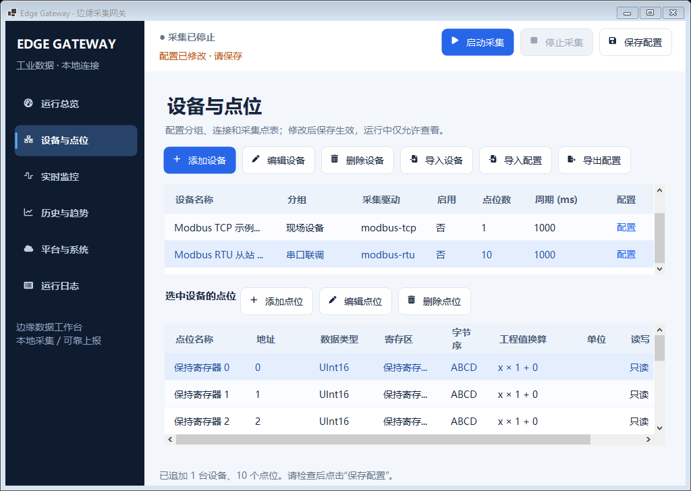
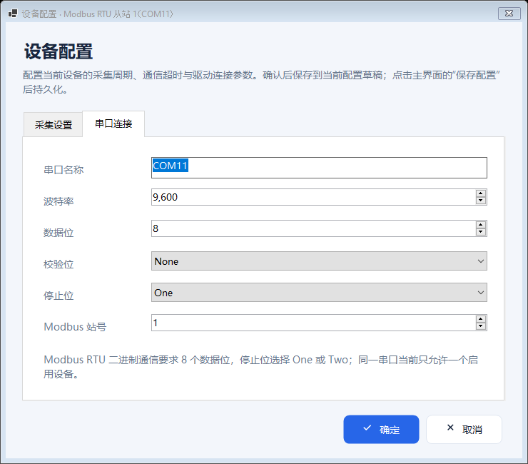

# Modbus RTU 从站 1（COM11）

本示例按用户提供的 Modbus Slave 截图配置，使用网关内置的 `modbus-rtu` 驱动。截图中的 ELTIMA 虚拟串口对为 COM10 ↔ COM11，底部状态显示 Slave 使用 **Port 10**，因此网关主站使用配对的 **COM11**。

配套文件：[单设备配置 JSON](../examples/modbus-rtu-com11.json) · [默认配置工厂](../src/EdgeGateway.Service/DemoConfiguration.cs)。

## 参数对应

| 项目 | 网关配置 | 依据 |
|---|---|---|
| 设备名称 / 分组 | Modbus RTU 从站 1（COM11） / 串口联调 | 示例命名 |
| 协议 / 串口 | Modbus RTU / COM11 | Slave 占用 COM10，主站连接虚拟串口对的另一端 |
| 从站地址 | `1` | 截图 `ID = 1` |
| 串口格式 | 9600 波特率、8 数据位、无校验、1 停止位 | 截图设置；对应 `9600 / 8 / None / One`，即 8N1 |
| 寄存区 / 地址 | `HoldingRegister` / `0`–`9` | 截图 `F = 03`，10 个保持寄存器；地址为零基偏移 |
| 数据类型 / 字节序 | `UInt16` / `ABCD` | 本示例选定的原始 16 位无符号整数默认值；截图中的全零值不能证明实际业务数据类型 |
| 倍率 / 偏移 | `1` / `0` | 保留原始寄存器数值 |
| 采集周期 / 超时 | 1000 ms / 3000 ms | 沿用网关默认值；截图未提供这两个网关参数 |
| 点位状态 | 10 个点位均启用、只读 | 本示例采集设置 |
| 初始设备状态 | 未启用 | 与其他真实协议示例一致，配置后手动启用 |

默认配置和示例 JSON 的自动启动、MQTT 均关闭。已有配置通过“导入设备”追加时，保留已有自动启动与 MQTT 设置，不用示例文件中的全局设置覆盖它们。

## 添加、启用与启动

1. 进入“设备与点位”。其他设备可以继续采集；新增或维护 COM11 目标使用 [运行中配置流程](live-configuration.md)，只在目标本身运行且配置变更时重启它。
2. 首次运行且没有已保存配置时，直接选择默认设备“Modbus RTU 从站 1（COM11）”。已有配置中没有这台设备时，点击 **导入设备**，选择 `examples/modbus-rtu-com11.json`。导入只追加设备，完整合并配置校验和自动保存成功后生效，失败则保留原配置。
3. 点击该设备行的 **配置**、双击普通数据列，或选中设备后点击工具栏 **编辑设备**，均打开同一个配置窗。默认“采集设置”页首行勾选 **启用设备**，核对名称、分组、驱动 `modbus-rtu`、采集周期与超时，再切换到“串口连接”页核对 COM11、站号和串口格式。
4. 点击 **确定** 后完整校验、自动保存并应用，成功后弹窗关闭、设备行同步显示已启用；失败保留输入。新增或原本停止的设备仍保持停止，无需额外保存操作。若已有其他启用设备使用 COM11，应先停用该设备或调整端口；完整配置校验会拒绝多个启用设备配置为同一串口，即使其中一台暂时没有启动。
5. 在 Modbus Slave 中按截图连接 **COM10**，确认从站地址为 1、RTU / 9600 / 8N1，功能码为 03，寄存器地址为 0–9。
6. 点击“Modbus RTU 从站 1（COM11）”这一行的 **启动**，到“实时监控”查看该设备的 10 个点位，核对数据质量、原始值和更新时间。需要暂停时点击同一行的 **停止**；其他正在采集的设备继续运行。Slave 保持截图中的全零寄存器值时，预期读到 0；修改某个寄存器后，应能在相同地址点位观察到对应变化。

### 两个导入按钮的区别

| 入口 | 对当前配置的影响 |
|---|---|
| **导入设备** | 仅追加文件中的设备，保留当前网关参数、MQTT、已有设备及未应用的平台输入；完整合并校验与自动保存成功后生效，失败保留原配置 |
| **导入配置** | 要求全部设备停止并确认，以文件中的整份网关配置替换当前配置，包括全局参数、MQTT 和设备；校验与自动保存成功后生效，并更新平台输入 |

本示例的设备和 10 个点位使用固定 ID。默认配置中已有该设备，或曾经导入过该示例时，再次“导入设备”会因重复 ID 被拒绝；此时直接选择已有设备编辑即可。

工具栏“添加设备”也使用同一个配置窗，新建确认时生成所选驱动的默认点位，不会自动复制本示例的 10 个点位；需要完整复现本页时使用上述默认设备或示例导入。编辑已有示例保留设备 ID 和原点位，若切换驱动，不会自动转换点位且仍需通过完整配置校验。窗体字段见 [设备配置](device-configuration.md)，当前保存规则见 [运行中配置](live-configuration.md)。

## RTS 与联调范围

截图中的 **RTS Toggle / RTS disable delay 1 ms** 属于 Modbus Slave 端的串口方向控制设置。当前网关原生 `modbus-rtu` 驱动未实现 RTS 自动翻转；此虚拟串口对无需将 Slave 端的 RTS 设置对称复制到主站。

用户截图显示 **No connection**，不能作为串口已连通的证据。本配置尚未在用户的 COM10 / COM11 虚拟串口环境完成实际联调；应按上述步骤确认连接、质量和寄存器读回。程序自动验证记录见 [验证说明](verification.md)，自动测试与界面烟测不替代现场串口验收。

参考：[Virtual Serial Port Driver 串口对说明](https://www.virtual-serial-port.org/user-guides/standard/overview.html) · [Modbus Slave 官方手册（串口设置、功能码和地址）](https://www.modbustools.com/mbslave-user-manual.html)。

每台设备的启停与自动保存说明见 [单设备启停与自动保存](device-control-autosave.md)。

## 历史版本实际界面

以下截图来自引入单设备启停、自动保存、恢复“启用设备”选项及合并设备窗体之前的 RTU 交付版本；图中的全局启停及“保存配置”已移除，弹窗布局也不代表当前统一配置窗，当前操作以本页上述步骤为准。以下为 Windows Server 2022、实际 96 DPI 下的真实 WinForms 截图，采集处于停止状态。设备表已选中新追加的 RTU 设备；表格内容较多时可滚动查看全部 10 个点位。





## RTU 初始交付版本验证与下载

以下测试、运行包与校验值对应 `80f7523` 的历史版本，保留供追溯；不代表后续单设备启停、自动保存、启用选项恢复、窗体合并或运行中配置已通过验证。当前版本的验证与下载以 [README 当前更新](../README.md) 及 [本轮验收入口](live-configuration.md#验收用例与证据) 为准。

代码提交 [`80f7523`](https://github.com/kingtentx/edge-gateway/commit/80f75237d7f99561d87e5e5a53807c07d4d86d0c) 已保留此前窗体资源命名修复。2026-10-23 的 [Windows CI](https://github.com/kingtentx/edge-gateway/actions/runs/39894976476) 首次执行全部通过，机器可读结果见 [验证记录](modbus-rtu-com11-verification.json)。

| 验证项 | Windows Server 2022 | Windows Server 2025 |
|---|---|---|
| Release 编译 | 通过，0 错误 | 通过，0 错误 |
| 自动测试 | 102 / 102 | 102 / 102 |
| 追加导入与拒绝后无修改 | 通过 | 通过 |
| 15 个驱动专用配置窗 | 通过 | 通过 |
| 等效工作区布局 | 20 / 20 | 20 / 20 |
| 实际窗口 DPI | 96 | 96 |
| 实际窗口截图 | 94 张 | 94 张 |

追加导入检查覆盖原网关、MQTT、旧设备与点位保留，深拷贝隔离，重复 ID 拒绝，以及两个启用 RTU 设备的 COM11 冲突拒绝。实际交付 JSON 通过程序的加载与完整配置校验。构建仍保留 419 条上游驱动警告；没有新增错误。等效工作区测试未改变真实 DPI，也未连接用户的虚拟串口。

[下载 Windows x64 自包含运行包](https://github.com/kingtentx/edge-gateway/actions/runs/39894976476/artifacts/12476816254)。运行包已核对 ZIP 完整性、21 个必要程序集（包含全部 12 个迁移驱动）、RTU 示例和使用说明；其中 JSON 与仓库文件在统一 Windows / Unix 换行后完全一致。

运行包内层 `EdgeGateway-win-x64.zip`：78,839,921 字节，588 个条目，SHA-256：

```text
d69ebf8277cfe52a20c5a4c8b129cee155c6bd520732ec7866f6ae999315ed18
```
