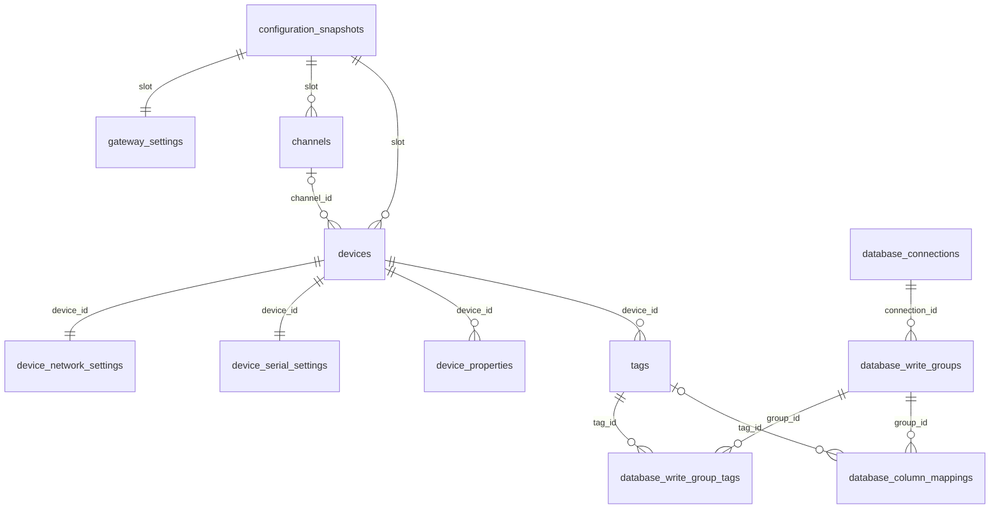

# SQLite 按功能保存配置

更新：2026-10-26。

原实现只有整份配置的 `configuration_versions.payload` JSON，以及内容重叠的 `driver_plugins`、`driver_catalog`。网关名称等单字段不能直接查询，设备、点位、外部连接和映射之间也没有数据库关联约束。本次改为 **17 张关系表**，固定字段按 `TEXT`、`INTEGER`、`REAL` 保存，使用 SQLite `STRICT` 表；没有配置 JSON / payload 列。

## 软件职责

WinForms 仍通过 `IGatewayApplication` 提交配置；Application 在最新配置上构建候选，Service 校验并通过生命周期锁协调设备。只有 DataAccess 负责表结构和 SQL，Hosting 负责创建及释放配置存储。模型、驱动契约、设备采集和外部数据库 SQL 不因内部存储变化而改变。

模型及 JSON 导入/导出继续使用 **schema 3**，数据库物理结构单独使用 **`PRAGMA user_version=4`**。二者含义不同。版本 3 的旧 JSON 配置数据库、未知版本及含已有表但未声明版本的数据库都会明确拒绝，不改写其内容、不自动清空、不迁移。开发部署需使用新的空数据目录；本轮没有打开、删除或修改用户现有运行数据库。

## 功能表

| 功能 | 表 | 保存内容 |
|---|---|---|
| 快照元数据 | `configuration_snapshots` | `slot`、`schema_version`、UTC 毫秒 `saved_ms`；没有 JSON |
| 网关身份 | `gateway_settings` | 网关标识、名称、自动采集开关 |
| 上报策略 | `telemetry_settings` | outbox 容量、上报周期、上报模式、心跳周期 |
| 平台连接 | `mqtt_settings` | 启用、服务器/端口/TLS、客户端身份、账号密码、Token、主题、平台类型及平台标识 |
| 远程控制 | `rpc_settings` | RPC 开关、远程写许可、请求/应答主题、超时 |
| 日志设置 | `logging_settings` | 等级、采样日志开关、文件大小、保留数量/天数、磁盘保护及恢复余量 |
| 通信通道 | `channels` | 稳定 ID、名称、请求间隔、说明、顺序 |
| 设备采集 | `devices` | 稳定 ID、分组、通道引用、驱动标识、开关、周期/超时、扫描与降速设置、顺序 |
| 网络连接 | `device_network_settings` | 每设备主机、端口、站号 |
| 串口连接 | `device_serial_settings` | 每设备串口名、波特率、数据位、校验及停止位 |
| 驱动扩展参数 | `device_properties` | 每设备一参数一行：`name` / `value`；保留未知参数和字符串原值 |
| 点位 | `tags` | 稳定 ID、设备引用、地址、数据类型、方法/字节序、开关/权限、倍率/偏移/表达式、周期/死区、单位/阈值/说明、顺序 |
| 外部数据库 | `database_connections` | 提供程序、服务器、账号、TLS、超时、批次、刷新周期、队列容量和重试限制 |
| 数据库写入组 | `database_write_groups` | 稳定 ID、连接引用、目标 schema/表、写入模式、启用、频率/时效/质量要求、顺序 |
| 写入组选点 | `database_write_group_tags` | 写入组与点位的关系、选择顺序；空集合仍表示所有启用点位 |
| 字段映射 | `database_column_mappings` | 每列一行：目标列、值来源、可选固定点位引用、转换类型、手动常量、顺序 |
| 驱动登记与清单 | `driver_registry` | 每驱动一个稳定 ID、一份名称/版本/程序集/哈希；插件状态、是否在可用清单中、能力、来源、更新时间 |

前 16 张表按 `slot=current/previous` 隔离配置快照；驱动登记独立于配置快照，由现有插件事务维护。`driver_registry.plugin_status IS NOT NULL` 表示插件登记，`listed=1` 表示当前可用清单。刷新清单只清除清单信息，保留未列出的插件登记；不再维护重复的插件表与目录表。应用显示仍以实时驱动注册表判断是否可用。

网络和串口表保存模型中的独立草稿，即使设备当前使用另一种连接方式也保留设置。驱动专用参数是开放式字典，因此使用键值行；普通配置不退化成通用键值表。枚举存名称并有检查约束，布尔值存 0/1，整数与实数分列，允许为空的阈值和引用保留 NULL。密码、Token、授权码按项目约定保留原始字符串；日志不输出这些值。

图省略其余单例设置表；所有配置外键均包含 `slot`，不能跨快照引用。设备 `driver_id` 不对瞬时可用驱动清单建立外键，避免驱动刷新/故障删除设备配置；驱动存在性继续由 Service 的配置校验和插件引用规则保证。

## 原子保存与读取

1. 在等待写锁之前捕获全部标量和集合关系；拒绝非有限数值、无效枚举及不允许的空字段。候选不再经 JSON 序列化落库。
2. 持有存储实例串行锁，开启 WAL / FULL 事务，启用外键，并在本事务内推迟关联检查。
3. 删除上一份快照，将当前快照及功能表关联整体切换为上一份，再插入新当前快照的全部功能记录。
4. 每行写入及提交前检查取消，提交时统一核验外键。任一约束、SQL、取消失败均回滚所有表及两个快照；提交成功后不返回伪取消。
5. 读取使用同一个 SQLite 读事务，避免跨表读到不同提交版本。必需设置缺失、损坏字段、失效关联、缺表和错误版本明确报错，不补默认值掩盖损坏。只在新空配置数据库上生成默认配置。

保持两个快照是现有恢复契约，属于有意保留的数据版本，不是多套重复表。只保留当前及上一份，不新增无限历史表。`position` 保留设备、点位、连接、选点与映射顺序；主键/唯一索引和关联索引用于定位与约束。删除的集合项不残留在当前快照，第三次保存后过期快照及其全部关联行被清除。

## 验证

用户授权范围：WinForms Release 构建、配置存储/关系表/平台切换/驱动管理定向测试、架构检查；最多两轮同范围修复重跑。未运行全量回归、界面烟测、业务数据库连接或现场采集验收。

最终 Release 构建成功（`build-2.log`：0 警告、0 错误），**50 / 50 项定向测试通过**（`test-3/relational-config.trx`：0 失败、0 跳过），架构检查通过（8 层、24 个工程，`architecture-1.log`）。覆盖所有配置标量的非默认值往返、NULL 与字符串原值、关系/顺序、三次保存后的快照切换、无效外键/重复 ID 的整事务回滚、事务写入中途取消、清空集合后的清理、损坏字段/缺表/孤儿记录拒绝、旧库不修改、驱动元数据合并及插件更新/删除、平台切换。

首轮构建有 419 条既有迁移驱动警告，48 项测试通过。审查补充了读取孤儿记录的拒绝处理、事务中途取消测试，并去掉与唯一索引重复的点位索引。第一次重跑 49 / 50 通过：新增损坏测试将不同设备点位全部改成同一设备 ID，先触发了顺序唯一约束，未到达预期的外键损坏场景。第二次重跑修正测试数据为各设备不同的失效 ID，50 / 50 通过，生产代码未为此放宽约束。测试项目存在 1 条既有 xUnit2031 警告，全部失败日志与 TRX 保留。

证据目录：`artifacts/relational-config-20261026/`。测试全部使用临时目录，无业务凭据，无现有运行库操作。
