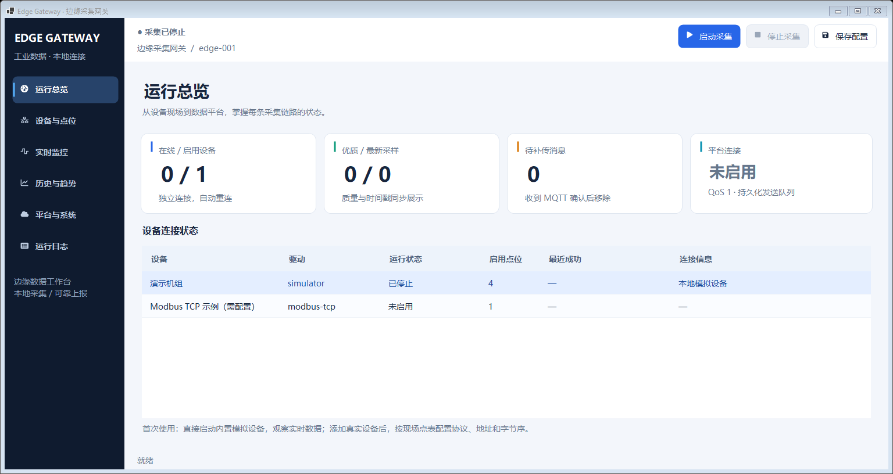
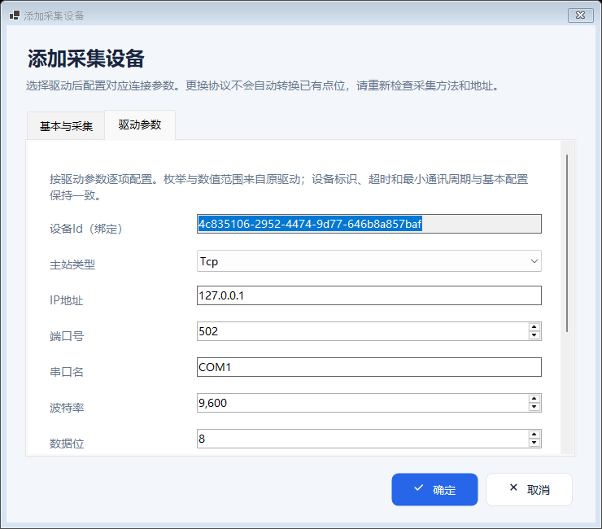
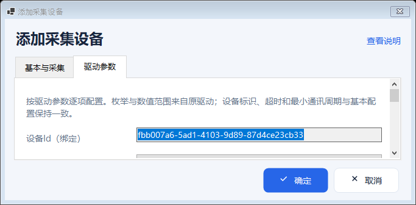

# Windows DPI 与现代界面升级

日期：2026-10-23（Asia/Shanghai）。适用项目：.NET 8 Windows Forms。

本页保留 DPI 与现代界面升级的历史执行记录、截图及下载。当前版本已将启动/停止移到每台设备所在行，移除顶部“保存配置”，并支持运行中维护配置、点位 CSV 与第七页通信诊断；操作及本轮验证入口见 [运行中配置与数据闭环](live-configuration.md)，运行包以 [README](../README.md) 标注的提交为准。下方历史测试数据不用于宣称这些后续改动已通过验证。

## 当前界面与 DPI 处理范围

界面采用深色导航、明亮内容区、带强调色的状态卡、圆角图标按钮、统一表格和弹窗。图标来自 FontAwesome.Sharp 6.6.0，按当前控件 DPI 绘制和缓存，替换及窗体关闭时释放图像。组件和字体图标许可证随代码与运行包保留，见 [第三方说明](../THIRD-PARTY-NOTICES.md)。

| 模块 | 实际处理 |
|---|---|
| 应用入口 | `ApplicationHighDpiMode=PerMonitorV2`，由 `ApplicationConfiguration.Initialize()` 在创建窗口前初始化；统一 Microsoft YaHei UI 10 pt 基础字体 |
| 所有主窗体与弹窗 | `DpiAwareForm` 统一 Dpi 模式和 96×96 基线；构造全过程暂停布局，完整控件树构造后执行框架自动缩放 |
| 防止重复缩放 | 首次框架缩放和 DPI 变更期间禁止响应布局预先写入物理尺寸；完成后触发 `DpiLayoutCompleted` 重排，不重置 96 基线或额外递归 Scale |
| 窗口范围 | 根据当前屏幕 WorkingArea 与 DPI 重算最小尺寸并限位，处理任务栏、负坐标副屏、分辨率或工作区改变；标准窗口边框保留系统移动/最大化功能 |
| 主页面 | 顶部显示采集汇总和配置状态，窄窗口按可用宽度重排；导航可滚动；总览卡按宽度切换四列、两列、一列 |
| 设备与点位 | 每行启动、停止和配置随列宽及当前 DPI 布局，表格横向滚动后可完整访问；按被点击行的设备 ID 执行 |
| 小工作区 | 页面及表格内容保留可用高度并提供滚动，不把字体缩小以强行塞入；平台设置标签按实际列宽换行 |
| 设备/点位弹窗 | 参数滚动、底部操作固定；短窗将详细说明放到可键盘操作的“查看说明”入口；多行输入按可视区调整高度并保留内部滚动 |
| 动态驱动配置 | 每批新字段及可移除页签使用独立、显式 96 DPI/10 pt 基线的内容容器，只缩放新子树；显示后切换驱动不重缩放旧宿主 |
| 表格 | 从当前控件字体计算正文、加粗表头、行高、单元格内边距与列最小宽度；不保留错误的固定小字号 |
| 页签与下拉 | 页签 Point Padding、ComboBox 下拉宽高从逻辑常量与当前工作区重新计算 |
| 趋势绘制 | 坐标间距、文字区域、网格线和数据线宽按当前 DPI 重绘 |

详细开发规则见 [WinForms DPI Skill 参考](../.agents/skills/develop-edge-gateway/references/winforms-dpi.md)。

## 验证范围与记录方式

| 分辨率 | 名义 Windows 缩放 |
|---|---|
| 1366×768 | 100%、125%、150%、175%、200% |
| 1920×1080 | 100%、125%、150%、175%、200% |
| 2560×1440 | 100%、125%、150%、175%、200% |
| 3200×2000 | 100%、125%、150%、175%、200% |

`--smoke-test --layout-matrix` 在 Windows 原生窗口中执行完整 15 个驱动设备/点位编辑器检查、显示后驱动切换，以及上述 20 种**等效工作区**。当前每个矩阵场景应检查七个主页面、导航、顶部状态、可滚动访问的设备行启动/停止/配置、卡片、平台字段及应用/重置按钮、原 Modbus 最长参数页、点位页、CSV 导入预览及多行写入弹窗。可滚动字段按焦点和祖先滚动路径逐项检查，不放宽裁剪断言；新页面和弹窗的结果以其对应版本的实际验证记录为准。

**等效工作区不是修改操作系统 DPI。** 脚本根据目标分辨率/名义缩放推算逻辑空间，扣除 48 逻辑像素任务栏预留，再换算成构建机实际 DPI 下的窗口尺寸。仅在测试模式下使用 `SetWindowPos` 绕过宿主桌面最大拖动尺寸限制，并严格比对实际 Bounds；截图可能在超出宿主显示范围的测试窗口上通过 DrawToBitmap 获取。报告包含 `viewportSimulation=true`、名义 DPI、实际 `DeviceDpi`、原生 `GetDpiForWindow`、OS、请求/实际窗口范围以及按钮/字体/参数控件尺寸。

真实不同 DPI 的首次启动、设置中切换缩放、100%↔150%↔200% 多屏往返、远程桌面重连需在相应 Windows 桌面环境验证。不能把等效工作区截图或几何测试写成这些场景已通过。

## DPI 升级历史版本执行结果

**两套 Windows 验证均已通过。** 程序源码提交为 [`2d528cba58e2a443aee784dd59ec3c1e48a26c0c`](https://github.com/kingtentx/edge-gateway/commit/2d528cba58e2a443aee784dd59ec3c1e48a26c0c)，对应 [Windows CI 39885093582](https://github.com/kingtentx/edge-gateway/actions/runs/39885093582)。本页及截图是该次执行后的证据补录，不改变运行包的程序源码。

| 检查 | Windows Server 2022 | Windows Server 2025 |
|---|---|---|
| 实际 OS build | 10.0.20348 | 10.0.26100 |
| .NET 运行时 | 8.0.32 | 8.0.32 |
| 干净 Release 构建 | 通过 | 通过 |
| 自动测试 | 101 / 101，0 失败、0 跳过 | 101 / 101，0 失败、0 跳过 |
| 原生主页面 / 设备 / 点位编辑器 | 6 / 15 / 15 通过 | 6 / 15 / 15 通过 |
| 显示后动态切换驱动 | 通过 | 通过 |
| 等效工作区矩阵 | 20 / 20 通过 | 20 / 20 通过 |
| 截图数量 | 76 | 76 |
| 实际 DeviceDpi / GetDpiForWindow | 96 / 96 | 96 / 96 |
| 烟测焦点恢复次数 | 0 | 0 |

迁移清单再次通过：12 个原驱动工程、65 个原读取方法、74 个原配置参数、176 个来源文件。开发 Skill 格式校验通过。本次增加的 8 个 DPI 几何用例与既有 93 项自动测试合计 101 项。干净构建仍保留上游驱动的 419 个源码警告，未将增量构建的 0 警告作为干净构建结果。

首轮 Server 2022 在第 19 个场景遇到一次窗口焦点同步检查失败；失败截图未显示裁剪。烟测增加了有界窗口激活与消息处理，并保留最终焦点、控件边界、按钮文字尺寸的严格断言。上述最终运行两个系统均全部通过，且没有触发焦点恢复。

- [该历史版本的 Windows x64 自包含运行包](https://github.com/kingtentx/edge-gateway/actions/runs/39885093582/artifacts/12472745656)：下载 artifact，解出其中 `EdgeGateway-win-x64.zip` 后完整解压，运行 `EdgeGateway.WinForms.exe`。
- [Server 2022 完整证据](https://github.com/kingtentx/edge-gateway/actions/runs/39885093582/artifacts/12471964011) · [Server 2025 完整证据](https://github.com/kingtentx/edge-gateway/actions/runs/39885093582/artifacts/12472208506)。包含 TRX、标准输出、PNG 与完整矩阵 JSON。
- [持久化验证摘要](ui-verification-summary.json)：记录测试数量、实际 DPI、每个场景的窗口尺寸、完整报告哈希和证据来源。

下载后的运行包已复核：577 个 ZIP 条目全部通过 CRC 检查，21 个必需文件检查通过，包含全部 12 个原驱动程序集、FontAwesome.Sharp、图标许可证和 Windows Desktop 运行时。内层 `EdgeGateway-win-x64.zip` 大小为 78,636,527 字节，SHA-256 为 `691fdbcb48c7b3ac68b771b550a66964d0a9fd7b6313c17e76ef96074c7c109a`。

GitHub Actions 下载可能需要登录，artifact 保留期以 GitHub 显示为准；可使用仓库内脚本重新构建。运行包内文档反映打包时状态，该历史版本的最终补录以本页和上述 CI 为准；当前版本见 [单设备启停与配置自动保存](device-control-autosave.md)。

### 历史版本实际程序截图

截图直接来自上述 Windows 原生界面烟测，使用默认演示配置且未启动现场采集。图中的全局启停与保存按钮属于当时版本；当前设备行操作与自动保存不以这些旧图作为验证证据。

总览：在实际 96 DPI 下以 1536×816 窗口绘制（矩阵中的 1920×1080 / 名义 125% 等效空间）。



原 Modbus 驱动参数弹窗：



小工作区：1366×768 / 名义 200% 等效空间对应实际 683×336 窗口；参数滚动、说明入口与固定操作栏保留。



## 复核命令

在 Windows 桌面会话中执行：

```powershell
dotnet restore EdgeGateway.sln
dotnet build EdgeGateway.sln -c Release --no-restore
dotnet test tests/EdgeGateway.Tests/EdgeGateway.Tests.csproj -c Release --no-build
dotnet run --project src/EdgeGateway.WinForms -c Release --no-build -- --smoke-test --layout-matrix --screenshot artifacts/ui-smoke.png
```

矩阵报告：`artifacts/ui-smoke-layout-matrix/layout-matrix.json`。Windows CI 分别保存两个系统的证据，运行包在 Windows Server 2022 作业发布。命令针对当前检出源码；当前烟测使用独立临时数据目录检查界面与本地模拟采集，不连接现场设备、不修改用户配置。

## 系统与现场边界

目标为符合 .NET 8 支持矩阵的 Windows 桌面系统，包括 Windows 11、仍受 .NET 8 支持的 Windows 10 版本，以及带桌面环境的 Windows Server。Windows 7 / 8.1 不在 .NET 8 支持范围内。操作系统实机、不同显卡/显示器、Windows 辅助功能“文本大小”和长时间跨屏操作须按现场环境验收。

微软参考：[.NET 8 高 DPI 改进](https://learn.microsoft.com/en-us/dotnet/desktop/winforms/whats-new/net80#high-dpi-improvements)、[自动缩放](https://learn.microsoft.com/en-us/dotnet/desktop/winforms/forms/autoscale)、[Windows .NET 支持矩阵](https://learn.microsoft.com/en-us/dotnet/core/install/windows)。
